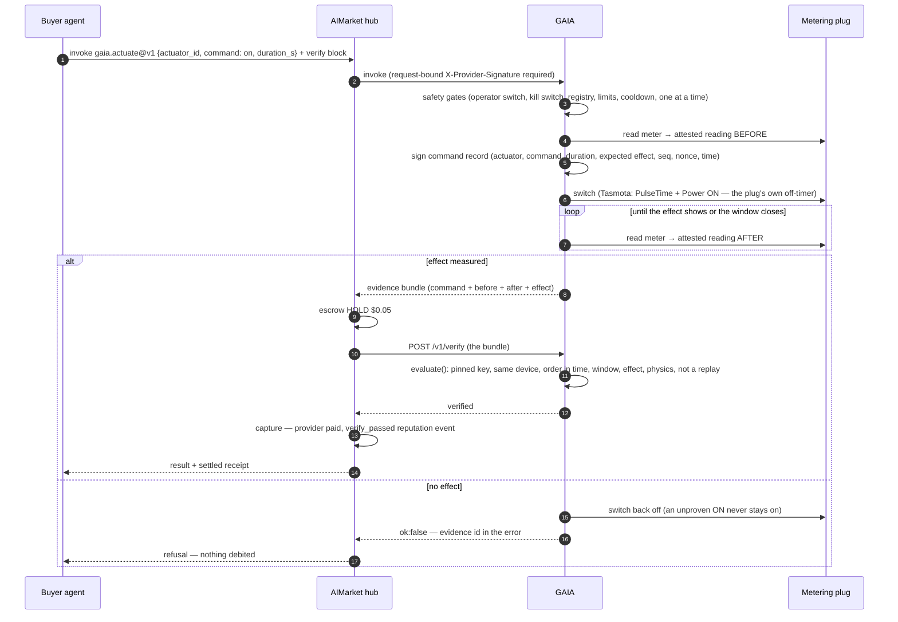
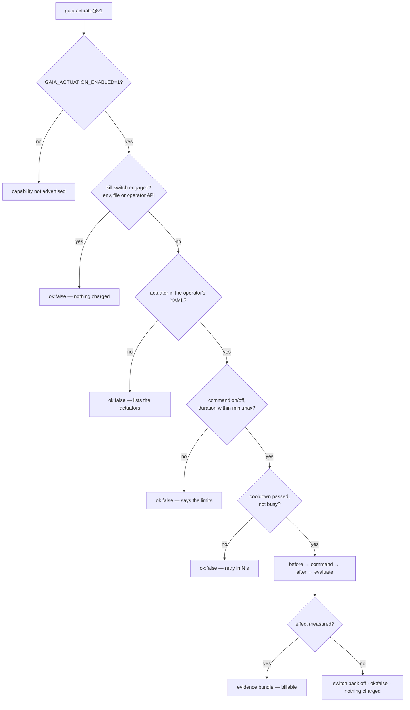

# Device control — pay only for the measured effect

> 🌐 **English** · [Русский](i18n/ACTUATION.ru.md) · [Español](i18n/ACTUATION.es.md) · [Français](i18n/ACTUATION.fr.md) · [中文](i18n/ACTUATION.zh.md)

Reading the physical world is half of what an agent needs from it. The other half is
changing it: turn on a heater, a pump or an EV charger for a while. GAIA sells that as
`gaia.actuate@v1`, with one rule that makes it safe to buy from a stranger:

**the price of a command is due only when the command's effect is measured.**

An actuator is a **metering smart plug**: the relay GAIA switches and the meter that sees
only what that relay switches. "Relay on" and "power rose" are then the same physical fact.
A whole-house meter would not do — a kettle somewhere else would "prove" that a heater came on.

## Capabilities

| Capability | Price | What it does |
|---|---|---|
| `gaia.actuator.list@v1` | free | The operator's actuators: commands, duration limits, cooldown, relay state, pinned device keys, and whether the kill switch is engaged |
| `gaia.actuate@v1` | $0.05 | Switch one actuator `on` for `duration_s` seconds (it switches itself off afterwards) or `off`. The result is the evidence bundle |

$0.05 is the hub's Pay-on-Verified price floor, so a buyer can hold the payment in escrow until
GAIA's `/v1/verify` confirms the effect.

## How a paid command settles



Without a `verify` block the effect still decides the charge: GAIA answers `ok:false` for an
unproven effect, and the hub debits nothing for `ok:false`. The verify block adds an
*independent* check of the evidence before the money moves.

## Safety gates



A caller names an **actuator id** — never an MQTT topic, a broker or a device the operator did
not list. "On" is always bounded: a duration is required and capped by the operator.

## Call it

```bash
# what can be switched, and the limits
curl -s -X POST https://iot.modelmarket.dev/ai-market/v2/invoke -H 'Content-Type: application/json' \
  -d '{"capability_id":"gaia.actuator.list@v1","input":{}}'

# switch the demo heater on for one minute
curl -s -X POST https://iot.modelmarket.dev/ai-market/v2/invoke -H 'Content-Type: application/json' \
  -d '{"capability_id":"gaia.actuate@v1",
       "input":{"actuator_id":"plug-sim-01","command":"on","duration_s":60}}'
```

The answer (abridged):

```json
{
  "actuation": {
    "record": {"command_id": "act_1f…", "actuator_id": "plug-sim-01", "command": "on",
               "duration_s": 60, "seq": 1792145220000, "issued_at": "2026-10-16T10:07:00Z",
               "nonce": "…", "expect": {"field": "power_w", "op": ">=", "value": 1000, "within_s": 20}},
    "attestation": {"algorithm": "ed25519", "public_key": "…", "value": "…"}
  },
  "before": {"reading": {"values": {"power_w": 0.4, "relay_on": 0.0, "…": "…"}}, "attestation": {"…": "…"}},
  "after":  {"reading": {"values": {"power_w": 1497.2, "relay_on": 1.0, "…": "…"}}, "attestation": {"…": "…"}},
  "effect": {"verified": true, "expected": {"…": "…"}, "observed": 1497.2},
  "simulated": true,
  "auto_off_at": "2026-10-16T10:08:00Z"
}
```

Anyone can check it again: `POST /v1/verify` with the bundle (the escrow slot), or invoke
`gaia.verify@v1` with it. Evidence of recent commands, including refused ones, is public at
`GET /actuation/v1/evidence/<command_id>`; `GET /actuation/v1/status` shows every actuator.

## What the verdict checks

All checks are hard — one false fact and nothing is owed:

| Check | Meaning |
|---|---|
| `command_signature` | the command record is signed by the plug's **pinned** key (from the fleet registry, never the key the bundle carries) |
| `before_device`, `after_device` | both readings come from that same actuator |
| `before_signature`, `after_signature` | both readings verify against the pinned key |
| `order` | before → command → after, in sequence number and in time |
| `window` | the effect was read within the promised window |
| `effect` | the expected predicate holds on the after reading (`power_w >= expect_on_w` for on, `<= off_max_w` for off) |
| `relay_state` | the plug reports the relay state the command asked for |
| `after_plausible` | the after reading passes GAIA's physics checks |

Each command settles once: its `seq` (wall-clock milliseconds, only ever growing) is the
escrow verifier's high-water mark, so a replayed bundle is rejected.

Plausibility knows plugs: `relay_on` is a field, an open relay that meters more than 25 W is a
contradiction, and the energy register is checked against what one 16 A socket could pass in
the time since the last read — not against present power times the gap, since a plug switched
between two reads is honest.

## Operators

The public demo runs one **simulated** plug (`plug-sim-01`, a 1500 W heater) from
[`config/actuators.yaml`](../config/actuators.yaml). For real hardware:

1. A Tasmota plug **with an energy chip**, on your MQTT broker, answering `Status 8`.
2. Your actuator file, from [`config/actuators.example.yaml`](../config/actuators.example.yaml):
   ```yaml
   actuators:
     - id: lab-heater-01
       kind: tasmota-mqtt
       topic: tasmota_lab_heater   # the plug's %topic%
       expect_on_w: 800            # below the heater's draw, above anything the plug idles at
       off_max_w: 5
       min_on_s: 30
       max_on_s: 1800
       cooldown_s: 60
       effect_timeout_s: 20
   ```
3. Environment:
   ```bash
   GAIA_ACTUATION_ENABLED=1
   GAIA_ACTUATORS_FILE=/path/to/actuators.yaml
   GAIA_MQTT_BROKER=mqtts://broker.example:8883
   GAIA_MQTT_USERNAME=gaia            # password from your secret store, never a file in git
   GAIA_ACTUATION_TOKEN=…             # Bearer token for the kill switch API
   ```

ON is sent as `Backlog PulseTime1 <duration>; Power1 ON`, so **the plug switches itself off**
after the paid duration even if GAIA, the broker or the network goes away. GAIA also sends its
own OFF at the deadline as a second stop.

### Kill switch

Three ways, any one is enough; while engaged every command is refused and nothing is charged:

```bash
curl -X POST https://<gaia>/actuation/v1/kill   -H "Authorization: Bearer $GAIA_ACTUATION_TOKEN"   # also switches everything off
curl -X POST https://<gaia>/actuation/v1/resume -H "Authorization: Bearer $GAIA_ACTUATION_TOKEN"
touch <data dir>/ACTUATION_KILL        # a file, for when the API is unreachable
GAIA_ACTUATION_KILL=1                  # an environment switch, for a restart
```

Without `GAIA_ACTUATION_TOKEN` the kill switch API answers 503 — it never opens unauthenticated.
Every command, outcome, kill and resume is appended to `actuation.jsonl` in the data directory.

## Honest limits

- A Tasmota plug has no secure element. GAIA's key signs **what the plug reported** — custody
  of the report, as with every GAIA relay, not proof that the hardware cannot lie. The meter and
  the relay being one device is what keeps the claim narrow.
- The effect proves power flowed through the socket, not what the appliance did with it.
- The public demo plug is simulated (`SIM`); its heater exists only in software, and every answer says so (`"simulated": true`).

W3C WoT: each plug's Thing Description (`GET /wot/<id>`) carries `switchOn` / `switchOff`
**actions** whose forms are paid `gaia.actuate@v1` invokes.
