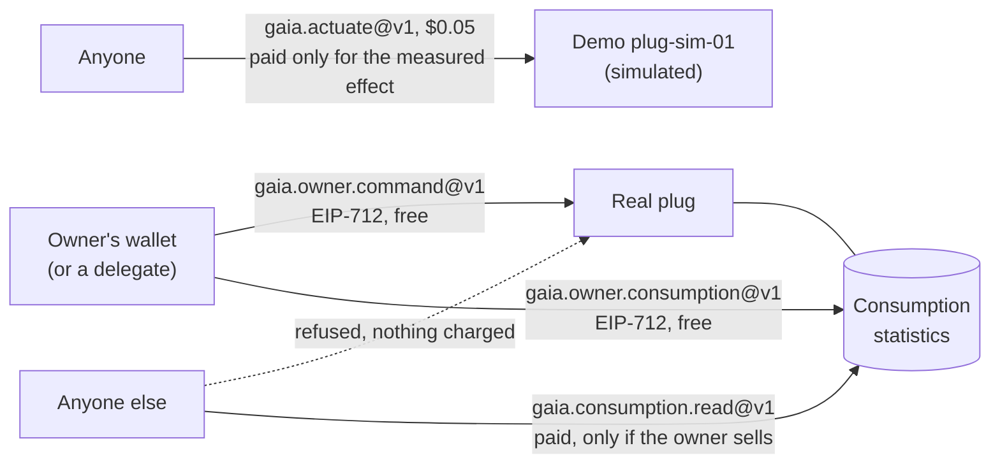
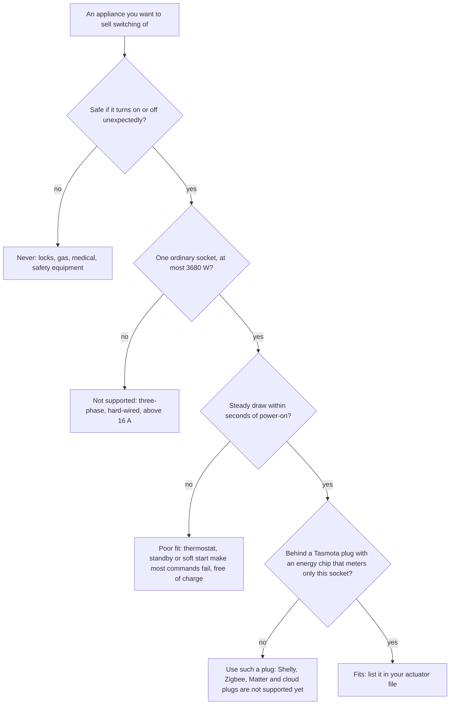
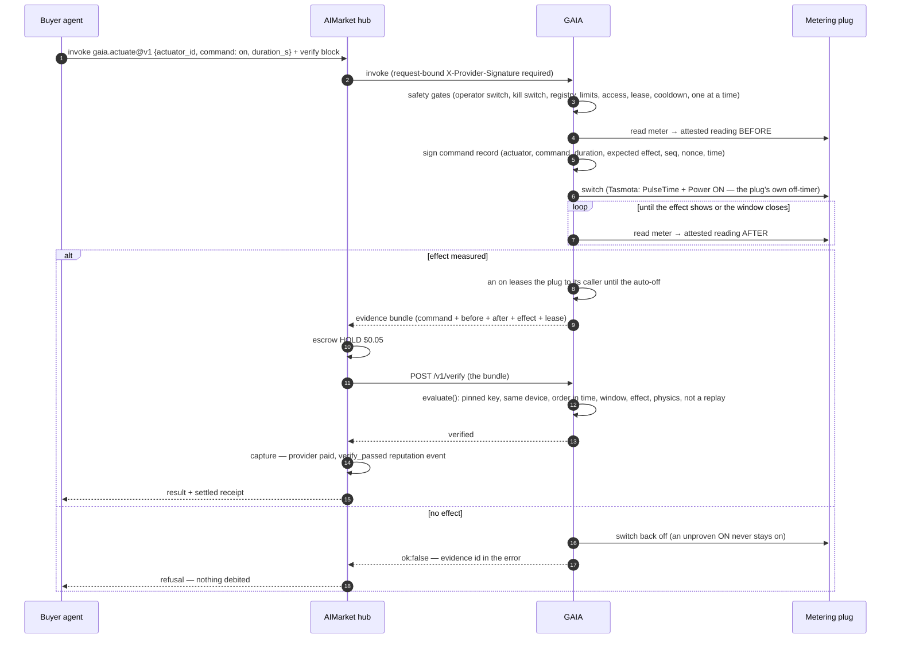
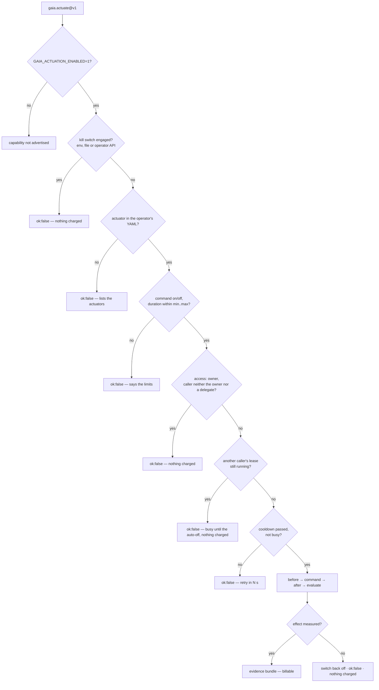
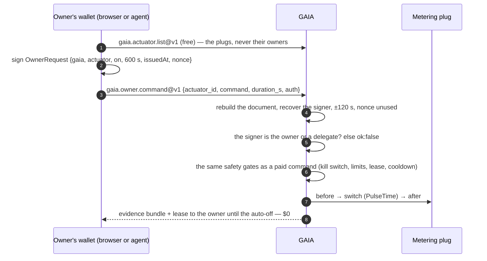
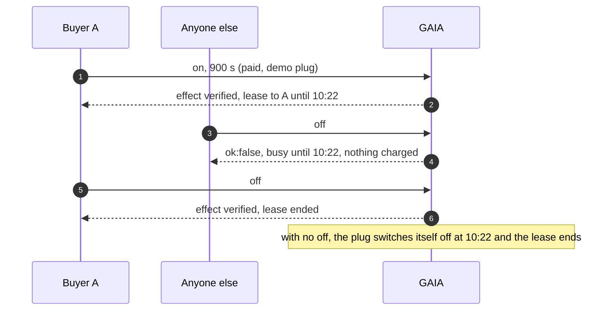
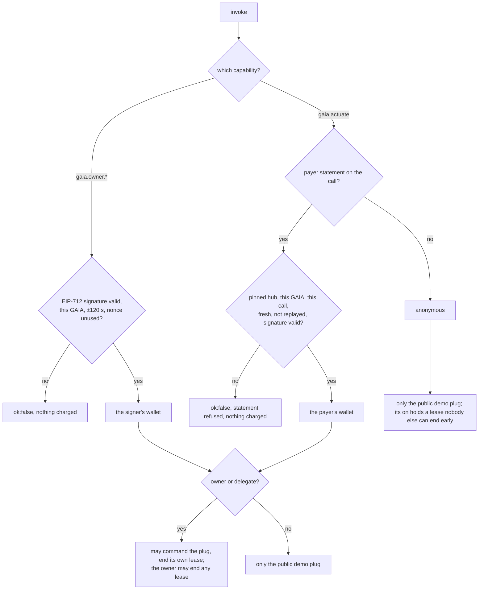
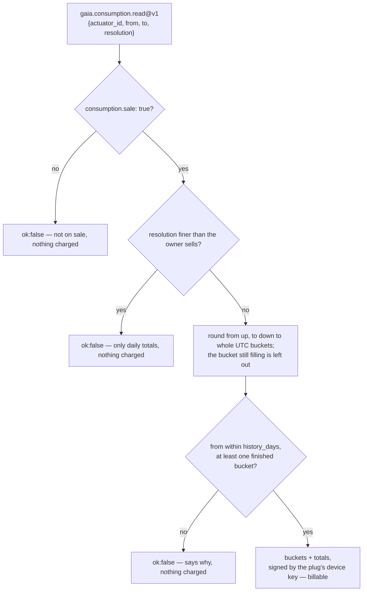

# Device control — a plug answers its owner; the demo sells the measured effect

> 🌐 **English** · [Русский](i18n/ACTUATION.ru.md) · [Español](i18n/ACTUATION.es.md) · [Français](i18n/ACTUATION.fr.md) · [中文](i18n/ACTUATION.zh.md)

Reading the physical world is half of what an agent needs from it. The other half is
changing it: turn on a heater, a pump or an EV charger for a while. GAIA does that through a
**metering smart plug**: the relay GAIA switches and the meter that sees only what that relay
switches. "Relay on" and "power rose" are then the same physical fact. A whole-house meter
would not do — a kettle somewhere else would "prove" that a heater came on.

Three rules decide who may do what:

1. **A real plug answers only its owner** — the wallet the operator's actuator file names as
   `owner`, and the `delegates` the owner listed (their own agents). The owner signs each command
   with that wallet (EIP-712) and pays nothing: no hub, no account. Nobody can buy the switching of
   someone else's plug, and a payment never opens one.
2. **The public demo plug is the one exception.** `plug-sim-01` on iot.modelmarket.dev is
   simulated, so anyone may switch it through `gaia.actuate@v1` — and pays only when the
   command's effect is measured (Pay-on-Verified).
3. **A stranger may at most buy a plug's consumption statistics**, and only where its owner put
   them on sale, no finer and no further back than the owner chose. The demo plug sells its
   hourly statistics, so that half can be tried too.



## What can be controlled

GAIA switches one kind of device: a **metering smart plug**. What it controls in practice is
whatever is plugged into that plug, and there are exactly two commands — `on` for a bounded
number of seconds, and `off`. No dimming, no temperature setpoints, no schedules: a schedule is
simply the buyer calling at the moment it chooses, for example at the start of the window
`gaia.power.window@v1` found.

Who may send those commands: the plug's owner and the owner's delegates for a real plug, anyone
for the simulated demo plug; and an `on` belongs to whoever sent it until it ends. See
[Who may switch a plug](#who-may-switch-a-plug).

### Which appliances fit

A command is paid only when the meter sees its effect, so the appliance has to **draw a steady
load within seconds of being powered**, and draw almost nothing once it is off.

| Behind the plug | Fits? | Why |
|---|---|---|
| Electric heater, oil radiator, towel rail | yes | a steady 0.5–2.5 kW as soon as it is powered |
| Water heater on a plug | while it heats | once the water is hot its thermostat cuts out; an `on` then shows no effect and is refused, free of charge |
| EV charging cable for a household socket, e-bike or scooter charger | yes, within the plug's and the cable's rating | the battery must actually charge: a full one draws nothing, and the command is refused |
| Pump, fan, dehumidifier | yes | if its draw clears the operator's `expect_on_w` |
| Lamp, grow light | yes | with a low `expect_on_w`, still well above `off_max_w` |
| Fridge, freezer, anything with its own thermostat, standby or slow soft start | poorly | "on" may draw nothing for minutes, so most commands are refused |
| Three-phase or hard-wired loads, anything above 16 A | no | one socket: 230 V × 16 A = 3680 W at most |
| Locks, gas valves, medical or safety equipment | **never** | nothing whose unexpected on or off could hurt someone belongs on a paid switch |

An `on` whose effect is not measured is **switched straight back off** and costs nothing, so a
poor fit wastes a buyer's time but never their money.



### Which plugs GAIA drives

| `kind` in the actuator file | What it is |
|---|---|
| `tasmota-mqtt` | A real plug running [Tasmota](https://tasmota.github.io/) firmware, reached through the operator's own MQTT broker |
| `sim-plug` | A plug and an appliance in software (`load_w` from 1 to 3680 W). The public demo `plug-sim-01` on iot.modelmarket.dev is one; every answer from it carries `"simulated": true` |

A Tasmota plug qualifies when:

1. **It has an energy-monitoring chip.** Tasmota's main page shows Voltage, Current and Power,
   and `Status 8` answers with an `ENERGY` block. A plug without one cannot prove anything,
   so every command to it would be refused.
2. **Its meter sees only the switched socket.** GAIA switches `Power1`. A power strip that
   meters several outlets together does not qualify — another outlet would "prove" the command.
3. **It is on the operator's MQTT broker** (`mqtt://` or `mqtts://`) with its own `%topic%`.
   GAIA speaks to it only there, and a caller names an actuator id, never a topic or a broker.
4. **It is rated for the load.** Long loads near 16 A heat household sockets; follow the plug's
   rating and, for EV charging, the cable's.

Every Tasmota plug has `PulseTime`, the plug's own off-timer: GAIA sends it with the `on`, so
the plug switches itself off after the paid duration even when GAIA, the broker or the network
is gone. That timer holds at most 64 800 s, so one `on` lasts at most 18 hours.

Not supported yet: Shelly, Zigbee, Matter, Home Assistant and cloud-only plugs, plugs with
several relays per meter, dimmers, thermostats and valves. Each needs its own driver and its
own way to prove the effect.

### What the operator decides per actuator

| Field | Meaning | Rule (default) |
|---|---|---|
| `expect_on_w` | metered power that proves "on" | below the appliance's steady draw, above anything the plug idles at |
| `off_max_w` | metered power that proves "off" | `0 < off_max_w < expect_on_w` (10 W) |
| `min_on_s`, `max_on_s` | how long one `on` may last | `0 < min ≤ max ≤ 64800` (10 s, 900 s) |
| `cooldown_s` | pause between two commands to one actuator | `≥ 0` (30 s) |
| `effect_timeout_s` | how long GAIA waits for the effect to show | 1–120 s (20 s) |
| `access` | who may command it: `owner` (the owner and the delegates) or `public` (anyone) | `owner`; `public` only for `kind: sim-plug` (the demo) |
| `owner` | the owner's wallet: its commands always pass, even during someone's lease | required with `owner` access |
| `delegates` | wallets of the owner's own agents, which may command it too | a list; only with `owner` access |
| `consumption.sale` | sell this plug's consumption statistics to others | `false` |
| `consumption.resolution` | the finest statistics sold: `hour` or `day` | `hour` |
| `consumption.history_days` | how far back statistics are sold | 1–366 (30) |
| `latitude`, `longitude` | optional: where ATLAS shows the actuator | — |

With actuation enabled, an actuator file that breaks these rules stops GAIA at start-up rather
than run a switch whose "on" and "off" could look alike. A valid plug that cannot be reached is
skipped and logged, and the rest of GAIA runs.

## Capabilities

| Capability | Price | Who | What it does |
|---|---|---|---|
| `gaia.actuator.list@v1` | free | anyone | The operator's actuators: commands, duration limits, cooldown, access policy, whether its statistics are for sale, when a running lease ends, relay state, pinned device keys, and whether the kill switch is engaged. Never the owner's or the delegates' wallets |
| `gaia.owner.command@v1` | free | the owner, a delegate | Switch your own plug `on` for `duration_s` or `off`, signed with your wallet (EIP-712). The same evidence bundle as below |
| `gaia.owner.consumption@v1` | free | the owner, a delegate | Your plug's consumption in hourly or daily buckets, any range, signed by the plug's device key |
| `gaia.actuate@v1` | $0.05 | the demo plug: anyone; a real plug: its owner through a hub | Switch one actuator `on` for `duration_s` seconds (it switches itself off afterwards) or `off`. The result is the evidence bundle, and after an `on`, the lease |
| `gaia.consumption.read@v1` | $0.01 | anyone, where the owner sells | A plug's consumption statistics in whole, finished UTC hours or days, within the owner's limits, signed by the plug's device key. Listed only while some plug sells |

$0.05 is the hub's Pay-on-Verified price floor, so a buyer can hold the payment in escrow until
GAIA's `/v1/verify` confirms the effect. The statistics price is the operator's
(`GAIA_CONSUMPTION_PRICE_USD`).

## How a paid command settles



Without a `verify` block the effect still decides the charge: GAIA answers `ok:false` for an
unproven effect, and the hub debits nothing for `ok:false`. The verify block adds a
second check before the money moves: the hub sends the evidence to GAIA's own verifier, which
re-checks it exactly ([below](#what-the-verdict-checks)) — a hub routes `gaia.actuate@v1` there with
`AIMARKET_VERIFY_ROUTES` rather than to its LLM jury.

A run with real money on Base mainnet, every transaction listed: [Pay-on-Verified for a physical effect](https://github.com/alexar76/aicom/blob/main/docs/pay-on-verified-device-demo.md).

## Safety gates



A caller names an **actuator id** — never an MQTT topic, a broker or a device the operator did
not list. "On" is always bounded: a duration is required and capped by the operator. The owner's
free `gaia.owner.command@v1` passes the same gates; its access check is the owner's signature.

## Who may switch a plug

Payment proves payment, not permission. Found on 2026-10-16: anyone who reached
`gaia.actuate@v1` could switch any listed plug, and a hub's free trial or a direct call needed no
payment at all. A plug in someone's home is not a vending machine, so the model is now:

| | Real plug (`tasmota-mqtt`) | Demo plug (`sim-plug`, `access: public`) |
|---|---|---|
| Switch it | the owner and the owner's delegates only | anyone, $0.05, paid only for the measured effect |
| Read its consumption | the owner and delegates, free | the same |
| Buy its consumption | anyone, only if the owner set `consumption.sale: true` | anyone (the demo sells its hourly statistics) |
| A stranger's paid `on` | refused, nothing charged | allowed; it then holds the plug until its auto-off |

### 1. Access: the owner, or the public demo

| `access` | Who may command it | Allowed for |
|---|---|---|
| `owner` (default) | the `owner` wallet and the `delegates` | every plug; the only choice for a real one |
| `public` | anyone who reaches GAIA | `kind: sim-plug` only — the demo |

GAIA checks the actuator file at start-up and refuses to run a file that breaks these rules,
rather than guess:

- a real plug with `access: public` — "a real plug answers only its owner";
- `access: owner` without an `owner`;
- `delegates` on a public plug;
- the draft keys `access: allowlist` and `allow:` — the message says to use `access: owner` with
  `owner:` and `delegates:`.

Addresses are `0x` + 40 hex (EVM, any case) or base58 (Solana). Quote them in YAML: a bare `0x…`
is read as a number, and GAIA refuses it at start-up rather than misread it. An owner signature
(below) is EVM only; a Solana owner commands through a hub.

```yaml
actuators:
  - id: lab-heater-01
    kind: tasmota-mqtt
    topic: tasmota_lab_heater
    expect_on_w: 800
    access: owner
    owner: "0x00000000000000000000000000000000000000a1"     # the owner's wallet
    delegates:
      - "0x00000000000000000000000000000000000000b2"        # the owner's home agent
    consumption:
      sale: false                                           # private unless the owner sells
```

`gaia.actuator.list@v1` and `/actuation/v1/status` say which policy an actuator has and whether
its statistics are for sale. They never list the owner or the delegates: an address tied to a
device in someone's home is the operator's to publish.

**Delegates** are the owner's own agents: a home-automation agent, a scheduler that switches the
water heater at the cheapest hour `gaia.power.window@v1` found. Each has its own wallet and key,
so a delegate's key can be revoked (removed from the file) without touching the owner's. A
delegate may switch the plug and read its statistics like the owner, with one difference: the
owner may end any lease, a delegate only its own.

### 2. The owner signs: EIP-712, free, no hub

The owner does not pay to switch their own plug and needs no hub or account. Each request is an
**EIP-712 typed-data signature** of the owner's wallet — what `eth_signTypedData_v4` in a browser
wallet produces, with the fields shown to the owner before they sign. Nothing goes on chain and
no gas is spent; the chain id only names the domain.

| Signed field | Value |
|---|---|
| domain | `{name: "GAIA", version: "1", chainId: 8453}` |
| `gaia` | this GAIA's public URL, without a trailing slash (`base_url` in its manifest) |
| `actuator` | the actuator id |
| `action` | `on`, `off` or `consumption` |
| `durationS` | for `on`: the seconds; else 0 |
| `fromTs`, `toTs` | for `consumption`: the window in unix seconds; else 0 |
| `issuedAt` | unix seconds; accepted within ±120 s of GAIA's clock |
| `nonce` | 32 random bytes; each is accepted once |

The request carries `auth: {signer, issued_at, nonce, signature}`. GAIA rebuilds the document from
the request's own fields, recovers the signer, compares it with `signer`, and only then claims the
nonce, in a file in the data directory that survives a restart. So a signature cannot be replayed,
moved to another GAIA, another plug, another command or another duration, or used after two
minutes, and a forged one cannot burn the owner's nonces.



**For people: the owner's page.** `https://<gaia>/owner` (for the demo host,
[iot.modelmarket.dev/owner](https://iot.modelmarket.dev/owner)) lists the plugs this GAIA has,
connects a browser wallet, switches the wallet to Base if needed, and offers *On for N min*,
*Off* and *Last 24 h* for each plug. Every button asks the wallet for one signature; the page
shows the measured effect and the auto-off time, or the hourly table. It is in English, Russian,
Spanish, French and Chinese, served by GAIA itself, with no third-party script (its policy allows
only its own two files).

**For agents: sign and call.**

```python
import secrets, time, requests
from eth_account import Account

GAIA = "https://iot.modelmarket.dev"          # base_url from the manifest, no trailing slash
key = open("owner.key").read().strip()         # the owner's or a delegate's key; never in git
FIELDS = ["gaia:string", "actuator:string", "action:string", "durationS:uint256",
          "fromTs:uint256", "toTs:uint256", "issuedAt:uint256", "nonce:bytes32"]

def owner_auth(actuator, action, duration_s=0, from_ts=0, to_ts=0):
    now, nonce = int(time.time()), "0x" + secrets.token_hex(32)
    doc = {"types": {"EIP712Domain": [{"name": "name", "type": "string"},
                                      {"name": "version", "type": "string"},
                                      {"name": "chainId", "type": "uint256"}],
                     "OwnerRequest": [dict(zip(("name", "type"), f.split(":"))) for f in FIELDS]},
           "primaryType": "OwnerRequest",
           "domain": {"name": "GAIA", "version": "1", "chainId": 8453},
           "message": {"gaia": GAIA, "actuator": actuator, "action": action,
                       "durationS": duration_s, "fromTs": from_ts, "toTs": to_ts,
                       "issuedAt": now, "nonce": nonce}}
    sig = Account.sign_typed_data(key, full_message=doc).signature.hex()
    return {"signer": Account.from_key(key).address, "issued_at": now, "nonce": nonce,
            "signature": "0x" + sig.removeprefix("0x")}

r = requests.post(f"{GAIA}/ai-market/v2/invoke", json={"capability_id": "gaia.owner.command@v1",
    "input": {"actuator_id": "lab-heater-01", "command": "on", "duration_s": 600,
              "auth": owner_auth("lab-heater-01", "on", duration_s=600)}})
print(r.json()["output"]["effect"])
```

The owner may also switch through a hub with `gaia.actuate@v1` and pay its price: the hub then
vouches for the payer ([below](#4-the-identity-whom-gaia-believes)), and the plug answers because that
payer is its owner. Payment never stands in for ownership.

### 3. The lease: an "on" belongs to its sender until the auto-off

A verified `on` gives its caller the actuator until `auto_off_at`. Until then only that caller,
the owner or the operator's kill switch may send `off` or a new `on`. Anyone else is refused
before anything switches or is recorded: `ok:false`, `busy until <time>, nothing charged`. On a
real plug that protects the owner's and the delegates' commands from each other (the owner wins);
on the demo plug it protects one buyer's paid minute from the next buyer.



- The lease ends at the auto-off, when the holder sends `off`, when the owner switches the
  actuator, when an `on` turns out unproven (it is switched straight back off), or when the kill
  switch is engaged (it ends every lease).
- The holder may send a new `on`; the lease then runs to the new auto-off.
- The cooldown still applies to everyone, the holder and the owner included: it protects the relay.
- Leases are written to `actuation-leases.json` in the data directory and survive a GAIA
  restart. GAIA re-arms its own backstop OFF for each, next to the plug's own timer.
- The status shows when a lease ends (`leased_until`), never who holds it.

### 4. The identity: whom GAIA believes

GAIA believes two identities, and never a caller's own word:

1. **An owner signature** (above): the wallet that signed this exact request, recovered from the
   signature.
2. **A payer that a hub it trusts vouches for on this exact call.** The hub knows who paid. For a
   payment channel, that is the address recovered from the payer's signature when the channel was
   opened. For x402, it is the authorization's `from`, checked against its signature. The hub signs
   that address with its federation key, next to the price gate's admission headers of the same
   call, and reuses their hub, audience, timestamp and nonce:

| Header | Content |
|---|---|
| `X-AIMarket-Hub-Payer` | the payer's wallet address |
| `X-AIMarket-Hub-Payer-Rail` | `channel` or `x402` |
| `X-AIMarket-Hub-Payer-Signature` | Ed25519 by the hub's key over `aimarket-hub-payer/v1` + the hub, the audience (this GAIA's invoke URL), the capability, the hash of the exact input, time, nonce, payer and rail |

The trusted hubs are the ones in `ORACLE_TRUSTED_HUBS`, the list the price gate pins. A
statement is good for one call, at this GAIA, within ±120 s, once. An input field,
`X-Payment-Channel` (a channel id is a reference, not a secret) and `X-AIMarket-Buyer` (an opaque
rate-limit key) can all be typed by anyone, so none of them identifies a caller.



An anonymous caller may command only the public demo plug, and it never matches a lease holder.
Its `on` still holds a lease (`holder: null`), so nobody but the owner or the kill switch can end
that buyer's time early, and the buyer cannot end it early either.

**Where this stands.** The owner signature works with GAIA alone. The hub's payer statement is
merged on the hub's side and reaches a hub with its next release; until a hub sends it, buyers
arriving through that hub are anonymous: the demo works, a paid `on` there is protected from
everyone else, and an owner commanding a real plug uses the free signature path.

## Consumption statistics

Every plug's meter is also a record of how the appliance behind it was used. GAIA keeps that
record for the owner, and sells it to others only where the owner chose to.

**Recording.** In the serving process a sampler reads every actuator's meter every
`GAIA_CONSUMPTION_SAMPLE_S` (60 s) — the same attested reading a command's evidence carries — and
adds it to the UTC hour it falls in: the energy (the step of the plug's own energy register, or
power × time when the register is missing or was reset), the sum and peak of the power, and how
long the relay was on. A gap longer than 600 s (GAIA down, the plug offline) is a pause, not
consumption. Hours are kept for `GAIA_CONSUMPTION_RETENTION_DAYS` (400) and live in the oracle's
store: SQLite in the data directory by default, Postgres when `ORACLE_DATABASE_URL` names one.
`GAIA_CONSUMPTION_SAMPLER=0` stops the sampler.

**The owner reads, free.** `gaia.owner.consumption@v1` with an owner signature (`action:
consumption`, the window as `fromTs` / `toTs`) answers any range, hourly or daily, for every plug
the wallet owns or is a delegate of — sold or not.

**Others buy, only where the owner sells.** Three keys in the actuator file decide it:

```yaml
    consumption:
      sale: true          # off by default
      resolution: day     # the finest sold: hour, or only daily totals
      history_days: 30    # how far back, 1–366
```



A sold series holds **whole, finished buckets only**. Without that rule a "day" over a one-hour
window would be an hourly reading, and reading the current hour again and again would be a
minute-by-minute one — finer than the owner chose to sell.

Each bucket says `start`, `end`, `energy_wh`, `mean_w`, `peak_w`, `on_minutes` and `samples`;
`totals` sums them. `attestation` is an Ed25519 signature by the plug's device key — the key its
readings carry, published in `gaia.actuator.list@v1` as `device_pubkey` — over the canonical JSON
of `{actuator_id, resolution, from, to, buckets}`, so a buyer can show where the numbers came
from. `simulated: true` marks the demo plug.

```bash
# the demo plug's hourly consumption over the last day ($0.01 through a hub)
curl -s -X POST https://iot.modelmarket.dev/ai-market/v2/invoke -H 'Content-Type: application/json' \
  -d '{"capability_id":"gaia.consumption.read@v1",
       "input":{"actuator_id":"plug-sim-01","resolution":"hour"}}'
```

`from` and `to` take unix seconds or ISO 8601 UTC (`2026-10-16T00:00:00Z`); the default is the
last 24 hours. At most 744 hourly or 366 daily buckets per call.

**Why off by default.** A heater's hours say when someone is home; a kettle's say when they wake
up. That is the owner's data. `resolution: day` sells the trend without the daily routine, and
`history_days` bounds how much of the past is for sale. Switching is never for sale.

## Call it

```bash
# what can be switched, and the limits
curl -s -X POST https://iot.modelmarket.dev/ai-market/v2/invoke -H 'Content-Type: application/json' \
  -d '{"capability_id":"gaia.actuator.list@v1","input":{}}'

# switch the demo heater on for one minute
curl -s -X POST https://iot.modelmarket.dev/ai-market/v2/invoke -H 'Content-Type: application/json' \
  -d '{"capability_id":"gaia.actuate@v1",
       "input":{"actuator_id":"plug-sim-01","command":"on","duration_s":60}}'
```

The answer (abridged):

```json
{
  "actuation": {
    "record": {"command_id": "act_1f…", "actuator_id": "plug-sim-01", "command": "on",
               "duration_s": 60, "seq": 1792145220000, "issued_at": "2026-10-16T10:07:00Z",
               "nonce": "…", "expect": {"field": "power_w", "op": ">=", "value": 1000, "within_s": 20}},
    "attestation": {"algorithm": "ed25519", "public_key": "…", "value": "…"}
  },
  "before": {"reading": {"values": {"power_w": 0.4, "relay_on": 0.0, "…": "…"}}, "attestation": {"…": "…"}},
  "after":  {"reading": {"values": {"power_w": 1497.2, "relay_on": 1.0, "…": "…"}}, "attestation": {"…": "…"}},
  "effect": {"verified": true, "expected": {"…": "…"}, "observed": 1497.2},
  "simulated": true,
  "auto_off_at": "2026-10-16T10:08:00Z",
  "lease": {"holder": null, "until": "2026-10-16T10:08:00Z"}
}
```

`holder` is `null` here because a direct call carries no payer a hub vouched for. Until
10:08:00 nobody else can switch this plug, and this caller cannot end the minute early
either ([above](#3-the-lease-an-on-belongs-to-its-sender-until-the-auto-off)). The same call
on a real plug answers `ok:false` — "takes commands only from its owner" — and charges nothing;
its owner uses [`gaia.owner.command@v1`](#2-the-owner-signs-eip-712-free-no-hub).

Anyone can check it again: `POST /v1/verify` with the bundle (the escrow slot), or invoke
`gaia.verify@v1` with it. Evidence of recent commands, including refused ones, is public at
`GET /actuation/v1/evidence/<command_id>`; `GET /actuation/v1/status` shows every actuator.

## What the verdict checks

All checks are hard — one false fact and nothing is owed:

| Check | Meaning |
|---|---|
| `command_signature` | the command record is signed by the plug's **pinned** key (from the fleet registry, never the key the bundle carries) |
| `before_device`, `after_device` | both readings come from that same actuator |
| `before_signature`, `after_signature` | both readings verify against the pinned key |
| `order` | before → command → after, in sequence number and in time |
| `window` | the effect was read within the promised window |
| `effect` | the expected predicate holds on the after reading (`power_w >= expect_on_w` for on, `<= off_max_w` for off) |
| `relay_state` | the plug reports the relay state the command asked for |
| `after_plausible` | the after reading passes GAIA's physics checks |

Each command settles once: its `seq` (wall-clock milliseconds, only ever growing) is the
escrow verifier's high-water mark, so a replayed bundle is rejected.

Plausibility knows plugs: `relay_on` is a field, an open relay that meters more than 25 W is a
contradiction, and the energy register is checked against what one 16 A socket could pass in
the time since the last read — not against present power times the gap, since a plug switched
between two reads is honest.

## Operators

The public demo runs one **simulated** plug (`plug-sim-01`, a 1500 W heater) from
[`config/actuators.yaml`](../config/actuators.yaml). For real hardware:

1. A Tasmota plug **with an energy chip**, on your MQTT broker, answering `Status 8`.
2. Your actuator file, from [`config/actuators.example.yaml`](../config/actuators.example.yaml):
   ```yaml
   actuators:
     - id: lab-heater-01
       kind: tasmota-mqtt
       topic: tasmota_lab_heater   # the plug's %topic%
       expect_on_w: 800            # below the heater's draw, above anything the plug idles at
       off_max_w: 5
       min_on_s: 30
       max_on_s: 1800
       cooldown_s: 60
       effect_timeout_s: 20
       access: owner               # the only choice for a real plug
       owner: "0x…"                # the owner's wallet, quoted
       delegates: ["0x…"]          # optional: the owner's own agents
       consumption:
         sale: false               # true sells statistics (gaia.consumption.read@v1)
         resolution: hour          # or day
         history_days: 30
   ```
3. Environment:
   ```bash
   GAIA_ACTUATION_ENABLED=1
   GAIA_ACTUATORS_FILE=/path/to/actuators.yaml
   GAIA_MQTT_BROKER=mqtts://broker.example:8883
   GAIA_MQTT_USERNAME=gaia            # password from your secret store, never a file in git
   GAIA_ACTUATION_TOKEN=…             # Bearer token for the kill switch API
   ORACLE_TRUSTED_HUBS=https://<hub>=<its signer_public_key>   # whose payer statements count
   GAIA_CONSUMPTION_PRICE_USD=0.01    # the statistics price; GAIA_CONSUMPTION_SAMPLE_S=60
   ORACLE_CALLS=1                     # the call log (on in our images) — see "Call statistics"
   ORACLE_OPS_TOKEN=…                 # Bearer token for /ops/v1/*, from a 0600 file
   ORACLE_DATABASE_URL=postgresql://… # optional: Postgres instead of SQLite in /data
   ```
   The owner's page is `/owner` on GAIA itself; behind nginx it needs a `location /owner` to the
   backend, as in `deploy/nginx/iot.modelmarket.dev.conf`.
4. **The hub that sells it with Pay-on-Verified** routes the capability to this GAIA's verifier, so
   an exact check, not an LLM jury, decides the money:
   ```
   # GAIA: in production /v1/verify refuses every caller until this is set
   GAIA_VERIFY_TOKEN=…                # a random secret, from a 0600 file
   # the hub's env file (one line, no quotes: --env-file takes values literally)
   AIMARKET_VERIFY_ROUTES={"gaia.actuate@v1": {"url": "https://<gaia>", "verifier_id": "gaia.verify@v1", "key_env": "AIMARKET_VERIFY_GAIA_TOKEN"}}
   AIMARKET_VERIFY_GAIA_TOKEN=…       # the same value as GAIA_VERIFY_TOKEN
   ```
   Without the token on the hub, the hub refuses the verify block before anything is switched;
   with a wrong one, GAIA answers 401 and the buyer is refunded. See
   [the hub's verifier routes](https://github.com/alexar76/aimarket-hub/blob/main/docs/pay-on-verified.md#verifier-routes).

ON is sent as `Backlog PulseTime1 <duration>; Power1 ON`, so **the plug switches itself off**
after the paid duration even if GAIA, the broker or the network goes away. GAIA also sends its
own OFF at the deadline as a second stop.

### Kill switch

Three ways, any one is enough; while engaged every command is refused and nothing is charged.
Engaging it also ends every lease:

```bash
curl -X POST https://<gaia>/actuation/v1/kill   -H "Authorization: Bearer $GAIA_ACTUATION_TOKEN"   # also switches everything off
curl -X POST https://<gaia>/actuation/v1/resume -H "Authorization: Bearer $GAIA_ACTUATION_TOKEN"
touch <data dir>/ACTUATION_KILL        # a file, for when the API is unreachable
GAIA_ACTUATION_KILL=1                  # an environment switch, for a restart
```

Without `GAIA_ACTUATION_TOKEN` the kill switch API answers 503 — it never opens unauthenticated.
Every command (with the caller GAIA verified, or none), outcome, lease, lease end, kill and
resume is appended to `actuation.jsonl` in the data directory.

### Call statistics

Every invoke GAIA answers — a paid switch, an owner's signed command, a refused stranger, a
statistics sale, a `402` — is one row in the call log of
[oracle-core](https://github.com/alexar76/oracles/blob/main/core/docs/CALL-LOG.md): the
capability, the outcome, the HTTP status, a short reason, who vouched for the call (a hub, an
operator-nominated caller, or nobody), the price of a served priced call, the latency, the subject
(`actuator_id`), a salted hash of the client address and the SHA-256 of the input. Never the
input itself and never an IP address, so an owner's signature does not end up in a log.

```bash
# on the GAIA host (the reverse proxy does not expose /ops/)
curl -s -H "Authorization: Bearer $ORACLE_OPS_TOKEN" 'http://127.0.0.1:9320/ops/v1/stats?since=2026-10-16T00:00:00Z'
curl -s -H "Authorization: Bearer $ORACLE_OPS_TOKEN" 'http://127.0.0.1:9320/ops/v1/calls?capability=gaia.actuate@v1&outcome=failed'
curl -s -H "Authorization: Bearer $ORACLE_OPS_TOKEN" http://127.0.0.1:9320/ops/v1/metrics   # Prometheus
```

## Honest limits

- A Tasmota plug has no secure element. GAIA's key signs **what the plug reported** — custody
  of the report, as with every GAIA relay, not proof that the hardware cannot lie. The meter and
  the relay being one device is what keeps the claim narrow.
- The effect proves power flowed through the socket, not what the appliance did with it.
- The public demo plug is simulated (`SIM`); its heater exists only in software, and every answer says so (`"simulated": true`).
- On the public demo plug the first verified `on` holds it, for at most `max_on_s`. A buyer who
  keeps paying, or a hub's free trial, can occupy it in turns; that is why only a simulated plug
  may be public.
- A wallet is whoever holds its key, not a person. Whoever has the owner's key owns the plug for
  GAIA; a delegate's leaked key is revoked by removing it from the actuator file (and restarting),
  not by GAIA.
- Ownership is what the operator's file says. GAIA does not check who owns the hardware; the
  operator who installs a plug for someone writes their wallet in.
- Sold statistics are what the plug's meter reported, kept by GAIA and signed with the plug's key:
  provenance, not a certified meter reading for billing.
- A trusted hub is trusted with who paid. A hub that lies about the payer, or a leaked hub key,
  can name any wallet. A wallet is whoever holds its key, not a person.
- With the route, GAIA is both the seller and the judge of `gaia.actuate@v1`. That is acceptable
  only because the verdict is a deterministic check of signed evidence that anyone can run again
  (`POST /v1/verify`, or `gaia.verify@v1` with the bundle), and because a buyer can appeal a pass
  to the hub's appeal court, a different verifier, where the hub runs one. No verifier, GAIA or an
  LLM, can catch evidence forged by whoever holds the plug's key.

W3C WoT: each plug's Thing Description (`GET /wot/<id>`) carries `switchOn` / `switchOff`
**actions** whose forms are paid `gaia.actuate@v1` invokes.
