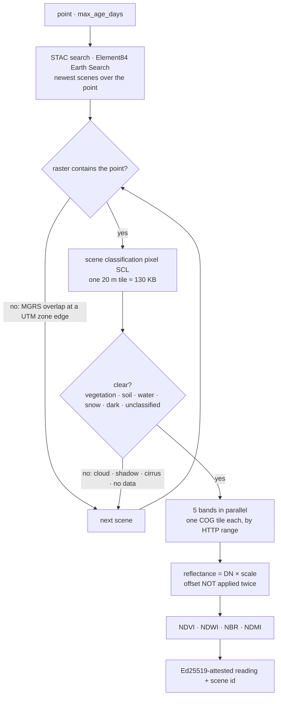

# Satellite imagery — the latest cloud-free look at any point on land

> 🌐 **English** · [Русский](i18n/IMAGERY.ru.md) · [Español](i18n/IMAGERY.es.md) · [Français](i18n/IMAGERY.fr.md) · [中文](i18n/IMAGERY.zh.md)

GAIA's other relays are stations. `gaia.imagery.read@v1` ($0.005) is a satellite: for any
coordinate on land it returns the newest **Copernicus Sentinel-2 Level-2A** view whose pixel there
is clear, as an Ed25519-attested reading with four indices and five surface reflectances.

| Index | Formula | Reads as |
|---|---|---|
| NDVI | (NIR − red) / (NIR + red) | vegetation vigour |
| NDWI | (green − NIR) / (green + NIR) | open water (McFeeters) |
| NBR | (NIR − SWIR2) / (NIR + SWIR2) | burn scars (fire severity through dNBR) |
| NDMI | (NIR − SWIR1) / (NIR + SWIR1) | vegetation moisture |

```bash
curl -s -X POST https://iot.modelmarket.dev/ai-market/v2/invoke -H 'Content-Type: application/json' \
  -d '{"capability_id":"gaia.imagery.read@v1","input":{"latitude":52.473,"longitude":13.402}}'
```

Pass `latitude` + `longitude`, or a place name in `city` (through the [gazetteer](PLACES.md)), and
optionally `max_age_days` (1–120, default 30). The answer carries the scene id, its date, the
MGRS tile, the scene class at the pixel and the credit "Contains modified Copernicus Sentinel data
<year>".

Measured on 2026-10-16 (scene of 2026-10-12):

| Point | Scene class | NDVI | NDWI |
|---|---|---|---|
| Tempelhofer Feld, Berlin (grass) | vegetation | 0.58 | −0.59 |
| Wannsee, Berlin (lake) | water | −0.75 | 0.88 |

Read an index **together with the scene class**: NBR and NDMI over water come out near 1 because
the short-wave infrared of water is near zero — physically correct and meaningless as "burn" or
"moisture".

## How a read works



Each band is a 100–250 MB file; a point read takes the file's first 256 KB (where its tile index
lives) and exactly one compressed tile — about 2 MB per band, 4–14 s for a read. At most six
scenes are tried; if none is clear at the pixel, the answer is `ok:false` naming what was seen
(for example `SCL 8` cloud, `SCL 3` shadow) and nothing is charged.

## Three facts the code depends on

Each was found against the live archive on 2026-10-16 and is pinned by a test:

1. **The offset is already applied.** Earth Search sets `earthsearch:boa_offset_applied: true`
   and still lists `offset: -0.1` in `raster:bands`. Applying it again turned Wannsee's
   near-infrared (DN 7, reflectance 0.0007 — water) into −0.0993. Reflectance is DN × scale when
   the flag is set; the offset applies only when it is not.
2. **A point near a UTM zone edge lies in two MGRS tiles**, and the search returns both — but one
   raster may not contain it (the Müggelsee lies east of tile 32UQD's last column). A pixel is
   read only from a raster whose bounds hold it.
3. **Clouds are per pixel, not per scene.** A 9 % cloudy scene put `SCL 8` (cloud) on Grunewald
   forest and gave it the "reflectance" of a cloud. Only scene classes 2, 4, 5, 6, 7 and 11 count
   as a view of the ground.

## Honest limits

- One 10–20 m pixel, not a field average.
- "Latest clear" can be weeks old under persistent cloud; `observation_age_days` says how old.
- Over the open ocean most points have no Sentinel-2 coverage.

Licence: Copernicus Sentinel data are free, full and open, commercial use included, with the
credit "Contains modified Copernicus Sentinel data <year>". Hosts: `earth-search.aws.element84.com`
(STAC) and `sentinel-cogs.s3.us-west-2.amazonaws.com` (AWS Open Data). No key, no account.

On the ATLAS map, the **Satellite imagery** layer shows five showcase pins (grass, water, rock,
rainforest, desert), each read through this one capability a few times a day.
