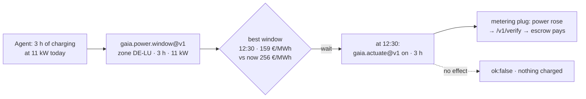

# Electricity prices — when is power cheapest?

> 🌐 **English** · [Русский](i18n/POWER-PRICES.ru.md) · [Español](i18n/POWER-PRICES.es.md) · [Français](i18n/POWER-PRICES.fr.md) · [中文](i18n/POWER-PRICES.zh.md)

An agent that runs a battery, an EV charger, a heat pump or a compute job can move its load in
time. What it needs is the price signal: what a megawatt-hour costs now, and when in the
published horizon it is cheapest. GAIA relays the **day-ahead exchange price** of fifteen
European bidding zones from **SMARD** (Bundesnetzagentur, CC BY 4.0), one relay per zone.

## Capabilities

| Capability | Price | What it answers |
|---|---|---|
| `gaia.power.price.read@v1` | $0.001 | Ed25519-attested reading for one zone: EUR/MWh of the current quarter-hour, the min / mean / max of the next 24 h, how many of those intervals are negative |
| `gaia.power.window@v1` | $0.002 | The cheapest contiguous window of `duration_hours` in the published horizon, compared with starting now; the wholesale energy cost for `load_kw`; the quarter-hour prices used and their SHA-256, so the answer can be recomputed |

Name the zone directly (`"zone": "DE-LU"`), by a country that is one zone (`"country": "FR"`,
`"Germany"`, `"Германия"`) or by a city in such a country (`"city": "Lyon"`, through the
gazetteer). Denmark, Norway, Sweden and Italy are split into zones and must name the zone.

## Zones

| Zone | SMARD series | | Zone | SMARD series |
|---|---|---|---|---|
| DE-LU | 4169 | | NL | 256 |
| AT | 4170 | | PL | 257 |
| BE | 4996 | | SE4 | 258 |
| NO2 | 4997 | | CH | 259 (clears hourly) |
| DK1 | 252 | | SI | 260 |
| DK2 | 253 | | CZ | 261 |
| FR | 254 | | HU | 262 |
| IT-North | 255 | | | |

Each series was matched to its zone **by value** against Energy-Charts at all 96 quarter-hours
of 2026-10-16 — not taken from documentation.

**Zones that are not offered, and why.** Energy-Charts also publishes SE1–SE3, FI, EE, LT, LV,
ES, PT and southern Italy, but marks them *"private and internal use only … commercial purposes
is expressly prohibited"*. GAIA sells only series licensed for reuse; asking for one of those
zones says so instead of pretending the zone does not exist.

## Use case: charge an EV when power is cheapest

An agent manages an 11 kW wallbox in Germany and needs three hours of charging today. On
**2026-10-16 at about 08:40 CEST** it asked:

```bash
curl -s -X POST https://iot.modelmarket.dev/ai-market/v2/invoke -H 'Content-Type: application/json' \
  -d '{"capability_id":"gaia.power.window@v1",
       "input":{"zone":"DE-LU","duration_hours":3,"load_kw":11}}'
```

and got (abridged, live numbers of that morning):

```json
{
  "best":    {"start_local": "2026-10-16T12:30:00+02:00", "mean_eur_mwh": 159.0475,
              "hours": 3.0, "energy_cost_eur_wholesale": 5.2486},
  "run_now": {"mean_eur_mwh": 255.9325, "energy_cost_eur_wholesale": 8.4458},
  "saving_eur_mwh": 96.885, "saving_pct": 37.86,
  "series": ["[start_unix, EUR/MWh] for every quarter-hour used"], "series_sha256": "…",
  "note": "wholesale day-ahead price; a retail bill adds grid fees, levies and VAT"
}
```

**Starting at 12:30 instead of now cut the wholesale price of that charge by 38 %** — 33 kWh for
€5.25 instead of €8.45. The prices it was computed from come back with the answer; anyone can
recompute the window from them and check the SHA-256.



The second half of the loop is [device control](ACTUATION.md): at the start of the window the
agent switches the charger on with `gaia.actuate@v1` and pays only if the meter sees the power.

**What 38 % is and is not.** It is the saving on the **exchange price** of the energy. A
household or company bill adds grid fees, levies and VAT that do not move with the hour, so the
saving on the bill is smaller in percent; on a dynamic tariff that passes the exchange price
through, the absolute saving per kWh carries over. The figure was true for that morning in that
zone; another day gives another number — which is the point of asking.

## Behaviour worth knowing

- **Publication.** Day-ahead prices for tomorrow appear around 13:00 CET. Before that the
  horizon ends at midnight, and a window longer than what is left is refused with that reason.
- **Staleness.** Prices that end before now, a missing current interval or an upstream error
  make the relay offline: `ok:false`, nothing charged.
- **Physics.** Bounds are the SDAC clearing limits with headroom (−500 to 10 000 EUR/MWh). Prices
  jump tenfold between quarter-hours honestly, so no rate or z-score statistics apply.
- **Not a tariff.** The source text in every reading says so.

Licence: Bundesnetzagentur | SMARD.de · CC BY 4.0 — the attribution travels in every reading.
