# GAIA — puerta de oráculo físico

<!-- sensor-operator-guide -->
> ¿Tienes una estación meteorológica o un sensor de calidad del aire? [Vende las lecturas con tu propio Hub + GAIA](https://github.com/alexar76/aicom/blob/main/docs/sensor-operator.es.md).
<!-- /sensor-operator-guide -->

<!-- aicom-readme-badges -->
<p align="center">
  <a href="https://github.com/alexar76/gaia/actions/workflows/ci.yml"></a>
  <a href="https://iot.modelmarket.dev/"></a>
  <a href="https://alexar76.github.io/gaia/"></a>
  =3.11" />
  
  
  <a href="../LICENSE"></a>
</p>
<!-- /aicom-readme-badges -->

<p align="center">
  <a href="https://iot.modelmarket.dev/">
    
  </a>
</p>

> 🌐 [English](../README.md) · [Русский](README.ru.md) · **Español** · [Français](README.fr.md) · [中文](README.zh.md) · [Glosario](https://github.com/alexar76/aicom/blob/main/docs/localization-glossary.md)

**GAIA** es una puerta de **oráculo físico** que vende **lecturas** de **sensores** con
**atestación** Ed25519 desde dispositivos IoT virtuales como capabilities de pago AIMarket v2,
y sirve un `/v1/verify` compatible con el envelope de Metis para que el hub liquide el
**depósito en garantía (escrow)** **Pay-on-Verified** —
una lectura honesta paga al **proveedor**; un sensor mentiroso reembolsa al comprador
automáticamente.

Es la **tercera clase de oráculos** del ecosistema: los oráculos matemáticos prueban
cómputos, Metis juzga la salida LLM, GAIA ancla la **liquidación** en la física. La
**flota** demo está simulada (dos estaciones meteorológicas co-ubicadas con una site truth,
un nodo de aire, un medidor de energía — modelos tipo BME280/SDS011/SCD30/Shelly-EM), pero
cada superficie de cable — manifiesto, **invocación (invoke)**, **recibos**, firma del
proveedor, verify envelope, W3C WoT Thing Descriptions — es la real.

<p align="center">
  <strong><a href="https://iot.modelmarket.dev/">Demo en vivo</a></strong>
  ·
  <strong><a href="https://alexar76.github.io/gaia/">Landing</a></strong>
  ·
  <strong><a href="https://github.com/alexar76/gaia/pkgs/container/gaia">GHCR</a></strong>
</p>

> 📖 Profundización (monorepo): [`docs/iot-physical-oracles.md`](https://github.com/alexar76/aicom/blob/main/docs/iot-physical-oracles.md)
> 🌍 Dispositivos vivos: [`gaia/devices/live.py`](../gaia/devices/live.py)
> 🎬 3D: [`frontend/`](../frontend/) (`cd frontend && npm i && npm run dev`)

## Inicio rápido

```bash
docker pull ghcr.io/alexar76/gaia:latest
docker run --rm -p 9320:9320 ghcr.io/alexar76/gaia:latest

pip install -e vendor/oracle-core -e ".[dev]"
python -m gaia.main                             # :9320
```

Probar:

```bash
curl -s localhost:9320/.well-known/ai-market.json
curl -s localhost:9320/ai-market/v2/manifest

curl -s -X POST localhost:9320/ai-market/v2/invoke \
  -H 'Content-Type: application/json' \
  -d '{"capability_id": "gaia.weather.read@v1", "product_id": "gaia.gateway",
       "input": {"device_id": "ws-01"}}'
```

## Dispositivos vivos — relés de sensores públicos

`GAIA_ENABLE_LIVE=1` registra **relés** de APIs públicas reales junto a los simuladores.
Cada relé usa el mismo camino de atestación Ed25519 y **plausibilidad**. Upstream inalcanzable
→ `DeviceOffline` → 503 / `{ok:false}` → **sin débito**. Los hosts upstream están en
**allowlist** (defensa SSRF); los clientes de invoke **nunca** envían una URL.

| Device id | Capability | Upstream | ¿Clave? |
|-----------|------------|----------|------|
| `nws-01` | `gaia.weather.read@v1` | NOAA/NWS `api.weather.gov` | no |
| `om-wx-01` | `gaia.weather.read@v1` | [Open-Meteo](https://open-meteo.com) weather | no |
| `osm-01` | `gaia.air.read@v1` | openSenseMap | no |
| `om-aq-01` | `gaia.air.read@v1` | Open-Meteo air quality | no |
| `sta-01` | `gaia.air.read@v1` | OGC SensorThings (Fraunhofer) | no |
| `openaq-01` | `gaia.air.read@v1` | OpenAQ v3 | **sí — gratis** en [explore.openaq.org](https://explore.openaq.org) → `GAIA_OPENAQ_API_KEY` |
| `uk-grid-01` | `gaia.grid.read@v1` | UK Carbon Intensity | no |
| `usgs-quake-01` | `gaia.quake.read@v1` | USGS GeoJSON feed | no |
| `noaa-tide-01` | `gaia.tide.read@v1` | NOAA CO-OPS tides | no |
| `firms-fire-01` | `gaia.fire.read@v1` | NASA FIRMS VIIRS (cite NASA) | no |
| `safecast-01` | `gaia.radiation.read@v1` | Safecast (CC0) | no |
| `cybernews-jam-01` | `gaia.jamming.read@v1` | CyberNews GNSS (CC BY 4.0) | no |
| `feeder-adsb-01` | `gaia.adsb.read@v1` | Own dump1090 ingest | `GAIA_FEEDER_*` |
| `feeder-ais-01` | `gaia.ais.read@v1` | Own AIS ingest | `GAIA_FEEDER_*` |

Notas de operador (5 idiomas): [`docs/LIVE-RELAYS.md`](LIVE-RELAYS.md).
Añadir un sensor / pin (GAIA → ATLAS): [`add-gaia-atlas-sensor`](https://github.com/alexar76/aicom/blob/main/docs/add-gaia-atlas-sensor.md) (EN · RU · ES · FR · ZH).

```bash
curl -s -X POST https://iot.modelmarket.dev/ai-market/v2/invoke \
  -H 'Content-Type: application/json' \
  -d '{"capability_id":"gaia.grid.read@v1","product_id":"gaia.gateway",
       "input":{"device_id":"uk-grid-01"}}'
```

## Más allá de leer — lugares, precios eléctricos, imágenes, control de dispositivos

| Capacidad | Precio | Qué hace | Guía |
|---|---|---|---|
| `gaia.place.resolve@v1` | gratis | Cualquier localidad por su nombre («Kraków», «Paris, Texas», «東京») → un lugar, o los candidatos si el nombre es ambiguo; indica qué lecturas de GAIA lo cubren (GeoNames, CC BY 4.0) | [Lugares](i18n/PLACES.es.md) |
| `gaia.power.price.read@v1` | $0.001 | Precio eléctrico del día siguiente de una zona de oferta europea, ahora y en las próximas 24 h (SMARD, CC BY 4.0; 15 zonas) | [Precios eléctricos](i18n/POWER-PRICES.es.md) |
| `gaia.power.window@v1` | $0.002 | Cuándo es más barata la energía durante N horas — con los precios usados y su SHA-256 (una carga de coche eléctrico de 11 kW fue un 38 % más barata a las 12:30 que a las 08:40 el 16-10-2026) | [Precios eléctricos](i18n/POWER-PRICES.es.md) |
| `gaia.imagery.read@v1` | $0.005 | Última vista Sentinel-2 sin nubes de cualquier punto en tierra: NDVI, NDWI, NBR, NDMI | [Imágenes](i18n/IMAGERY.es.md) |
| `gaia.actuator.list@v1` | gratis | Los dispositivos conmutables del operador y sus límites | [Control de dispositivos](i18n/ACTUATION.es.md) |
| `gaia.actuate@v1` | $0.05 | Encender un enchufe con medición durante N segundos o apagarlo — **se paga solo el efecto que mide su medidor** (Pay-on-Verified) | [Control de dispositivos](i18n/ACTUATION.es.md) |

## Licencia

MIT — ver [LICENSE](../LICENSE).
