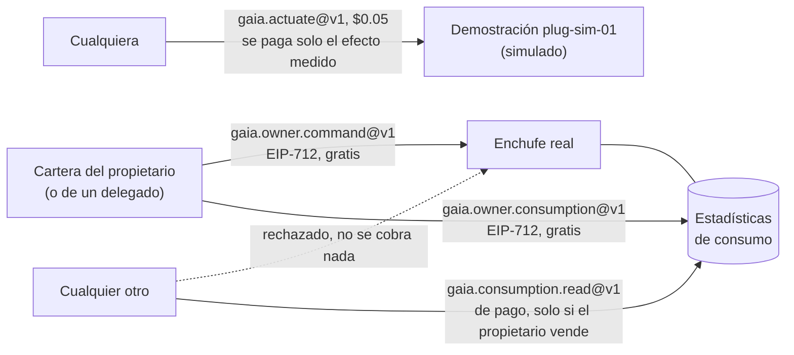
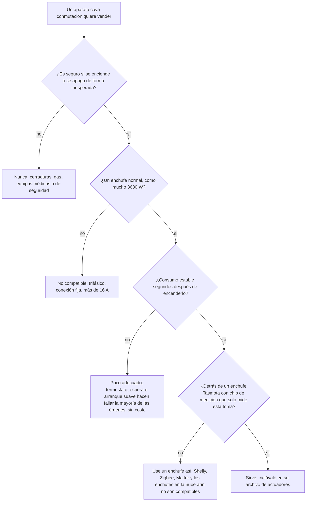
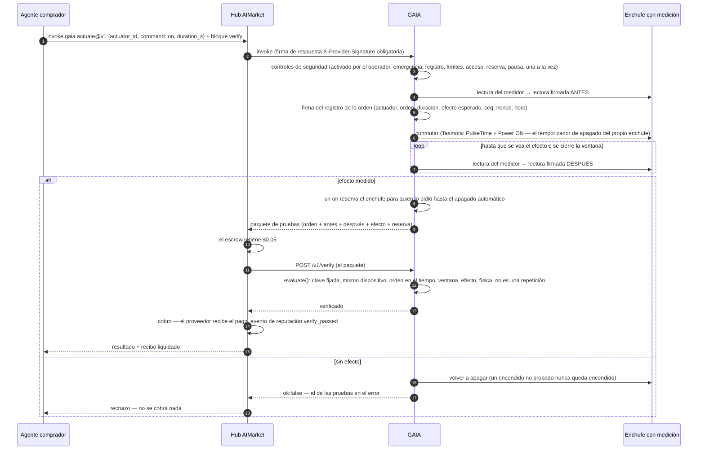
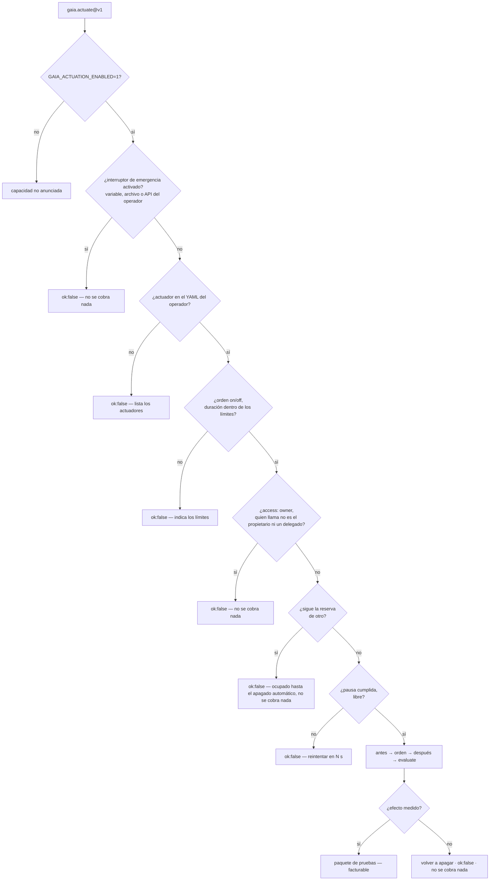
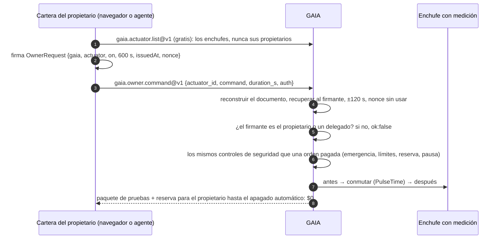
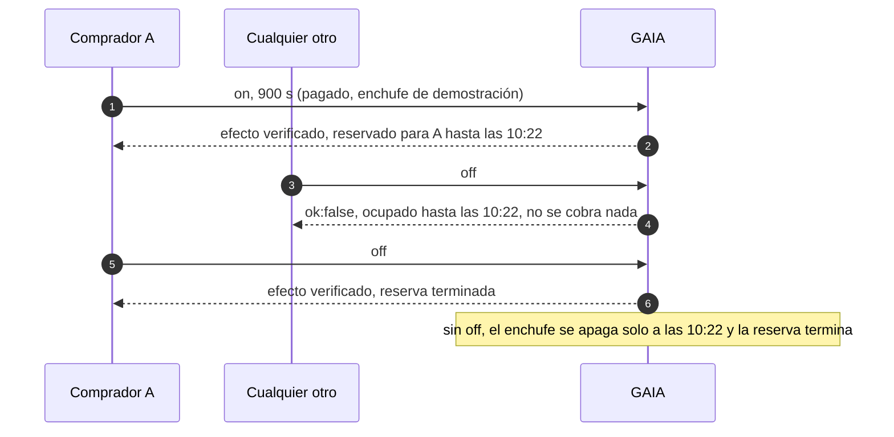
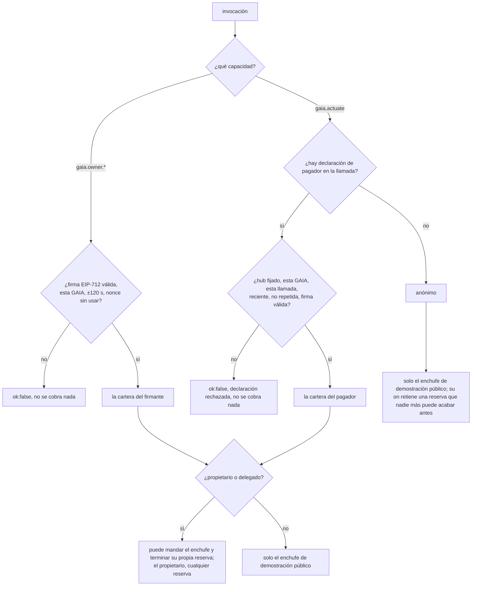
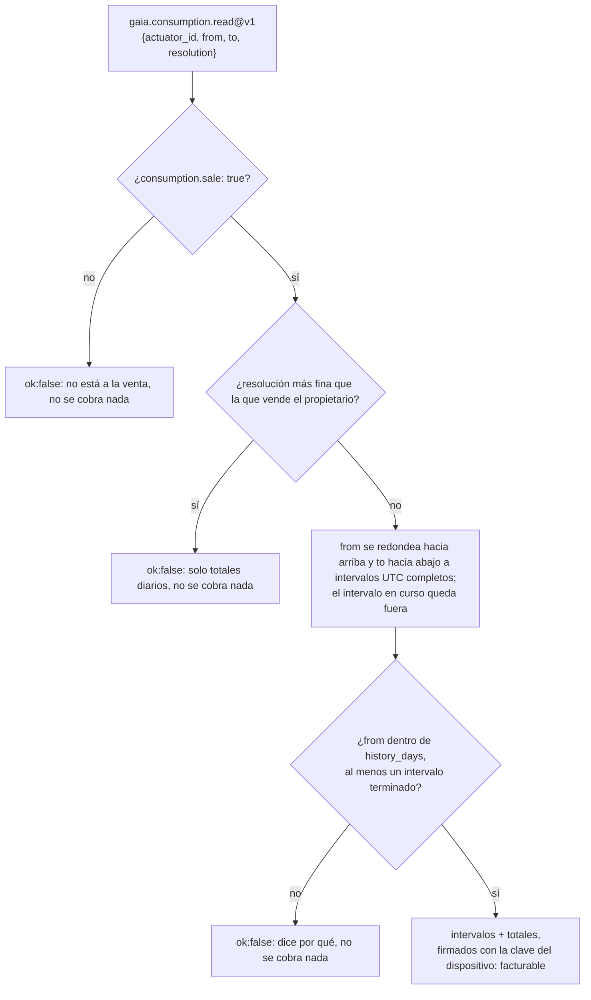

# Control de dispositivos — un enchufe obedece a su propietario; la demostración vende el efecto medido

> 🌐 [English](../ACTUATION.md) · [Русский](ACTUATION.ru.md) · **Español** · [Français](ACTUATION.fr.md) · [中文](ACTUATION.zh.md)

Leer el mundo físico es la mitad de lo que un agente necesita de él. La otra mitad es cambiarlo:
encender un calefactor, una bomba o un cargador de coche eléctrico durante un tiempo. GAIA lo hace
mediante un **enchufe inteligente con medición** (un actuador): el relé que GAIA conmuta y el
medidor que solo ve lo que ese relé conmuta. «Relé encendido» y «la potencia subió» son entonces
el mismo hecho físico. Un medidor de toda la casa no serviría: un hervidor en otra habitación
«probaría» que el calefactor se encendió.

Tres reglas deciden quién puede hacer qué:

1. **Un enchufe real solo obedece a su propietario**: la cartera que el archivo de actuadores del
   operador nombra como `owner`, y los delegados (`delegates`) que el propietario indicó (sus
   propios agentes). El propietario firma cada orden con esa cartera (EIP-712) y no paga nada: sin
   hub, sin cuenta. Nadie puede comprar la conmutación del enchufe de otro, y un pago nunca abre uno.
2. **El enchufe de demostración público es la única excepción.** `plug-sim-01` en
   iot.modelmarket.dev es simulado, así que cualquiera puede conmutarlo con `gaia.actuate@v1`, y
   solo paga cuando el efecto de la orden se ha medido (Pay-on-Verified).
3. **Un desconocido puede comprar, como mucho, las estadísticas de consumo de un enchufe**, y solo
   donde su propietario las puso a la venta, sin más detalle ni más pasado del que eligió. El
   enchufe de demostración vende sus estadísticas por horas, para que esa mitad también se pueda probar.



## Qué se puede controlar

GAIA conmuta un solo tipo de dispositivo: un **enchufe inteligente con medición**. En la
práctica controla lo que esté enchufado a él, y hay exactamente dos órdenes: `on` durante un
número limitado de segundos, y `off`. Sin regulación de intensidad, sin consignas de
temperatura, sin horarios: un horario es simplemente el comprador llamando en el momento que
elija, por ejemplo al inicio de la ventana que encontró `gaia.power.window@v1`.

Quién puede enviar esas órdenes: el propietario y sus delegados en un enchufe real, cualquiera en
el enchufe de demostración simulado; y un `on` es de quien lo envió hasta que termina. Véase
[Quién puede conmutar un enchufe](#quién-puede-conmutar-un-enchufe).

### Qué aparatos sirven

Una orden solo se paga cuando el medidor ve su efecto, así que el aparato tiene que **consumir
una carga estable pocos segundos después de recibir corriente**, y casi nada una vez apagado.

| Detrás del enchufe | ¿Sirve? | Por qué |
|---|---|---|
| Calefactor eléctrico, radiador de aceite, toallero | sí | 0,5–2,5 kW estables en cuanto recibe corriente |
| Termo eléctrico enchufado | mientras calienta | cuando el agua ya está caliente su termostato corta; un `on` entonces no muestra efecto y se rechaza sin coste |
| Cable de carga de coche eléctrico para enchufe doméstico, cargador de bicicleta o patinete eléctrico | sí, dentro de la capacidad del enchufe y del cable | la batería tiene que cargar de verdad: una llena no consume nada y la orden se rechaza |
| Bomba, ventilador, deshumidificador | sí | si su consumo supera el `expect_on_w` del operador |
| Lámpara, luz de cultivo | sí | con un `expect_on_w` bajo, aún muy por encima de `off_max_w` |
| Frigorífico, congelador, cualquier aparato con termostato propio, modo de espera o arranque suave lento | mal | «encendido» puede no consumir nada durante minutos, así que la mayoría de las órdenes se rechazan |
| Cargas trifásicas o de conexión fija, cualquier cosa por encima de 16 A | no | un enchufe: como mucho 230 V × 16 A = 3680 W |
| Cerraduras, válvulas de gas, equipos médicos o de seguridad | **nunca** | nada cuyo encendido o apagado inesperado pueda dañar a alguien cabe en un interruptor de pago |

Un `on` cuyo efecto no se mide **se vuelve a apagar enseguida** y no cuesta nada: un aparato poco
adecuado le hace perder tiempo al comprador, pero nunca dinero.



### Qué enchufes maneja GAIA

| `kind` en el archivo de actuadores | Qué es |
|---|---|
| `tasmota-mqtt` | Un enchufe real con el firmware [Tasmota](https://tasmota.github.io/), accesible a través del broker MQTT propio del operador |
| `sim-plug` | Un enchufe y un aparato en software (`load_w` de 1 a 3680 W). La demostración pública `plug-sim-01` en iot.modelmarket.dev es de este tipo; cada respuesta suya lleva `"simulated": true` |

Un enchufe Tasmota sirve cuando:

1. **Tiene un chip de medición de energía.** La página principal de Tasmota muestra Voltage,
   Current y Power, y `Status 8` responde con un bloque `ENERGY`. Un enchufe sin él no puede
   probar nada, así que toda orden se rechazaría.
2. **Su medidor solo ve la toma conmutada.** GAIA conmuta `Power1`. Una regleta que mide varias
   tomas juntas no sirve: otra toma «probaría» la orden.
3. **Está en el broker MQTT del operador** (`mqtt://` o `mqtts://`) con su propio `%topic%`.
   GAIA solo le habla allí, y quien llama nombra un id de actuador, nunca un topic ni un broker.
4. **Está dimensionado para la carga.** Las cargas largas cerca de 16 A calientan los enchufes
   domésticos; respete la capacidad del enchufe y, para cargar un coche eléctrico, la del cable.

Todo enchufe Tasmota tiene `PulseTime`, su propio temporizador de apagado. GAIA lo envía con el
`on`, de modo que el enchufe se apaga solo al terminar el tiempo pagado aunque GAIA, el broker o
la red hayan desaparecido. Ese temporizador admite como mucho 64 800 s, así que un `on` dura como
máximo 18 horas.

Aún no son compatibles: Shelly, Zigbee, Matter, Home Assistant y los enchufes que solo funcionan
en la nube, los enchufes con varios relés por medidor, los reguladores de intensidad, los
termostatos y las válvulas. Cada uno necesita su propio controlador y su propia forma de probar
el efecto.

### Qué decide el operador para cada actuador

| Campo | Significado | Regla (por defecto) |
|---|---|---|
| `expect_on_w` | potencia medida que prueba «encendido» | por debajo del consumo estable del aparato, por encima de lo que el enchufe consume en reposo |
| `off_max_w` | potencia medida que prueba «apagado» | `0 < off_max_w < expect_on_w` (10 W) |
| `min_on_s`, `max_on_s` | cuánto puede durar un `on` | `0 < min ≤ max ≤ 64800` (10 s, 900 s) |
| `cooldown_s` | pausa entre dos órdenes al mismo actuador | `≥ 0` (30 s) |
| `effect_timeout_s` | cuánto espera GAIA a que aparezca el efecto | 1–120 s (20 s) |
| `access` | quién puede darle órdenes: `owner` (el propietario y los delegados) o `public` (cualquiera) | `owner`; `public` solo para `kind: sim-plug` (la demostración) |
| `owner` | la cartera del propietario: sus órdenes pasan siempre, incluso durante la reserva de otro | obligatorio con acceso `owner` |
| `delegates` | carteras de los propios agentes del propietario, que también pueden darle órdenes | una lista; solo con acceso `owner` |
| `consumption.sale` | vender a otros las estadísticas de consumo de este enchufe | `false` |
| `consumption.resolution` | lo más detallado que se vende: `hour` o `day` | `hour` |
| `consumption.history_days` | cuánto hacia atrás se venden | 1–366 (30) |
| `latitude`, `longitude` | opcional: dónde lo muestra ATLAS | — |

Con el control de dispositivos activado, un archivo de actuadores que incumpla estas reglas
detiene GAIA al arrancar, en lugar de poner en marcha un interruptor cuyo «encendido» y
«apagado» podrían parecerse. Un enchufe bien descrito al que no se puede llegar se omite y queda
registrado, y el resto de GAIA sigue funcionando.

## Capacidades

| Capacidad | Precio | Quién | Qué hace |
|---|---|---|---|
| `gaia.actuator.list@v1` | gratis | cualquiera | Los actuadores del operador: órdenes, límites de duración, pausa entre órdenes, política de acceso, si sus estadísticas están a la venta, cuándo termina la reserva en curso, estado del relé, claves fijadas de los dispositivos y si el interruptor de emergencia está activado. Nunca las carteras del propietario ni de los delegados |
| `gaia.owner.command@v1` | gratis | el propietario, un delegado | Encender su propio enchufe (`on`) durante `duration_s` o apagarlo (`off`), firmado con su cartera (EIP-712). El mismo paquete de pruebas que abajo |
| `gaia.owner.consumption@v1` | gratis | el propietario, un delegado | El consumo de su enchufe por horas o por días, cualquier periodo, firmado con la clave del dispositivo |
| `gaia.actuate@v1` | $0.05 | el enchufe de demostración: cualquiera; uno real: su propietario a través de un hub | Encender un actuador (`on`) durante `duration_s` segundos —después se apaga solo— o apagarlo (`off`). El resultado es el paquete de pruebas y, tras un `on`, la reserva |
| `gaia.consumption.read@v1` | $0.01 | cualquiera, donde el propietario vende | Las estadísticas de consumo de un enchufe en horas o días UTC completos y terminados, dentro de los límites del propietario, firmadas con la clave del dispositivo. Solo se anuncia mientras algún enchufe vende |

$0.05 es el precio mínimo de Pay-on-Verified en el hub: el comprador puede retener el pago en
custodia (escrow) hasta que `/v1/verify` de GAIA confirme el efecto. El precio de las estadísticas
lo fija el operador (`GAIA_CONSUMPTION_PRICE_USD`).

## Cómo se liquida una orden pagada



Sin bloque `verify` el efecto sigue decidiendo el cobro: ante un efecto no probado GAIA responde
`ok:false`, y el hub no cobra nada por `ok:false`. El bloque `verify` añade una segunda
comprobación antes de que se mueva el dinero: el hub envía las pruebas al verificador propio de
GAIA, que las vuelve a comprobar con exactitud (abajo); un hub enruta `gaia.actuate@v1` hacia él con
`AIMARKET_VERIFY_ROUTES` en lugar de a su jurado de LLM.

Una ejecución con dinero real en Base mainnet, con todas las transacciones: [Pay-on-Verified por un efecto físico](https://github.com/alexar76/aicom/blob/main/docs/pay-on-verified-device-demo.es.md).

## Controles de seguridad



Quien llama nombra un **id de actuador** — nunca un tema MQTT, un broker ni un dispositivo que el
operador no haya listado. «Encender» siempre está acotado: la duración es obligatoria y el
operador fija su máximo. La `gaia.owner.command@v1` gratuita del propietario pasa los mismos
controles; su control de acceso es la firma del propietario.

## Quién puede conmutar un enchufe

Pagar demuestra el pago, no el permiso. Encontrado el 2026-10-16: cualquiera que llegara a
`gaia.actuate@v1` podía conmutar cualquier enchufe de la lista, y la prueba gratuita de un hub o
una llamada directa ni siquiera necesitaban pagar. Un enchufe en casa de alguien no es una máquina
expendedora, así que el modelo ahora es este:

| | Enchufe real (`tasmota-mqtt`) | Enchufe de demostración (`sim-plug`, `access: public`) |
|---|---|---|
| Conmutarlo | solo el propietario y sus delegados | cualquiera, $0.05, se paga solo el efecto medido |
| Leer sus estadísticas de consumo | el propietario y los delegados, gratis | igual |
| Comprar sus estadísticas de consumo | cualquiera, solo si el propietario puso `consumption.sale: true` | cualquiera (la demostración vende sus estadísticas por horas) |
| Un `on` pagado de un desconocido | rechazado, no se cobra nada | permitido; después retiene el enchufe hasta el apagado automático |

### 1. Acceso: el propietario, o la demostración pública

| `access` | Quién puede darle órdenes | Permitido para |
|---|---|---|
| `owner` (por defecto) | la cartera `owner` y los `delegates` | todo enchufe; la única opción para uno real |
| `public` | cualquiera que llegue a GAIA | solo `kind: sim-plug`, la demostración |

GAIA comprueba el archivo de actuadores al arrancar y se niega a funcionar con uno que incumpla
estas reglas, en lugar de adivinar:

- un enchufe real con `access: public`: «un enchufe real solo obedece a su propietario»;
- `access: owner` sin `owner`;
- `delegates` en un enchufe público;
- las claves del borrador `access: allowlist` y `allow:`; el mensaje indica usar `access: owner`
  con `owner:` y `delegates:`.

Las direcciones son `0x` + 40 hex (EVM, en mayúsculas o minúsculas) o base58 (Solana). Póngalas
entre comillas en el YAML: un `0x…` sin comillas se lee como número, y GAIA rechaza el archivo al
arrancar en lugar de leerlo mal. La firma del propietario (más abajo) es solo EVM; un propietario
con cartera Solana da órdenes a través de un hub.

```yaml
actuators:
  - id: lab-heater-01
    kind: tasmota-mqtt
    topic: tasmota_lab_heater
    expect_on_w: 800
    access: owner
    owner: "0x00000000000000000000000000000000000000a1"     # la cartera del propietario
    delegates:
      - "0x00000000000000000000000000000000000000b2"        # el agente doméstico del propietario
    consumption:
      sale: false                                           # privado salvo que el propietario venda
```

`gaia.actuator.list@v1` y `/actuation/v1/status` dicen qué política tiene un actuador y si sus
estadísticas están a la venta. Nunca enumeran al propietario ni a los delegados: publicar una
dirección ligada a un aparato en casa de alguien le corresponde al operador.

**Los delegados** son los propios agentes del propietario: un agente de domótica, un programador
que enciende el termo a la hora más barata que encontró `gaia.power.window@v1`. Cada uno tiene su
propia cartera y su clave, así que la clave de un delegado se puede revocar (quitándola del
archivo) sin tocar la del propietario. Un delegado conmuta el enchufe y lee sus estadísticas como
el propietario, con una diferencia: el propietario puede terminar cualquier reserva, un delegado
solo la suya.

### 2. El propietario firma: EIP-712, gratis, sin hub

El propietario no paga por conmutar su propio enchufe y no necesita hub ni cuenta. Cada petición
es una **firma EIP-712 (datos tipados)** de la cartera del propietario: lo que produce
`eth_signTypedData_v4` en una cartera de navegador, que muestra los campos al propietario antes
de firmar. Nada va a la cadena y no se gasta gas; el id de la cadena solo nombra el dominio.

| Campo firmado | Valor |
|---|---|
| dominio | `{name: "GAIA", version: "1", chainId: 8453}` |
| `gaia` | la URL pública de esta GAIA, sin barra final (`base_url` en su manifiesto) |
| `actuator` | el id del actuador |
| `action` | `on`, `off` o `consumption` |
| `durationS` | para `on`: los segundos; si no, 0 |
| `fromTs`, `toTs` | para `consumption`: la ventana en segundos unix; si no, 0 |
| `issuedAt` | segundos unix; se acepta a ±120 s del reloj de GAIA |
| `nonce` | 32 bytes aleatorios; cada uno se acepta una vez |

La petición lleva `auth: {signer, issued_at, nonce, signature}`. GAIA reconstruye el documento a
partir de los campos de la propia petición, recupera al firmante, lo compara con `signer` y solo
entonces consume el nonce, en un archivo del directorio de datos que sobrevive a un reinicio. Así,
una firma no se puede repetir, ni llevar a otra GAIA, otro enchufe, otra orden u otra duración, ni
usar pasados dos minutos, y una firma falsificada no puede gastar los nonces del propietario.



**Para personas: la página del propietario.** `https://<gaia>/owner` (en el host de demostración,
[iot.modelmarket.dev/owner](https://iot.modelmarket.dev/owner)) lista los enchufes de esta GAIA,
conecta una cartera de navegador, la cambia a la red Base si hace falta y ofrece *Encender N min*,
*Apagar* y *Últimas 24 h* para cada enchufe. Cada botón pide a la cartera una firma; la página
muestra el efecto medido y la hora del apagado automático, o la tabla por horas. Está en inglés,
ruso, español, francés y chino, la sirve la propia GAIA y no carga scripts de terceros (su política
solo permite sus dos archivos).

**Para agentes: firmar y llamar.**

```python
import secrets, time, requests
from eth_account import Account

GAIA = "https://iot.modelmarket.dev"          # base_url del manifiesto, sin barra final
key = open("owner.key").read().strip()         # clave del propietario o de un delegado; nunca en git
FIELDS = ["gaia:string", "actuator:string", "action:string", "durationS:uint256",
          "fromTs:uint256", "toTs:uint256", "issuedAt:uint256", "nonce:bytes32"]

def owner_auth(actuator, action, duration_s=0, from_ts=0, to_ts=0):
    now, nonce = int(time.time()), "0x" + secrets.token_hex(32)
    doc = {"types": {"EIP712Domain": [{"name": "name", "type": "string"},
                                      {"name": "version", "type": "string"},
                                      {"name": "chainId", "type": "uint256"}],
                     "OwnerRequest": [dict(zip(("name", "type"), f.split(":"))) for f in FIELDS]},
           "primaryType": "OwnerRequest",
           "domain": {"name": "GAIA", "version": "1", "chainId": 8453},
           "message": {"gaia": GAIA, "actuator": actuator, "action": action,
                       "durationS": duration_s, "fromTs": from_ts, "toTs": to_ts,
                       "issuedAt": now, "nonce": nonce}}
    sig = Account.sign_typed_data(key, full_message=doc).signature.hex()
    return {"signer": Account.from_key(key).address, "issued_at": now, "nonce": nonce,
            "signature": "0x" + sig.removeprefix("0x")}

r = requests.post(f"{GAIA}/ai-market/v2/invoke", json={"capability_id": "gaia.owner.command@v1",
    "input": {"actuator_id": "lab-heater-01", "command": "on", "duration_s": 600,
              "auth": owner_auth("lab-heater-01", "on", duration_s=600)}})
print(r.json()["output"]["effect"])
```

El propietario también puede conmutar a través de un hub con `gaia.actuate@v1` y pagar su precio:
el hub avala entonces al pagador ([más abajo](#4-la-identidad-a-quién-cree-gaia)), y el enchufe
obedece porque ese pagador es su propietario. El pago nunca sustituye a la propiedad.

### 3. La reserva: un «on» es de quien lo envió hasta el apagado automático

Un `on` verificado da el actuador a quien lo pidió hasta `auto_off_at`. Hasta entonces solo esa
misma persona que llama, el propietario o el interruptor de emergencia del operador pueden enviar
`off` o un nuevo `on`. A cualquier otro se le rechaza antes de conmutar o registrar nada:
`ok:false`, `busy until <hora>, nothing charged` (ocupado hasta esa hora, no se cobra nada). En un
enchufe real eso ordena las órdenes del propietario y de los delegados (manda el propietario); en
el de demostración protege el minuto pagado de un comprador frente al siguiente.



- La reserva termina con el apagado automático, cuando su titular envía `off`, cuando el
  propietario conmuta el actuador, cuando un `on` resulta no probado (se apaga de inmediato) o
  cuando se activa el interruptor de emergencia (termina todas las reservas).
- El titular puede enviar un nuevo `on`; la reserva dura entonces hasta el nuevo apagado automático.
- La pausa entre órdenes sigue valiendo para todos, también para el titular y el propietario:
  protege el relé.
- Las reservas se escriben en `actuation-leases.json` en el directorio de datos y sobreviven a un
  reinicio de GAIA. GAIA vuelve a armar su OFF de respaldo para cada una, junto al temporizador
  del propio enchufe.
- El estado muestra cuándo termina una reserva (`leased_until`), nunca de quién es.

### 4. La identidad: a quién cree GAIA

GAIA cree dos identidades, y nunca la palabra de quien llama:

1. **Una firma del propietario** (arriba): la cartera que firmó exactamente esta petición,
   recuperada de la firma.
2. **Un pagador que un hub de su confianza avala en esta misma llamada.** El hub sabe quién pagó.
   En un canal de pago, es la dirección recuperada de la firma del pagador al abrir el canal. En
   x402, es el `from` de la autorización, comprobado con su firma. El hub firma esa dirección con
   su clave de federación, junto a las cabeceras de admisión (price gate) de la misma llamada, y
   reutiliza su hub, audiencia, hora y nonce:

| Cabecera | Contenido |
|---|---|
| `X-AIMarket-Hub-Payer` | la dirección de la cartera del pagador |
| `X-AIMarket-Hub-Payer-Rail` | `channel` o `x402` |
| `X-AIMarket-Hub-Payer-Signature` | Ed25519 con la clave del hub sobre `aimarket-hub-payer/v1` + el hub, la audiencia (la URL de invocación de esta GAIA), la capacidad, el hash de la entrada exacta, hora, nonce, pagador y vía de pago |

Los hubs de confianza son los de `ORACLE_TRUSTED_HUBS`, la misma lista que fija el price gate.
Una declaración vale para una llamada, en esta GAIA, dentro de ±120 s, una vez. Un campo de la
entrada, `X-Payment-Channel` (el id de un canal es una referencia, no un secreto) y
`X-AIMarket-Buyer` (una clave opaca para limitar la frecuencia) los puede escribir cualquiera, así
que ninguno identifica a quien llama.



Un anónimo solo puede mandar el enchufe de demostración público y nunca coincide con el titular de
una reserva. Su `on` retiene igualmente una reserva (`holder: null`), así que nadie salvo el
propietario o el interruptor de emergencia puede acabar antes el tiempo de ese comprador, y el
propio comprador tampoco.

**Situación actual.** La firma del propietario funciona solo con GAIA. La declaración de pagador
está integrada en el lado del hub y llega a cada hub con su próxima versión; mientras un hub no la
envíe, los compradores que llegan por él son anónimos: la demostración funciona, un `on` pagado
allí está protegido de todos los demás, y el propietario de un enchufe real usa la firma gratuita.

## Estadísticas de consumo

El medidor de cada enchufe es también un registro de cómo se usó el aparato que hay detrás. GAIA
guarda ese registro para el propietario, y solo lo vende a otros donde el propietario así lo decidió.

**Registro.** En el proceso que sirve las llamadas, un muestreador lee el medidor de cada actuador
cada `GAIA_CONSUMPTION_SAMPLE_S` (60 s) —la misma lectura firmada que llevan las pruebas de una
orden— y la suma a la hora UTC en que cae: la energía (el salto del contador de energía del propio
enchufe, o potencia × tiempo si falta el contador o se reinició), la suma y el pico de la potencia,
y cuánto tiempo estuvo encendido el relé. Un hueco de más de 600 s (GAIA parada, enchufe sin
conexión) es una pausa, no consumo. Las horas se conservan `GAIA_CONSUMPTION_RETENTION_DAYS` (400
días) en el almacén del oráculo: SQLite en el directorio de datos por defecto, Postgres cuando
`ORACLE_DATABASE_URL` lo indica. `GAIA_CONSUMPTION_SAMPLER=0` detiene el muestreador.

**El propietario lee gratis.** `gaia.owner.consumption@v1` con una firma del propietario (`action:
consumption`, la ventana como `fromTs` / `toTs`) responde cualquier periodo, por horas o por días,
de cada enchufe del que la cartera sea propietaria o delegada, esté a la venta o no.

**Los demás compran, solo donde el propietario vende.** Lo deciden tres claves del archivo de
actuadores:

```yaml
    consumption:
      sale: true          # desactivado por defecto
      resolution: day     # lo más detallado que se vende: hour, o solo totales diarios
      history_days: 30    # cuánto hacia atrás, 1–366
```



Una serie vendida contiene **solo intervalos completos y terminados**. Sin esa regla, un «día»
sobre una ventana de una hora sería una lectura horaria, y leer una y otra vez la hora en curso
daría una lectura minuto a minuto: más detalle del que el propietario decidió vender.

Cada intervalo indica `start`, `end`, `energy_wh`, `mean_w`, `peak_w`, `on_minutes` y `samples`;
`totals` los suma. `attestation` es una firma Ed25519 con la clave del dispositivo —la que llevan
sus lecturas, publicada en `gaia.actuator.list@v1` como `device_pubkey`— sobre el JSON canónico de
`{actuator_id, resolution, from, to, buckets}`, para que el comprador pueda mostrar de dónde salen
las cifras. `simulated: true` marca el enchufe de demostración.

```bash
# consumo por horas del enchufe de demostración en el último día ($0.01 a través de un hub)
curl -s -X POST https://iot.modelmarket.dev/ai-market/v2/invoke -H 'Content-Type: application/json' \
  -d '{"capability_id":"gaia.consumption.read@v1",
       "input":{"actuator_id":"plug-sim-01","resolution":"hour"}}'
```

`from` y `to` aceptan segundos unix o ISO 8601 UTC (`2026-10-16T00:00:00Z`); por defecto, las
últimas 24 horas. Como mucho 744 intervalos horarios o 366 diarios por llamada.

**Por qué está desactivado por defecto.** Las horas de un calefactor dicen cuándo hay alguien en
casa; las de un hervidor, cuándo se levanta. Son datos del propietario. `resolution: day` vende la
tendencia sin la rutina diaria, y `history_days` limita cuánto pasado está a la venta. Conmutar no
está nunca a la venta.

## Cómo llamarlo

```bash
# qué se puede conmutar y con qué límites
curl -s -X POST https://iot.modelmarket.dev/ai-market/v2/invoke -H 'Content-Type: application/json' \
  -d '{"capability_id":"gaia.actuator.list@v1","input":{}}'

# encender el calefactor de demostración un minuto
curl -s -X POST https://iot.modelmarket.dev/ai-market/v2/invoke -H 'Content-Type: application/json' \
  -d '{"capability_id":"gaia.actuate@v1",
       "input":{"actuator_id":"plug-sim-01","command":"on","duration_s":60}}'
```

La respuesta (resumida):

```json
{
  "actuation": {
    "record": {"command_id": "act_1f…", "actuator_id": "plug-sim-01", "command": "on",
               "duration_s": 60, "seq": 1792145220000, "issued_at": "2026-10-16T10:07:00Z",
               "nonce": "…", "expect": {"field": "power_w", "op": ">=", "value": 1000, "within_s": 20}},
    "attestation": {"algorithm": "ed25519", "public_key": "…", "value": "…"}
  },
  "before": {"reading": {"values": {"power_w": 0.4, "relay_on": 0.0, "…": "…"}}, "attestation": {"…": "…"}},
  "after":  {"reading": {"values": {"power_w": 1497.2, "relay_on": 1.0, "…": "…"}}, "attestation": {"…": "…"}},
  "effect": {"verified": true, "expected": {"…": "…"}, "observed": 1497.2},
  "simulated": true,
  "auto_off_at": "2026-10-16T10:08:00Z",
  "lease": {"holder": null, "until": "2026-10-16T10:08:00Z"}
}
```

Aquí `holder` es `null` porque una llamada directa no lleva un pagador avalado por un hub. Hasta
las 10:08:00 nadie más puede conmutar este enchufe, y quien llamó tampoco puede acabar antes su
minuto ([más arriba](#quién-puede-conmutar-un-enchufe)). La misma llamada a un enchufe real
responde `ok:false` («solo acepta órdenes de su propietario») y no cobra nada; su propietario usa
`gaia.owner.command@v1`.

Cualquiera puede comprobarlo de nuevo: `POST /v1/verify` con el paquete (la ranura del escrow),
o invocar `gaia.verify@v1` con él. Las pruebas de las órdenes recientes, también de las
rechazadas, son públicas en `GET /actuation/v1/evidence/<command_id>`; `GET /actuation/v1/status`
muestra todos los actuadores.

## Qué comprueba el veredicto

Todas las comprobaciones son duras: un solo hecho falso y no se debe nada.

| Comprobación | Significado |
|---|---|
| `command_signature` | el registro de la orden está firmado con la clave **fijada** del enchufe (del registro de la flota, nunca la que trae el paquete) |
| `before_device`, `after_device` | ambas lecturas vienen del mismo actuador |
| `before_signature`, `after_signature` | ambas lecturas se verifican con la clave fijada |
| `order` | antes → orden → después, por número de secuencia y por tiempo |
| `window` | el efecto se leyó dentro de la ventana prometida |
| `effect` | la condición esperada se cumple en la lectura posterior (`power_w >= expect_on_w` para encender, `<= off_max_w` para apagar) |
| `relay_state` | el enchufe informa el estado del relé que pidió la orden |
| `after_plausible` | la lectura posterior pasa los controles físicos de GAIA |

Cada orden se liquida una sola vez: su `seq` (milisegundos de reloj, siempre creciente) es la
marca máxima del verificador del escrow, así que un paquete repetido se rechaza.

La plausibilidad conoce los enchufes: `relay_on` es un campo; un relé abierto que mide más de
25 W es una contradicción; y el contador de energía se compara con lo que un enchufe de 16 A
pudo dejar pasar desde la última lectura, no con potencia actual por tiempo: un enchufe
conmutado entre dos lecturas es honesto.

## Operadores

La demostración pública funciona con un enchufe **simulado** (`plug-sim-01`, un calefactor de
1500 W) desde [`config/actuators.yaml`](../../config/actuators.yaml). Para hardware real:

1. Un enchufe Tasmota **con chip de energía**, en su broker MQTT, que responda a `Status 8`.
2. Su archivo de actuadores, a partir de [`config/actuators.example.yaml`](../../config/actuators.example.yaml):
   ```yaml
   actuators:
     - id: lab-heater-01
       kind: tasmota-mqtt
       topic: tasmota_lab_heater   # el %topic% del enchufe
       expect_on_w: 800            # por debajo del consumo del calefactor, por encima del reposo del enchufe
       off_max_w: 5
       min_on_s: 30
       max_on_s: 1800
       cooldown_s: 60
       effect_timeout_s: 20
       access: owner               # la única opción para un enchufe real
       owner: "0x…"                # la cartera del propietario, entre comillas
       delegates: ["0x…"]          # opcional: los propios agentes del propietario
       consumption:
         sale: false               # true vende las estadísticas (gaia.consumption.read@v1)
         resolution: hour          # o day
         history_days: 30
   ```
3. Entorno:
   ```bash
   GAIA_ACTUATION_ENABLED=1
   GAIA_ACTUATORS_FILE=/path/to/actuators.yaml
   GAIA_MQTT_BROKER=mqtts://broker.example:8883
   GAIA_MQTT_USERNAME=gaia            # la contraseña, de su almacén de secretos, nunca en un archivo de git
   GAIA_ACTUATION_TOKEN=…             # token Bearer para la API del interruptor de emergencia
   ORACLE_TRUSTED_HUBS=https://<hub>=<su signer_public_key>   # qué declaraciones de pagador cuentan
   GAIA_CONSUMPTION_PRICE_USD=0.01    # precio de las estadísticas; GAIA_CONSUMPTION_SAMPLE_S=60
   ORACLE_CALLS=1                     # el registro de llamadas (activado en nuestras imágenes); véase «Estadísticas de llamadas»
   ORACLE_OPS_TOKEN=…                 # token Bearer para /ops/v1/*, desde un archivo 0600
   ORACLE_DATABASE_URL=postgresql://… # opcional: Postgres en lugar de SQLite en /data
   ```
   La página del propietario es `/owner` en la propia GAIA; detrás de nginx necesita un
   `location /owner` hacia el backend, como en `deploy/nginx/iot.modelmarket.dev.conf`.
4. **El hub que la vende con Pay-on-Verified** enruta la capacidad al verificador de esta GAIA, para
   que el dinero lo decida una comprobación exacta y no un jurado de LLM:
   ```
   # GAIA: en producción /v1/verify rechaza a todos hasta que esto esté definido
   GAIA_VERIFY_TOKEN=…                # un secreto aleatorio, desde un archivo 0600
   # archivo de entorno del hub (una línea, sin comillas: --env-file toma los valores literalmente)
   AIMARKET_VERIFY_ROUTES={"gaia.actuate@v1": {"url": "https://<gaia>", "verifier_id": "gaia.verify@v1", "key_env": "AIMARKET_VERIFY_GAIA_TOKEN"}}
   AIMARKET_VERIFY_GAIA_TOKEN=…       # el mismo valor que GAIA_VERIFY_TOKEN
   ```
   Sin el token en el hub, el hub rechaza el bloque `verify` antes de conmutar nada; con uno
   incorrecto, GAIA responde 401 y se reembolsa al comprador. Véanse
   [las rutas de verificador del hub](https://github.com/alexar76/aimarket-hub/blob/main/docs/pay-on-verified.md#verifier-routes).

El encendido se envía como `Backlog PulseTime1 <duración>; Power1 ON`, así que **el enchufe se
apaga solo** al terminar la duración pagada aunque GAIA, el broker o la red desaparezcan. GAIA
además envía su propio OFF al vencer el plazo, como segundo freno.

### Interruptor de emergencia

Tres vías, basta cualquiera; mientras está activado toda orden se rechaza y no se cobra nada.
Activarlo también termina todas las reservas:

```bash
curl -X POST https://<gaia>/actuation/v1/kill   -H "Authorization: Bearer $GAIA_ACTUATION_TOKEN"   # además apaga todo
curl -X POST https://<gaia>/actuation/v1/resume -H "Authorization: Bearer $GAIA_ACTUATION_TOKEN"
touch <directorio de datos>/ACTUATION_KILL   # un archivo, para cuando la API no responde
GAIA_ACTUATION_KILL=1                        # una variable de entorno, para un reinicio
```

Sin `GAIA_ACTUATION_TOKEN` la API del interruptor responde 503: nunca se abre sin autenticación.
Cada orden (con quien llama, si GAIA lo comprobó, o sin él), resultado, reserva, fin de reserva,
parada y reanudación se añade a `actuation.jsonl` en el directorio de datos.

### Estadísticas de llamadas

Cada invocación que responde GAIA —una conmutación pagada, una orden firmada del propietario, un
desconocido rechazado, una venta de estadísticas, un `402`— es una fila del registro de llamadas
de [oracle-core](https://github.com/alexar76/oracles/blob/main/core/docs/CALL-LOG.es.md): la
capacidad, el resultado, el estado HTTP, un motivo breve, quién avaló la llamada (un hub, un
llamante designado por el operador o nadie), el precio de una llamada de pago servida, la latencia,
el objeto (`actuator_id`), un hash con sal de la dirección del cliente y el SHA-256 de la entrada.
Nunca la entrada misma ni una dirección IP, así que la firma de un propietario no acaba en un registro.

```bash
# en el host de GAIA (el proxy inverso no expone /ops/)
curl -s -H "Authorization: Bearer $ORACLE_OPS_TOKEN" 'http://127.0.0.1:9320/ops/v1/stats?since=2026-10-16T00:00:00Z'
curl -s -H "Authorization: Bearer $ORACLE_OPS_TOKEN" 'http://127.0.0.1:9320/ops/v1/calls?capability=gaia.actuate@v1&outcome=failed'
curl -s -H "Authorization: Bearer $ORACLE_OPS_TOKEN" http://127.0.0.1:9320/ops/v1/metrics   # Prometheus
```

## Límites honestos

- Un enchufe Tasmota no tiene elemento seguro. La clave de GAIA firma **lo que informó el
  enchufe** — custodia del informe, como en todo relé de GAIA, no prueba de que el hardware no
  pueda mentir. Que medidor y relé sean un solo dispositivo es lo que mantiene la afirmación acotada.
- El efecto prueba que pasó potencia por el enchufe, no qué hizo el aparato con ella.
- El enchufe de la demostración pública es simulado (`SIM`): su calefactor solo existe en software, y cada respuesta lo indica (`"simulated": true`).
- El enchufe de demostración público lo retiene el primer `on` verificado, durante `max_on_s` como
  mucho. Un comprador que pague una y otra vez, o la prueba gratuita de un hub, pueden ocuparlo por
  turnos; por eso solo un enchufe simulado puede ser público.
- La propiedad es lo que dice el archivo del operador. GAIA no comprueba de quién es el hardware;
  el operador que instala un enchufe para alguien escribe su cartera.
- La clave filtrada de un delegado se revoca quitándola del archivo de actuadores (y reiniciando);
  GAIA no lo hace por sí misma.
- Las estadísticas vendidas son lo que informó el medidor del enchufe, guardadas por GAIA y
  firmadas con la clave del enchufe: procedencia, no una lectura de contador certificada para facturar.
- En un hub de confianza se confía también para saber quién pagó. Un hub que mienta sobre el
  pagador, o una clave de hub filtrada, puede nombrar cualquier cartera. Una cartera es quien
  tiene su clave, no una persona.
- Con la ruta, GAIA es a la vez vendedor y juez de `gaia.actuate@v1`. Es aceptable solo porque el
  veredicto es una comprobación determinista de pruebas firmadas que cualquiera puede repetir
  (`POST /v1/verify`, o `gaia.verify@v1` con el paquete), y porque un comprador puede apelar un
  aprobado ante el tribunal de apelación del hub —otro verificador— cuando el hub tiene uno. Ningún
  verificador, ni GAIA ni un LLM, detecta pruebas falsificadas por quien tenga la clave del enchufe.

W3C WoT: la Thing Description de cada enchufe (`GET /wot/<id>`) incluye las **acciones**
`switchOn` / `switchOff`, cuyos formularios son invocaciones pagadas de `gaia.actuate@v1`.
