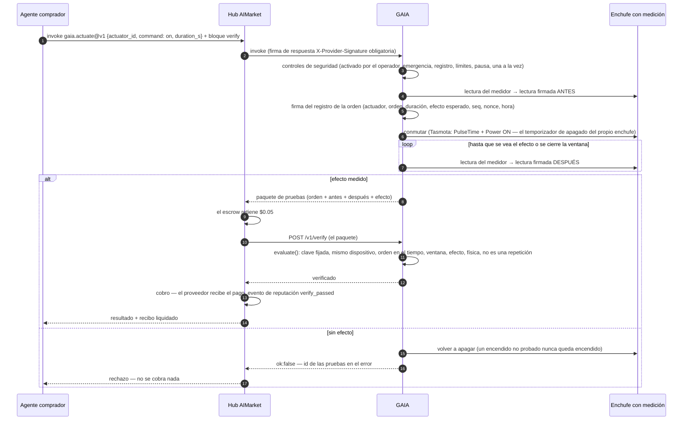
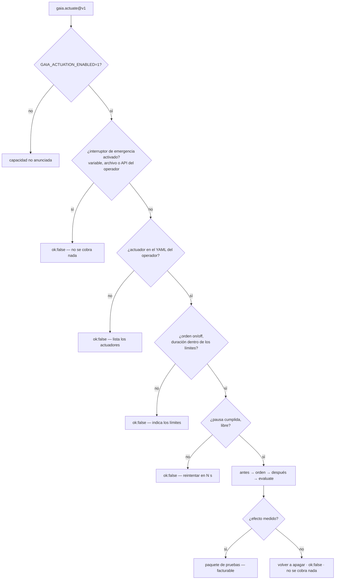

# Control de dispositivos — se paga solo el efecto medido

> 🌐 [English](../ACTUATION.md) · [Русский](ACTUATION.ru.md) · **Español** · [Français](ACTUATION.fr.md) · [中文](ACTUATION.zh.md)

Leer el mundo físico es la mitad de lo que un agente necesita de él. La otra mitad es cambiarlo:
encender un calefactor, una bomba o un cargador de coche eléctrico durante un tiempo. GAIA lo
vende como `gaia.actuate@v1`, con una regla que hace seguro comprárselo a un desconocido:

**el precio de una orden solo se debe cuando su efecto se ha medido.**

Un actuador es un **enchufe inteligente con medición**: el relé que GAIA conmuta y el medidor que
solo ve lo que ese relé conmuta. «Relé encendido» y «la potencia subió» son entonces el mismo
hecho físico. Un medidor de toda la casa no serviría: un hervidor en otra habitación «probaría»
que el calefactor se encendió.

## Capacidades

| Capacidad | Precio | Qué hace |
|---|---|---|
| `gaia.actuator.list@v1` | gratis | Los actuadores del operador: órdenes, límites de duración, pausa entre órdenes, estado del relé, claves fijadas de los dispositivos y si el interruptor de emergencia está activado |
| `gaia.actuate@v1` | $0.05 | Encender un actuador (`on`) durante `duration_s` segundos —después se apaga solo— o apagarlo (`off`). El resultado es el paquete de pruebas |

$0.05 es el precio mínimo de Pay-on-Verified en el hub: el comprador puede retener el pago en
custodia (escrow) hasta que `/v1/verify` de GAIA confirme el efecto.

## Cómo se liquida una orden pagada



Sin bloque `verify` el efecto sigue decidiendo el cobro: ante un efecto no probado GAIA responde
`ok:false`, y el hub no cobra nada por `ok:false`. El bloque `verify` añade una comprobación
**independiente** de las pruebas antes de que se mueva el dinero.

## Controles de seguridad



Quien llama nombra un **id de actuador** — nunca un tema MQTT, un broker ni un dispositivo que el
operador no haya listado. «Encender» siempre está acotado: la duración es obligatoria y el
operador fija su máximo.

## Cómo llamarlo

```bash
# qué se puede conmutar y con qué límites
curl -s -X POST https://iot.modelmarket.dev/ai-market/v2/invoke -H 'Content-Type: application/json' \
  -d '{"capability_id":"gaia.actuator.list@v1","input":{}}'

# encender el calefactor de demostración un minuto
curl -s -X POST https://iot.modelmarket.dev/ai-market/v2/invoke -H 'Content-Type: application/json' \
  -d '{"capability_id":"gaia.actuate@v1",
       "input":{"actuator_id":"plug-sim-01","command":"on","duration_s":60}}'
```

La respuesta (resumida):

```json
{
  "actuation": {
    "record": {"command_id": "act_1f…", "actuator_id": "plug-sim-01", "command": "on",
               "duration_s": 60, "seq": 1792145220000, "issued_at": "2026-10-16T10:07:00Z",
               "nonce": "…", "expect": {"field": "power_w", "op": ">=", "value": 1000, "within_s": 20}},
    "attestation": {"algorithm": "ed25519", "public_key": "…", "value": "…"}
  },
  "before": {"reading": {"values": {"power_w": 0.4, "relay_on": 0.0, "…": "…"}}, "attestation": {"…": "…"}},
  "after":  {"reading": {"values": {"power_w": 1497.2, "relay_on": 1.0, "…": "…"}}, "attestation": {"…": "…"}},
  "effect": {"verified": true, "expected": {"…": "…"}, "observed": 1497.2},
  "simulated": true,
  "auto_off_at": "2026-10-16T10:08:00Z"
}
```

Cualquiera puede comprobarlo de nuevo: `POST /v1/verify` con el paquete (la ranura del escrow),
o invocar `gaia.verify@v1` con él. Las pruebas de las órdenes recientes, también de las
rechazadas, son públicas en `GET /actuation/v1/evidence/<command_id>`; `GET /actuation/v1/status`
muestra todos los actuadores.

## Qué comprueba el veredicto

Todas las comprobaciones son duras: un solo hecho falso y no se debe nada.

| Comprobación | Significado |
|---|---|
| `command_signature` | el registro de la orden está firmado con la clave **fijada** del enchufe (del registro de la flota, nunca la que trae el paquete) |
| `before_device`, `after_device` | ambas lecturas vienen del mismo actuador |
| `before_signature`, `after_signature` | ambas lecturas se verifican con la clave fijada |
| `order` | antes → orden → después, por número de secuencia y por tiempo |
| `window` | el efecto se leyó dentro de la ventana prometida |
| `effect` | la condición esperada se cumple en la lectura posterior (`power_w >= expect_on_w` para encender, `<= off_max_w` para apagar) |
| `relay_state` | el enchufe informa el estado del relé que pidió la orden |
| `after_plausible` | la lectura posterior pasa los controles físicos de GAIA |

Cada orden se liquida una sola vez: su `seq` (milisegundos de reloj, siempre creciente) es la
marca máxima del verificador del escrow, así que un paquete repetido se rechaza.

La plausibilidad conoce los enchufes: `relay_on` es un campo; un relé abierto que mide más de
25 W es una contradicción; y el contador de energía se compara con lo que un enchufe de 16 A
pudo dejar pasar desde la última lectura, no con potencia actual por tiempo: un enchufe
conmutado entre dos lecturas es honesto.

## Operadores

La demostración pública funciona con un enchufe **simulado** (`plug-sim-01`, un calefactor de
1500 W) desde [`config/actuators.yaml`](../../config/actuators.yaml). Para hardware real:

1. Un enchufe Tasmota **con chip de energía**, en su broker MQTT, que responda a `Status 8`.
2. Su archivo de actuadores, a partir de [`config/actuators.example.yaml`](../../config/actuators.example.yaml):
   ```yaml
   actuators:
     - id: lab-heater-01
       kind: tasmota-mqtt
       topic: tasmota_lab_heater   # el %topic% del enchufe
       expect_on_w: 800            # por debajo del consumo del calefactor, por encima del reposo del enchufe
       off_max_w: 5
       min_on_s: 30
       max_on_s: 1800
       cooldown_s: 60
       effect_timeout_s: 20
   ```
3. Entorno:
   ```bash
   GAIA_ACTUATION_ENABLED=1
   GAIA_ACTUATORS_FILE=/path/to/actuators.yaml
   GAIA_MQTT_BROKER=mqtts://broker.example:8883
   GAIA_MQTT_USERNAME=gaia            # la contraseña, de su almacén de secretos, nunca en un archivo de git
   GAIA_ACTUATION_TOKEN=…             # token Bearer para la API del interruptor de emergencia
   ```

El encendido se envía como `Backlog PulseTime1 <duración>; Power1 ON`, así que **el enchufe se
apaga solo** al terminar la duración pagada aunque GAIA, el broker o la red desaparezcan. GAIA
además envía su propio OFF al vencer el plazo, como segundo freno.

### Interruptor de emergencia

Tres vías, basta cualquiera; mientras está activado toda orden se rechaza y no se cobra nada:

```bash
curl -X POST https://<gaia>/actuation/v1/kill   -H "Authorization: Bearer $GAIA_ACTUATION_TOKEN"   # además apaga todo
curl -X POST https://<gaia>/actuation/v1/resume -H "Authorization: Bearer $GAIA_ACTUATION_TOKEN"
touch <directorio de datos>/ACTUATION_KILL   # un archivo, para cuando la API no responde
GAIA_ACTUATION_KILL=1                        # una variable de entorno, para un reinicio
```

Sin `GAIA_ACTUATION_TOKEN` la API del interruptor responde 503: nunca se abre sin autenticación.
Cada orden, resultado, parada y reanudación se añade a `actuation.jsonl` en el directorio de datos.

## Límites honestos

- Un enchufe Tasmota no tiene elemento seguro. La clave de GAIA firma **lo que informó el
  enchufe** — custodia del informe, como en todo relé de GAIA, no prueba de que el hardware no
  pueda mentir. Que medidor y relé sean un solo dispositivo es lo que mantiene la afirmación acotada.
- El efecto prueba que pasó potencia por el enchufe, no qué hizo el aparato con ella.
- El enchufe de la demostración pública es simulado (`SIM`): su calefactor solo existe en software, y cada respuesta lo indica (`"simulated": true`).

W3C WoT: la Thing Description de cada enchufe (`GET /wot/<id>`) incluye las **acciones**
`switchOn` / `switchOff`, cuyos formularios son invocaciones pagadas de `gaia.actuate@v1`.
