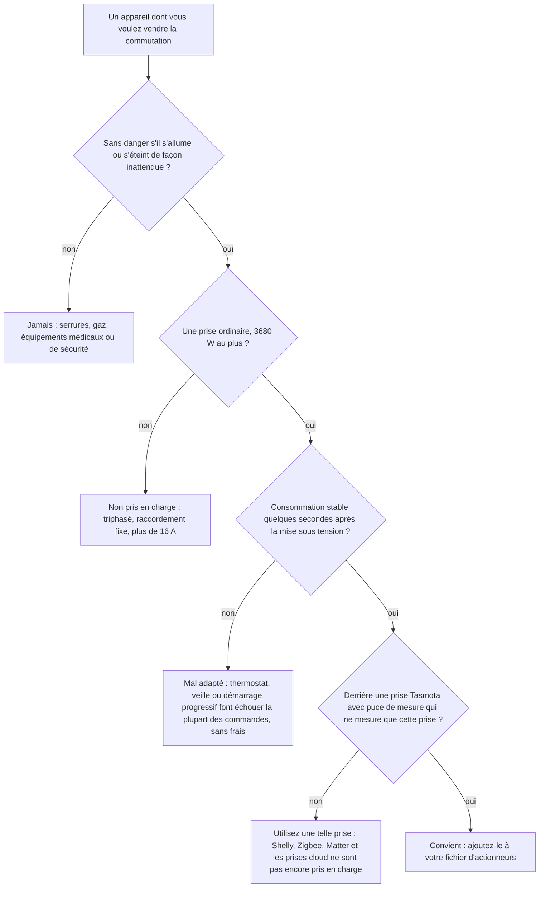
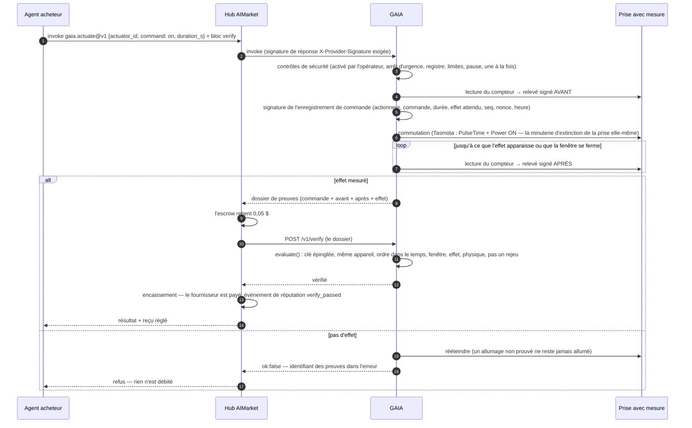
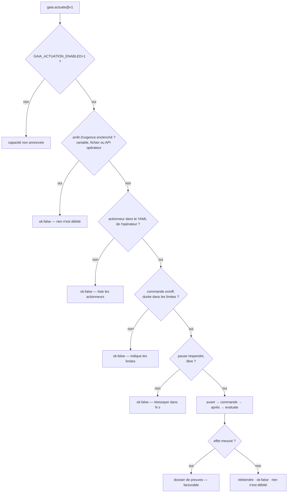

# Pilotage d'appareils — on ne paie que l'effet mesuré

> 🌐 [English](../ACTUATION.md) · [Русский](ACTUATION.ru.md) · [Español](ACTUATION.es.md) · **Français** · [中文](ACTUATION.zh.md)

Lire le monde physique, c'est la moitié de ce qu'un agent en attend. L'autre moitié, c'est le
modifier : allumer un radiateur, une pompe ou une borne de recharge pendant un moment. GAIA le
vend sous le nom `gaia.actuate@v1`, avec une règle qui rend l'achat sûr auprès d'un inconnu :

**le prix d'une commande n'est dû que lorsque son effet est mesuré.**

Un actionneur est une **prise connectée avec mesure** : le relais que GAIA commute et le
compteur qui ne voit que ce que ce relais commute. « Relais fermé » et « la puissance a monté »
sont alors le même fait physique. Un compteur de toute la maison ne conviendrait pas : une
bouilloire dans une autre pièce « prouverait » que le radiateur s'est allumé.

## Ce que l'on peut commander

GAIA commute un seul type d'appareil : une **prise connectée avec mesure**. En pratique, il
commande ce qui est branché sur cette prise, et il n'existe que deux commandes : `on` pendant un
nombre de secondes borné, et `off`. Pas de variation, pas de consigne de température, pas de
planning : un planning, c'est simplement l'acheteur qui appelle au moment qu'il choisit, par
exemple au début de la fenêtre trouvée par `gaia.power.window@v1`.

### Quels appareils conviennent

Une commande n'est payée que lorsque le compteur voit son effet ; l'appareil doit donc
**consommer une charge stable quelques secondes après sa mise sous tension**, et presque rien
une fois éteint.

| Derrière la prise | Convient ? | Pourquoi |
|---|---|---|
| Radiateur électrique, radiateur à bain d'huile, sèche-serviettes | oui | 0,5 à 2,5 kW stables dès la mise sous tension |
| Chauffe-eau sur prise | tant qu'il chauffe | une fois l'eau chaude, son thermostat coupe ; un `on` ne montre alors aucun effet et il est refusé, sans frais |
| Câble de recharge de voiture électrique sur prise domestique, chargeur de vélo ou de trottinette électrique | oui, dans la limite de la prise et du câble | la batterie doit vraiment charger : pleine, elle ne consomme rien et la commande est refusée |
| Pompe, ventilateur, déshumidificateur | oui | si sa consommation dépasse le `expect_on_w` de l'opérateur |
| Lampe, lampe de culture | oui | avec un `expect_on_w` bas, toujours nettement au-dessus de `off_max_w` |
| Réfrigérateur, congélateur, tout appareil avec son propre thermostat, une veille ou un démarrage progressif lent | mal | « allumé » peut ne rien consommer pendant des minutes, donc la plupart des commandes sont refusées |
| Charges triphasées ou raccordées en fixe, tout ce qui dépasse 16 A | non | une prise : 230 V × 16 A = 3680 W au plus |
| Serrures, vannes de gaz, équipements médicaux ou de sécurité | **jamais** | rien dont l'allumage ou l'arrêt inattendu pourrait blesser quelqu'un n'a sa place sur un interrupteur payant |

Un `on` dont l'effet n'est pas mesuré est **aussitôt éteint** et ne coûte rien : un appareil
mal adapté fait perdre du temps à l'acheteur, jamais son argent.



### Quelles prises GAIA pilote

| `kind` dans le fichier d'actionneurs | Ce que c'est |
|---|---|
| `tasmota-mqtt` | Une vraie prise sous firmware [Tasmota](https://tasmota.github.io/), joignable par le broker MQTT de l'opérateur |
| `sim-plug` | Une prise et un appareil en logiciel (`load_w` de 1 à 3680 W). La démonstration publique `plug-sim-01` sur iot.modelmarket.dev en est une ; chacune de ses réponses porte `"simulated": true` |

Une prise Tasmota convient quand :

1. **Elle a une puce de mesure d'énergie.** La page principale de Tasmota affiche Voltage,
   Current et Power, et `Status 8` répond avec un bloc `ENERGY`. Une prise qui n'en a pas ne
   peut rien prouver, et toute commande serait refusée.
2. **Son compteur ne voit que la prise commutée.** GAIA commute `Power1`. Une multiprise qui
   mesure plusieurs prises ensemble ne convient pas : une autre prise « prouverait » la commande.
3. **Elle est sur le broker MQTT de l'opérateur** (`mqtt://` ou `mqtts://`) avec son propre
   `%topic%`. GAIA ne lui parle que là, et l'appelant nomme un id d'actionneur, jamais un topic
   ni un broker.
4. **Elle est dimensionnée pour la charge.** Les charges longues proches de 16 A font chauffer
   les prises domestiques ; respectez le calibre de la prise et, pour recharger une voiture,
   celui du câble.

Toute prise Tasmota a `PulseTime`, sa propre minuterie d'arrêt. GAIA l'envoie avec le `on`, si
bien que la prise s'éteint d'elle-même à la fin de la durée payée, même si GAIA, le broker ou le
réseau ont disparu. Cette minuterie tient au plus 64 800 s : un `on` dure donc au plus 18 heures.

Pas encore pris en charge : Shelly, Zigbee, Matter, Home Assistant et les prises uniquement
cloud, les prises à plusieurs relais par compteur, les variateurs, les thermostats et les vannes.
Chacun demande son propre pilote et sa propre façon de prouver l'effet.

### Ce que l'opérateur fixe pour chaque actionneur

| Champ | Sens | Règle (par défaut) |
|---|---|---|
| `expect_on_w` | puissance mesurée qui prouve « allumé » | sous la consommation stable de l'appareil, au-dessus de ce que la prise consomme au repos |
| `off_max_w` | puissance mesurée qui prouve « éteint » | `0 < off_max_w < expect_on_w` (10 W) |
| `min_on_s`, `max_on_s` | durée possible d'un `on` | `0 < min ≤ max ≤ 64800` (10 s, 900 s) |
| `cooldown_s` | pause entre deux commandes au même actionneur | `≥ 0` (30 s) |
| `effect_timeout_s` | combien de temps GAIA attend l'effet | 1 à 120 s (20 s) |
| `latitude`, `longitude` | facultatif : où ATLAS l'affiche | — |

Quand la commande des appareils est activée, un fichier d'actionneurs qui enfreint ces règles
arrête GAIA au démarrage, plutôt que de faire tourner un interrupteur dont « allumé » et
« éteint » pourraient se ressembler. Une prise bien décrite mais injoignable est ignorée et
journalisée, et le reste de GAIA fonctionne.

## Capacités

| Capacité | Prix | Ce qu'elle fait |
|---|---|---|
| `gaia.actuator.list@v1` | gratuit | Les actionneurs de l'opérateur : commandes, limites de durée, pause entre commandes, état du relais, clés épinglées des appareils, et si l'arrêt d'urgence est enclenché |
| `gaia.actuate@v1` | 0,05 $ | Allumer un actionneur (`on`) pendant `duration_s` secondes — il s'éteint ensuite tout seul — ou l'éteindre (`off`). Le résultat est le dossier de preuves |

0,05 $ est le prix plancher du Pay-on-Verified du hub : l'acheteur peut garder le paiement en
séquestre (escrow) jusqu'à ce que `/v1/verify` de GAIA confirme l'effet.

## Comment une commande payée se règle



Sans bloc `verify`, l'effet décide toujours du paiement : pour un effet non prouvé GAIA répond
`ok:false`, et le hub ne débite rien pour un `ok:false`. Le bloc `verify` ajoute une
seconde vérification avant que l'argent ne bouge : le hub envoie les preuves au vérificateur
propre de GAIA, qui les revérifie exactement (ci-dessous) ; un hub y achemine `gaia.actuate@v1` avec
`AIMARKET_VERIFY_ROUTES` plutôt qu'à son jury de LLM.

## Contrôles de sécurité



L'appelant nomme un **identifiant d'actionneur** — jamais un topic MQTT, un broker ni un appareil
que l'opérateur n'a pas listé. « Allumer » est toujours borné : la durée est obligatoire et
l'opérateur en fixe le maximum.

## L'appeler

```bash
# ce qu'on peut commuter, et les limites
curl -s -X POST https://iot.modelmarket.dev/ai-market/v2/invoke -H 'Content-Type: application/json' \
  -d '{"capability_id":"gaia.actuator.list@v1","input":{}}'

# allumer le radiateur de démonstration une minute
curl -s -X POST https://iot.modelmarket.dev/ai-market/v2/invoke -H 'Content-Type: application/json' \
  -d '{"capability_id":"gaia.actuate@v1",
       "input":{"actuator_id":"plug-sim-01","command":"on","duration_s":60}}'
```

La réponse (abrégée) :

```json
{
  "actuation": {
    "record": {"command_id": "act_1f…", "actuator_id": "plug-sim-01", "command": "on",
               "duration_s": 60, "seq": 1792145220000, "issued_at": "2026-10-16T10:07:00Z",
               "nonce": "…", "expect": {"field": "power_w", "op": ">=", "value": 1000, "within_s": 20}},
    "attestation": {"algorithm": "ed25519", "public_key": "…", "value": "…"}
  },
  "before": {"reading": {"values": {"power_w": 0.4, "relay_on": 0.0, "…": "…"}}, "attestation": {"…": "…"}},
  "after":  {"reading": {"values": {"power_w": 1497.2, "relay_on": 1.0, "…": "…"}}, "attestation": {"…": "…"}},
  "effect": {"verified": true, "expected": {"…": "…"}, "observed": 1497.2},
  "simulated": true,
  "auto_off_at": "2026-10-16T10:08:00Z"
}
```

N'importe qui peut le revérifier : `POST /v1/verify` avec le dossier (l'emplacement de
l'escrow), ou invoquer `gaia.verify@v1` avec lui. Les preuves des commandes récentes, refusées
comprises, sont publiques sur `GET /actuation/v1/evidence/<command_id>` ;
`GET /actuation/v1/status` montre tous les actionneurs.

## Ce que vérifie le verdict

Tous les contrôles sont stricts : un seul fait faux et rien n'est dû.

| Contrôle | Sens |
|---|---|
| `command_signature` | l'enregistrement de commande est signé par la clé **épinglée** de la prise (celle du registre de la flotte, jamais celle qu'apporte le dossier) |
| `before_device`, `after_device` | les deux relevés viennent du même actionneur |
| `before_signature`, `after_signature` | les deux relevés se vérifient avec la clé épinglée |
| `order` | avant → commande → après, par numéro de séquence et dans le temps |
| `window` | l'effet a été lu dans la fenêtre promise |
| `effect` | la condition attendue est vraie sur le relevé après (`power_w >= expect_on_w` pour allumer, `<= off_max_w` pour éteindre) |
| `relay_state` | la prise indique l'état du relais demandé par la commande |
| `after_plausible` | le relevé après passe les contrôles physiques de GAIA |

Chaque commande se règle une seule fois : son `seq` (millisecondes d'horloge, toujours
croissantes) est la marque haute du vérificateur de l'escrow, donc un dossier rejoué est refusé.

La plausibilité connaît les prises : `relay_on` est un champ ; un relais ouvert qui mesure plus de
25 W est une contradiction ; et le compteur d'énergie est comparé à ce qu'une prise de 16 A a pu
laisser passer depuis la dernière lecture, pas à la puissance actuelle multipliée par l'intervalle :
une prise commutée entre deux lectures est honnête.

## Opérateurs

La démonstration publique utilise une prise **simulée** (`plug-sim-01`, un radiateur de 1500 W)
définie dans [`config/actuators.yaml`](../../config/actuators.yaml). Pour du vrai matériel :

1. Une prise Tasmota **avec puce de mesure d'énergie**, sur votre broker MQTT, qui répond à `Status 8`.
2. Votre fichier d'actionneurs, à partir de [`config/actuators.example.yaml`](../../config/actuators.example.yaml) :
   ```yaml
   actuators:
     - id: lab-heater-01
       kind: tasmota-mqtt
       topic: tasmota_lab_heater   # le %topic% de la prise
       expect_on_w: 800            # sous la consommation du radiateur, au-dessus du repos de la prise
       off_max_w: 5
       min_on_s: 30
       max_on_s: 1800
       cooldown_s: 60
       effect_timeout_s: 20
   ```
3. Environnement :
   ```bash
   GAIA_ACTUATION_ENABLED=1
   GAIA_ACTUATORS_FILE=/path/to/actuators.yaml
   GAIA_MQTT_BROKER=mqtts://broker.example:8883
   GAIA_MQTT_USERNAME=gaia            # le mot de passe vient de votre coffre à secrets, jamais d'un fichier dans git
   GAIA_ACTUATION_TOKEN=…             # jeton Bearer de l'API d'arrêt d'urgence
   ```
4. **Le hub qui la vend avec Pay-on-Verified** achemine la capacité vers le vérificateur de cette
   GAIA, pour que l'argent soit décidé par une vérification exacte et non par un jury de LLM :
   ```
   # GAIA : en production, /v1/verify refuse tout appelant tant que ceci n'est pas défini
   GAIA_VERIFY_TOKEN=…                # un secret aléatoire, depuis un fichier 0600
   # fichier d'environnement du hub (une ligne, sans guillemets : --env-file prend les valeurs telles quelles)
   AIMARKET_VERIFY_ROUTES={"gaia.actuate@v1": {"url": "https://<gaia>", "verifier_id": "gaia.verify@v1", "key_env": "AIMARKET_VERIFY_GAIA_TOKEN"}}
   AIMARKET_VERIFY_GAIA_TOKEN=…       # la même valeur que GAIA_VERIFY_TOKEN
   ```
   Sans le jeton côté hub, le hub refuse le bloc `verify` avant toute commutation ; avec un jeton
   erroné, GAIA répond 401 et l'acheteur est remboursé. Voir
   [les routes de vérificateur du hub](https://github.com/alexar76/aimarket-hub/blob/main/docs/pay-on-verified.md#verifier-routes).

L'allumage est envoyé sous la forme `Backlog PulseTime1 <durée>; Power1 ON`, donc **la prise
s'éteint d'elle-même** au bout de la durée payée, même si GAIA, le broker ou le réseau
disparaissent. GAIA envoie aussi son propre OFF à l'échéance, comme second arrêt.

### Arrêt d'urgence

Trois moyens, un seul suffit ; tant qu'il est enclenché, toute commande est refusée et rien n'est
débité :

```bash
curl -X POST https://<gaia>/actuation/v1/kill   -H "Authorization: Bearer $GAIA_ACTUATION_TOKEN"   # éteint aussi tout
curl -X POST https://<gaia>/actuation/v1/resume -H "Authorization: Bearer $GAIA_ACTUATION_TOKEN"
touch <répertoire de données>/ACTUATION_KILL   # un fichier, quand l'API est injoignable
GAIA_ACTUATION_KILL=1                          # une variable d'environnement, pour un redémarrage
```

Sans `GAIA_ACTUATION_TOKEN`, l'API d'arrêt d'urgence répond 503 : elle ne s'ouvre jamais sans
authentification. Chaque commande, résultat, arrêt et reprise est ajouté à `actuation.jsonl` dans
le répertoire de données.

## Limites honnêtes

- Une prise Tasmota n'a pas d'élément sécurisé. La clé de GAIA signe **ce que la prise a
  rapporté** — la garde du rapport, comme pour tout relais de GAIA, pas une preuve que le matériel
  ne peut pas mentir. C'est parce que compteur et relais forment un seul appareil que
  l'affirmation reste étroite.
- L'effet prouve que de la puissance a traversé la prise, pas ce que l'appareil en a fait.
- La prise de la démonstration publique est simulée (`SIM`) : son radiateur n'existe qu'en logiciel, et chaque réponse le dit (`"simulated": true`).
- Avec la route, GAIA est à la fois vendeur et juge de `gaia.actuate@v1`. Ce n'est acceptable que
  parce que le verdict est une vérification déterministe de preuves signées que chacun peut rejouer
  (`POST /v1/verify`, ou `gaia.verify@v1` avec le lot), et parce qu'un acheteur peut faire appel d'un
  succès devant la cour d'appel du hub — un autre vérificateur — quand le hub en a une. Aucun
  vérificateur, ni GAIA ni un LLM, ne détecte des preuves forgées par qui détient la clé de la prise.

W3C WoT : la Thing Description de chaque prise (`GET /wot/<id>`) porte les **actions**
`switchOn` / `switchOff`, dont les formulaires sont des invocations payantes de `gaia.actuate@v1`.
