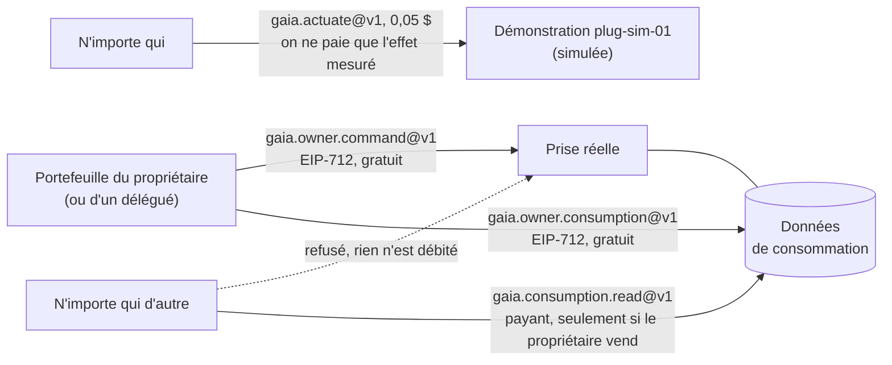
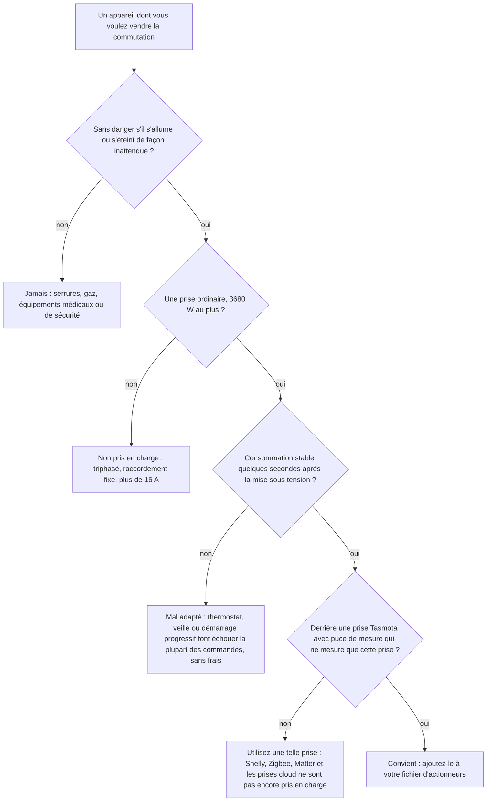
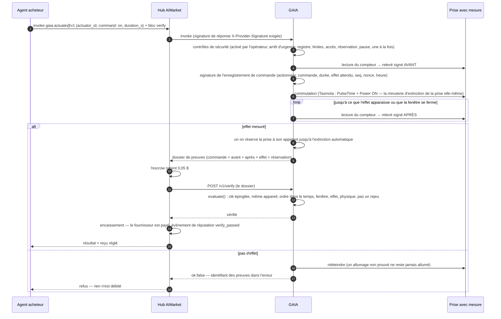
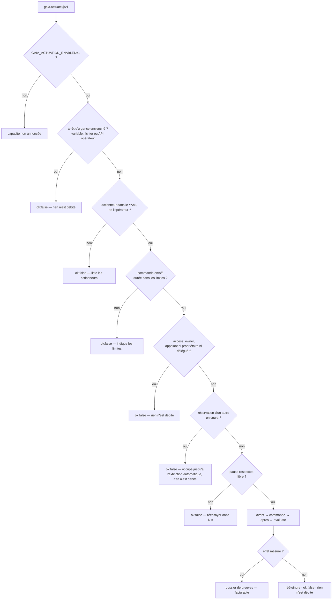
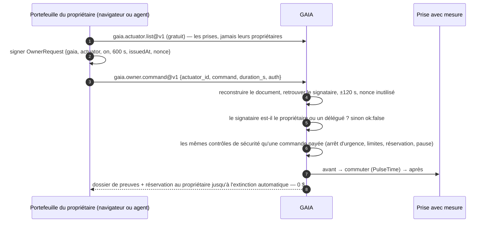
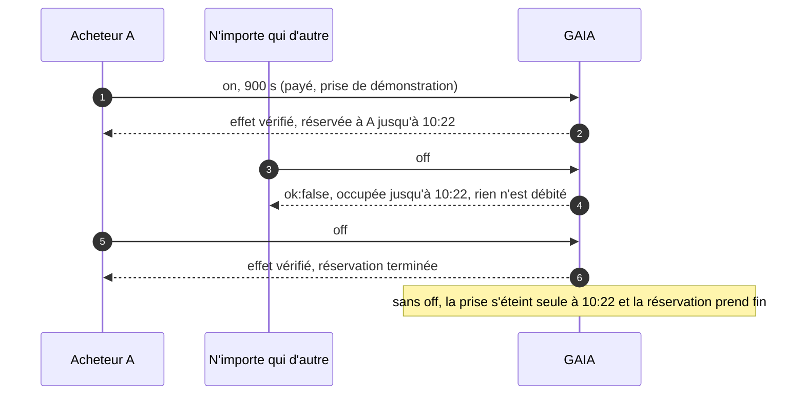
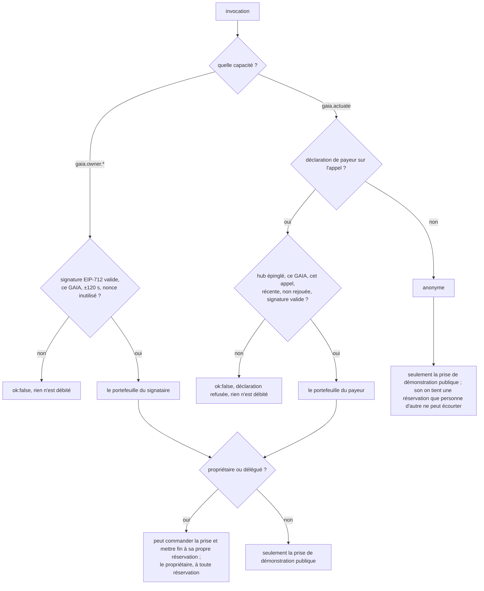
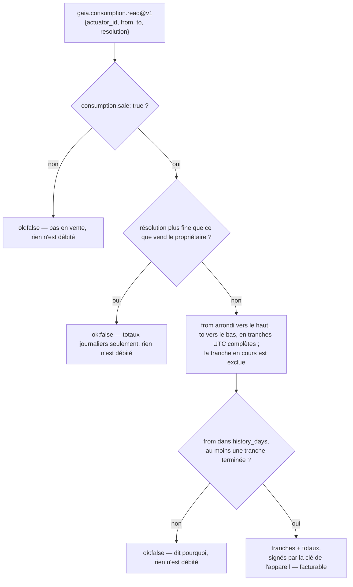

# Pilotage d'appareils — une prise obéit à son propriétaire ; la démonstration vend l'effet mesuré

> 🌐 [English](../ACTUATION.md) · [Русский](ACTUATION.ru.md) · [Español](ACTUATION.es.md) · **Français** · [中文](ACTUATION.zh.md)

Lire le monde physique, c'est la moitié de ce qu'un agent en attend. L'autre moitié, c'est le
modifier : allumer un radiateur, une pompe ou une borne de recharge pendant un moment. GAIA le fait
au moyen d'une **prise connectée avec mesure** (un actionneur) : le relais que GAIA commute et le
compteur qui ne voit que ce que ce relais commute. « Relais fermé » et « la puissance a monté » sont
alors le même fait physique. Un compteur de toute la maison ne conviendrait pas : une bouilloire
dans une autre pièce « prouverait » que le radiateur s'est allumé.

Trois règles décident qui peut faire quoi :

1. **Une prise réelle n'obéit qu'à son propriétaire** — le portefeuille que le fichier d'actionneurs
   de l'opérateur nomme `owner`, et les délégués (`delegates`) que le propriétaire a listés (ses
   propres agents). Le propriétaire signe chaque commande avec ce portefeuille (EIP-712) et ne paie
   rien : ni hub, ni compte. Personne ne peut acheter la commutation de la prise d'un autre, et un
   paiement n'en ouvre jamais une.
2. **La prise de démonstration publique est la seule exception.** `plug-sim-01` sur
   iot.modelmarket.dev est simulée : n'importe qui peut la commuter via `gaia.actuate@v1`, et ne
   paie que lorsque l'effet de la commande est mesuré (Pay-on-Verified).
3. **Un inconnu peut tout au plus acheter les données de consommation d'une prise**, et seulement
   là où son propriétaire les a mises en vente, sans plus de détail ni plus de passé qu'il ne l'a
   choisi. La prise de démonstration vend ses données horaires, pour que cette moitié aussi puisse
   être essayée.



## Ce que l'on peut commander

GAIA commute un seul type d'appareil : une **prise connectée avec mesure**. En pratique, il
commande ce qui est branché sur cette prise, et il n'existe que deux commandes : `on` pendant un
nombre de secondes borné, et `off`. Pas de variation, pas de consigne de température, pas de
planning : un planning, c'est simplement l'acheteur qui appelle au moment qu'il choisit, par
exemple au début de la fenêtre trouvée par `gaia.power.window@v1`.

Qui peut envoyer ces commandes : le propriétaire et ses délégués pour une prise réelle, n'importe
qui pour la prise de démonstration simulée ; et un `on` appartient à son expéditeur jusqu'à sa fin.
Voir [Qui peut commuter une prise](#qui-peut-commuter-une-prise).

### Quels appareils conviennent

Une commande n'est payée que lorsque le compteur voit son effet ; l'appareil doit donc
**consommer une charge stable quelques secondes après sa mise sous tension**, et presque rien
une fois éteint.

| Derrière la prise | Convient ? | Pourquoi |
|---|---|---|
| Radiateur électrique, radiateur à bain d'huile, sèche-serviettes | oui | 0,5 à 2,5 kW stables dès la mise sous tension |
| Chauffe-eau sur prise | tant qu'il chauffe | une fois l'eau chaude, son thermostat coupe ; un `on` ne montre alors aucun effet et il est refusé, sans frais |
| Câble de recharge de voiture électrique sur prise domestique, chargeur de vélo ou de trottinette électrique | oui, dans la limite de la prise et du câble | la batterie doit vraiment charger : pleine, elle ne consomme rien et la commande est refusée |
| Pompe, ventilateur, déshumidificateur | oui | si sa consommation dépasse le `expect_on_w` de l'opérateur |
| Lampe, lampe de culture | oui | avec un `expect_on_w` bas, toujours nettement au-dessus de `off_max_w` |
| Réfrigérateur, congélateur, tout appareil avec son propre thermostat, une veille ou un démarrage progressif lent | mal | « allumé » peut ne rien consommer pendant des minutes, donc la plupart des commandes sont refusées |
| Charges triphasées ou raccordées en fixe, tout ce qui dépasse 16 A | non | une prise : 230 V × 16 A = 3680 W au plus |
| Serrures, vannes de gaz, équipements médicaux ou de sécurité | **jamais** | rien dont l'allumage ou l'arrêt inattendu pourrait blesser quelqu'un n'a sa place sur un interrupteur payant |

Un `on` dont l'effet n'est pas mesuré est **aussitôt éteint** et ne coûte rien : un appareil
mal adapté fait perdre du temps à l'acheteur, jamais son argent.



### Quelles prises GAIA pilote

| `kind` dans le fichier d'actionneurs | Ce que c'est |
|---|---|
| `tasmota-mqtt` | Une vraie prise sous firmware [Tasmota](https://tasmota.github.io/), joignable par le broker MQTT de l'opérateur |
| `sim-plug` | Une prise et un appareil en logiciel (`load_w` de 1 à 3680 W). La démonstration publique `plug-sim-01` sur iot.modelmarket.dev en est une ; chacune de ses réponses porte `"simulated": true` |

Une prise Tasmota convient quand :

1. **Elle a une puce de mesure d'énergie.** La page principale de Tasmota affiche Voltage,
   Current et Power, et `Status 8` répond avec un bloc `ENERGY`. Une prise qui n'en a pas ne
   peut rien prouver, et toute commande serait refusée.
2. **Son compteur ne voit que la prise commutée.** GAIA commute `Power1`. Une multiprise qui
   mesure plusieurs prises ensemble ne convient pas : une autre prise « prouverait » la commande.
3. **Elle est sur le broker MQTT de l'opérateur** (`mqtt://` ou `mqtts://`) avec son propre
   `%topic%`. GAIA ne lui parle que là, et l'appelant nomme un id d'actionneur, jamais un topic
   ni un broker.
4. **Elle est dimensionnée pour la charge.** Les charges longues proches de 16 A font chauffer
   les prises domestiques ; respectez le calibre de la prise et, pour recharger une voiture,
   celui du câble.

Toute prise Tasmota a `PulseTime`, sa propre minuterie d'arrêt. GAIA l'envoie avec le `on`, si
bien que la prise s'éteint d'elle-même à la fin de la durée payée, même si GAIA, le broker ou le
réseau ont disparu. Cette minuterie tient au plus 64 800 s : un `on` dure donc au plus 18 heures.

Pas encore pris en charge : Shelly, Zigbee, Matter, Home Assistant et les prises uniquement
cloud, les prises à plusieurs relais par compteur, les variateurs, les thermostats et les vannes.
Chacun demande son propre pilote et sa propre façon de prouver l'effet.

### Ce que l'opérateur fixe pour chaque actionneur

| Champ | Sens | Règle (par défaut) |
|---|---|---|
| `expect_on_w` | puissance mesurée qui prouve « allumé » | sous la consommation stable de l'appareil, au-dessus de ce que la prise consomme au repos |
| `off_max_w` | puissance mesurée qui prouve « éteint » | `0 < off_max_w < expect_on_w` (10 W) |
| `min_on_s`, `max_on_s` | durée possible d'un `on` | `0 < min ≤ max ≤ 64800` (10 s, 900 s) |
| `cooldown_s` | pause entre deux commandes au même actionneur | `≥ 0` (30 s) |
| `effect_timeout_s` | combien de temps GAIA attend l'effet | 1 à 120 s (20 s) |
| `access` | qui peut le commander : `owner` (le propriétaire et les délégués) ou `public` (n'importe qui) | `owner` ; `public` seulement pour `kind: sim-plug` (la démonstration) |
| `owner` | le portefeuille du propriétaire : ses commandes passent toujours, même pendant la réservation d'un autre | obligatoire avec l'accès `owner` |
| `delegates` | les portefeuilles des propres agents du propriétaire, qui peuvent aussi le commander | une liste ; seulement avec l'accès `owner` |
| `consumption.sale` | vendre à d'autres les données de consommation de cette prise | `false` |
| `consumption.resolution` | le plus fin vendu : `hour` ou `day` | `hour` |
| `consumption.history_days` | jusqu'où dans le passé les données sont vendues | 1–366 (30) |
| `latitude`, `longitude` | facultatif : où ATLAS l'affiche | — |

Quand la commande des appareils est activée, un fichier d'actionneurs qui enfreint ces règles
arrête GAIA au démarrage, plutôt que de faire tourner un interrupteur dont « allumé » et
« éteint » pourraient se ressembler. Une prise bien décrite mais injoignable est ignorée et
journalisée, et le reste de GAIA fonctionne.

## Capacités

| Capacité | Prix | Qui | Ce qu'elle fait |
|---|---|---|---|
| `gaia.actuator.list@v1` | gratuit | n'importe qui | Les actionneurs de l'opérateur : commandes, limites de durée, pause entre commandes, politique d'accès, si les données sont en vente, fin de la réservation en cours, état du relais, clés épinglées des appareils, et si l'arrêt d'urgence est enclenché. Jamais les portefeuilles du propriétaire ni des délégués |
| `gaia.owner.command@v1` | gratuit | le propriétaire, un délégué | Allumer votre propre prise (`on`) pendant `duration_s` ou l'éteindre (`off`), signé par votre portefeuille (EIP-712). Le même dossier de preuves que ci-dessous |
| `gaia.owner.consumption@v1` | gratuit | le propriétaire, un délégué | La consommation de votre prise par heure ou par jour, sur n'importe quelle période, signée par la clé de l'appareil |
| `gaia.actuate@v1` | 0,05 $ | la prise de démonstration : n'importe qui ; une prise réelle : son propriétaire via un hub | Allumer un actionneur (`on`) pendant `duration_s` secondes — il s'éteint ensuite tout seul — ou l'éteindre (`off`). Le résultat est le dossier de preuves et, après un `on`, la réservation |
| `gaia.consumption.read@v1` | 0,01 $ | n'importe qui, là où le propriétaire vend | Les données de consommation d'une prise en heures ou en jours UTC complets et terminés, dans les limites du propriétaire, signées par la clé de l'appareil. Annoncée seulement tant qu'une prise est en vente |

0,05 $ est le prix plancher du Pay-on-Verified du hub : l'acheteur peut garder le paiement en
séquestre (escrow) jusqu'à ce que `/v1/verify` de GAIA confirme l'effet. Le prix des données est
celui de l'opérateur (`GAIA_CONSUMPTION_PRICE_USD`).

## Comment une commande payée se règle



Sans bloc `verify`, l'effet décide toujours du paiement : pour un effet non prouvé GAIA répond
`ok:false`, et le hub ne débite rien pour un `ok:false`. Le bloc `verify` ajoute une
seconde vérification avant que l'argent ne bouge : le hub envoie les preuves au vérificateur
propre de GAIA, qui les revérifie exactement (ci-dessous) ; un hub y achemine `gaia.actuate@v1` avec
`AIMARKET_VERIFY_ROUTES` plutôt qu'à son jury de LLM.

Un passage avec de l'argent réel sur Base mainnet, toutes les transactions listées : [Pay-on-Verified pour un effet physique](https://github.com/alexar76/aicom/blob/main/docs/pay-on-verified-device-demo.fr.md).

## Contrôles de sécurité



L'appelant nomme un **identifiant d'actionneur** — jamais un topic MQTT, un broker ni un appareil
que l'opérateur n'a pas listé. « Allumer » est toujours borné : la durée est obligatoire et
l'opérateur en fixe le maximum. La `gaia.owner.command@v1` gratuite du propriétaire passe les mêmes
contrôles ; son contrôle d'accès est la signature du propriétaire.

## Qui peut commuter une prise

Payer prouve le paiement, pas l'autorisation. Constaté le 2026-10-16 : quiconque atteignait
`gaia.actuate@v1` pouvait commuter n'importe quelle prise de la liste, et l'essai gratuit d'un hub
ou un appel direct n'avaient même pas besoin de payer. Une prise chez quelqu'un n'est pas un
distributeur automatique ; le modèle est donc désormais le suivant :

| | Prise réelle (`tasmota-mqtt`) | Prise de démonstration (`sim-plug`, `access: public`) |
|---|---|---|
| La commuter | seulement le propriétaire et ses délégués | n'importe qui, 0,05 $, on ne paie que l'effet mesuré |
| Lire ses données de consommation | le propriétaire et les délégués, gratuitement | idem |
| Acheter ses données de consommation | n'importe qui, seulement si le propriétaire a mis `consumption.sale: true` | n'importe qui (la démonstration vend ses données horaires) |
| Un `on` payé par un inconnu | refusé, rien n'est débité | autorisé ; il tient ensuite la prise jusqu'à l'extinction automatique |

### 1. L'accès : le propriétaire, ou la démonstration publique

| `access` | Qui peut le commander | Autorisé pour |
|---|---|---|
| `owner` (par défaut) | le portefeuille `owner` et les `delegates` | toute prise ; le seul choix pour une prise réelle |
| `public` | quiconque atteint GAIA | `kind: sim-plug` seulement — la démonstration |

GAIA vérifie le fichier d'actionneurs au démarrage et refuse de tourner avec un fichier qui enfreint
ces règles, plutôt que de deviner :

- une prise réelle avec `access: public` — « une prise réelle n'obéit qu'à son propriétaire » ;
- `access: owner` sans `owner` ;
- des `delegates` sur une prise publique ;
- les clés du brouillon `access: allowlist` et `allow:` — le message indique d'utiliser
  `access: owner` avec `owner:` et `delegates:`.

Les adresses sont `0x` + 40 hex (EVM, casse indifférente) ou base58 (Solana). Mettez-les entre
guillemets dans le YAML : un `0x…` nu est lu comme un nombre, et GAIA refuse le fichier au démarrage
plutôt que de le lire de travers. La signature du propriétaire (plus bas) est réservée à l'EVM ; un
propriétaire avec un portefeuille Solana commande via un hub.

```yaml
actuators:
  - id: lab-heater-01
    kind: tasmota-mqtt
    topic: tasmota_lab_heater
    expect_on_w: 800
    access: owner
    owner: "0x00000000000000000000000000000000000000a1"     # le portefeuille du propriétaire
    delegates:
      - "0x00000000000000000000000000000000000000b2"        # l'agent domestique du propriétaire
    consumption:
      sale: false                                           # privé, sauf si le propriétaire vend
```

`gaia.actuator.list@v1` et `/actuation/v1/status` indiquent la politique d'un actionneur et si ses
données sont en vente. Ils n'énumèrent jamais le propriétaire ni les délégués : publier une adresse
liée à un appareil chez quelqu'un revient à l'opérateur.

**Les délégués** sont les propres agents du propriétaire : un agent domotique, un planificateur qui
allume le chauffe-eau à l'heure la moins chère trouvée par `gaia.power.window@v1`. Chacun a son
portefeuille et sa clé, si bien que la clé d'un délégué peut être révoquée (retirée du fichier) sans
toucher à celle du propriétaire. Un délégué commute la prise et lit ses données comme le
propriétaire, à une différence près : le propriétaire peut mettre fin à n'importe quelle
réservation, un délégué seulement à la sienne.

### 2. Le propriétaire signe : EIP-712, gratuit, sans hub

Le propriétaire ne paie pas pour commuter sa propre prise et n'a besoin ni de hub ni de compte.
Chaque requête est une **signature EIP-712 (données typées)** du portefeuille du propriétaire : ce
que produit `eth_signTypedData_v4` dans un portefeuille de navigateur, qui montre les champs au
propriétaire avant qu'il signe. Rien ne part sur la chaîne et aucun gas n'est dépensé ; l'identifiant
de chaîne ne fait que nommer le domaine.

| Champ signé | Valeur |
|---|---|
| domaine | `{name: "GAIA", version: "1", chainId: 8453}` |
| `gaia` | l'URL publique de ce GAIA, sans barre oblique finale (`base_url` dans son manifeste) |
| `actuator` | l'identifiant de l'actionneur |
| `action` | `on`, `off` ou `consumption` |
| `durationS` | pour `on` : les secondes ; sinon 0 |
| `fromTs`, `toTs` | pour `consumption` : la fenêtre en secondes unix ; sinon 0 |
| `issuedAt` | secondes unix ; accepté à ±120 s de l'horloge de GAIA |
| `nonce` | 32 octets aléatoires ; chacun n'est accepté qu'une fois |

La requête porte `auth: {signer, issued_at, nonce, signature}`. GAIA reconstruit le document à partir
des champs de la requête elle-même, retrouve le signataire, le compare à `signer`, et seulement
ensuite consomme le nonce, dans un fichier du répertoire de données qui survit à un redémarrage.
Une signature ne peut donc être ni rejouée, ni portée vers un autre GAIA, une autre prise, une autre
commande ou une autre durée, ni utilisée au-delà de deux minutes, et une signature forgée ne peut pas
brûler les nonces du propriétaire.



**Pour les personnes : la page du propriétaire.** `https://<gaia>/owner` (sur l'hôte de
démonstration, [iot.modelmarket.dev/owner](https://iot.modelmarket.dev/owner)) liste les prises de ce
GAIA, connecte un portefeuille de navigateur, le bascule sur le réseau Base si besoin et propose
*Allumer N min*, *Éteindre* et *Dernières 24 h* pour chaque prise. Chaque bouton demande une
signature au portefeuille ; la page affiche l'effet mesuré et l'heure d'extinction automatique, ou le
tableau horaire. Elle existe en anglais, russe, espagnol, français et chinois, est servie par GAIA
lui-même et ne charge aucun script tiers (sa politique n'autorise que ses deux fichiers).

**Pour les agents : signer et appeler.**

```python
import secrets, time, requests
from eth_account import Account

GAIA = "https://iot.modelmarket.dev"          # base_url du manifeste, sans barre oblique finale
key = open("owner.key").read().strip()         # clé du propriétaire ou d'un délégué ; jamais dans git
FIELDS = ["gaia:string", "actuator:string", "action:string", "durationS:uint256",
          "fromTs:uint256", "toTs:uint256", "issuedAt:uint256", "nonce:bytes32"]

def owner_auth(actuator, action, duration_s=0, from_ts=0, to_ts=0):
    now, nonce = int(time.time()), "0x" + secrets.token_hex(32)
    doc = {"types": {"EIP712Domain": [{"name": "name", "type": "string"},
                                      {"name": "version", "type": "string"},
                                      {"name": "chainId", "type": "uint256"}],
                     "OwnerRequest": [dict(zip(("name", "type"), f.split(":"))) for f in FIELDS]},
           "primaryType": "OwnerRequest",
           "domain": {"name": "GAIA", "version": "1", "chainId": 8453},
           "message": {"gaia": GAIA, "actuator": actuator, "action": action,
                       "durationS": duration_s, "fromTs": from_ts, "toTs": to_ts,
                       "issuedAt": now, "nonce": nonce}}
    sig = Account.sign_typed_data(key, full_message=doc).signature.hex()
    return {"signer": Account.from_key(key).address, "issued_at": now, "nonce": nonce,
            "signature": "0x" + sig.removeprefix("0x")}

r = requests.post(f"{GAIA}/ai-market/v2/invoke", json={"capability_id": "gaia.owner.command@v1",
    "input": {"actuator_id": "lab-heater-01", "command": "on", "duration_s": 600,
              "auth": owner_auth("lab-heater-01", "on", duration_s=600)}})
print(r.json()["output"]["effect"])
```

Le propriétaire peut aussi commuter via un hub avec `gaia.actuate@v1` et en payer le prix : le hub
garantit alors le payeur (voir « L'identité » plus bas), et la prise obéit parce que ce payeur est
son propriétaire. Le paiement ne remplace jamais la propriété.

### 3. La réservation : un « on » appartient à son expéditeur jusqu'à l'extinction automatique

Un `on` vérifié donne l'actionneur à son appelant jusqu'à `auto_off_at`. D'ici là, seuls ce même
appelant, le propriétaire ou l'arrêt d'urgence de l'opérateur peuvent envoyer `off` ou un nouveau
`on`. Tout autre appelant est refusé avant que rien ne soit commuté ni enregistré : `ok:false`,
`busy until <heure>, nothing charged` (occupé jusqu'à cette heure, rien n'est débité). Sur une prise
réelle, cela départage les commandes du propriétaire et des délégués (le propriétaire l'emporte) ;
sur la prise de démonstration, cela protège la minute payée d'un acheteur contre le suivant.



- La réservation prend fin à l'extinction automatique, quand son titulaire envoie `off`, quand le
  propriétaire commute l'actionneur, quand un `on` se révèle non prouvé (il est aussitôt éteint) ou
  quand l'arrêt d'urgence est enclenché (il met fin à toutes les réservations).
- Le titulaire peut envoyer un nouveau `on` ; la réservation court alors jusqu'à la nouvelle
  extinction automatique.
- La pause entre commandes s'applique à tous, titulaire et propriétaire compris : elle protège le relais.
- Les réservations sont écrites dans `actuation-leases.json` du répertoire de données et survivent à
  un redémarrage de GAIA. GAIA réarme son OFF de secours pour chacune, à côté du minuteur de la prise.
- Le statut indique quand une réservation se termine (`leased_until`), jamais qui la détient.

### 4. L'identité : qui GAIA croit

GAIA croit deux identités, et jamais la parole de l'appelant :

1. **Une signature du propriétaire** (plus haut) : le portefeuille qui a signé exactement cette
   requête, retrouvé à partir de la signature.
2. **Un payeur qu'un hub de confiance garantit sur cet appel précis.** Le hub sait qui a payé. Pour
   un canal de paiement, c'est l'adresse retrouvée à partir de la signature du payeur à l'ouverture
   du canal. Pour x402, c'est le `from` de l'autorisation, vérifié par sa signature. Le hub signe
   cette adresse avec sa clé de fédération, à côté des en-têtes d'admission (price gate) du même
   appel, et en reprend le hub, l'audience, l'horodatage et le nonce :

| En-tête | Contenu |
|---|---|
| `X-AIMarket-Hub-Payer` | l'adresse du portefeuille du payeur |
| `X-AIMarket-Hub-Payer-Rail` | `channel` ou `x402` |
| `X-AIMarket-Hub-Payer-Signature` | Ed25519 par la clé du hub sur `aimarket-hub-payer/v1` + le hub, l'audience (l'URL d'invocation de ce GAIA), la capacité, l'empreinte de l'entrée exacte, l'heure, le nonce, le payeur et le moyen de paiement |

Les hubs de confiance sont ceux de `ORACLE_TRUSTED_HUBS`, la liste qu'épingle le price gate. Une
déclaration vaut pour un appel, sur ce GAIA, à ±120 s, une seule fois. Un champ de l'entrée,
`X-Payment-Channel` (un identifiant de canal est une référence, pas un secret) et `X-AIMarket-Buyer`
(une clé opaque de limitation de débit) peuvent être tapés par n'importe qui ; aucun n'identifie
donc l'appelant.



Un anonyme ne peut commander que la prise de démonstration publique et ne correspond jamais au
titulaire d'une réservation. Son `on` tient tout de même une réservation (`holder: null`) : personne,
hormis le propriétaire ou l'arrêt d'urgence, ne peut écourter le temps de cet acheteur, et
l'acheteur lui-même non plus.

**Où en est-on.** La signature du propriétaire fonctionne avec GAIA seul. La déclaration de payeur
est intégrée côté hub et arrive sur chaque hub avec sa prochaine version ; tant qu'un hub ne l'envoie
pas, les acheteurs qui passent par lui sont anonymes : la démonstration fonctionne, un `on` payé y
est protégé de tous les autres, et le propriétaire d'une prise réelle utilise la signature gratuite.

## Données de consommation

Le compteur de chaque prise est aussi un relevé de l'usage de l'appareil branché derrière. GAIA
conserve ce relevé pour le propriétaire, et ne le vend à d'autres que là où le propriétaire l'a choisi.

**Enregistrement.** Dans le processus qui sert les appels, un échantillonneur lit le compteur de
chaque actionneur toutes les `GAIA_CONSUMPTION_SAMPLE_S` (60 s) — la même lecture signée que porte
le dossier de preuves d'une commande — et l'ajoute à l'heure UTC où elle tombe : l'énergie (le pas du
compteur d'énergie de la prise, ou puissance × temps si ce compteur manque ou a été remis à zéro), la
somme et la pointe de la puissance, et la durée où le relais était fermé. Un trou de plus de 600 s
(GAIA arrêté, prise hors ligne) est une pause, pas une consommation. Les heures sont conservées
`GAIA_CONSUMPTION_RETENTION_DAYS` (400 jours) dans le stockage de l'oracle : SQLite dans le
répertoire de données par défaut, Postgres quand `ORACLE_DATABASE_URL` en désigne un.
`GAIA_CONSUMPTION_SAMPLER=0` arrête l'échantillonneur.

**Le propriétaire lit gratuitement.** `gaia.owner.consumption@v1` avec une signature du propriétaire
(`action: consumption`, la fenêtre en `fromTs` / `toTs`) répond sur n'importe quelle période, par
heure ou par jour, pour chaque prise dont le portefeuille est propriétaire ou délégué — en vente ou non.

**Les autres achètent, seulement là où le propriétaire vend.** Trois clés du fichier d'actionneurs
en décident :

```yaml
    consumption:
      sale: true          # désactivé par défaut
      resolution: day     # le plus fin vendu : hour, ou seulement des totaux journaliers
      history_days: 30    # jusqu'où dans le passé, 1–366
```



Une série vendue ne contient **que des tranches complètes et terminées**. Sans cette règle, un
« jour » sur une fenêtre d'une heure serait une lecture horaire, et relire sans cesse l'heure en cours
donnerait une lecture minute par minute — plus fine que ce que le propriétaire a choisi de vendre.

Chaque tranche indique `start`, `end`, `energy_wh`, `mean_w`, `peak_w`, `on_minutes` et `samples` ;
`totals` les additionne. `attestation` est une signature Ed25519 par la clé de l'appareil — celle que
portent ses lectures, publiée dans `gaia.actuator.list@v1` comme `device_pubkey` — sur le JSON
canonique de `{actuator_id, resolution, from, to, buckets}`, pour que l'acheteur puisse montrer d'où
viennent les chiffres. `simulated: true` signale la prise de démonstration.

```bash
# la consommation horaire de la prise de démonstration sur le dernier jour (0,01 $ via un hub)
curl -s -X POST https://iot.modelmarket.dev/ai-market/v2/invoke -H 'Content-Type: application/json' \
  -d '{"capability_id":"gaia.consumption.read@v1",
       "input":{"actuator_id":"plug-sim-01","resolution":"hour"}}'
```

`from` et `to` acceptent des secondes unix ou de l'ISO 8601 UTC (`2026-10-16T00:00:00Z`) ; par
défaut, les dernières 24 heures. Au plus 744 tranches horaires ou 366 journalières par appel.

**Pourquoi c'est désactivé par défaut.** Les heures d'un radiateur disent quand quelqu'un est chez
lui ; celles d'une bouilloire, quand il se lève. Ce sont les données du propriétaire. `resolution:
day` vend la tendance sans la routine quotidienne, et `history_days` borne la part du passé mise en
vente. La commutation n'est jamais à vendre.

## L'appeler

```bash
# ce qu'on peut commuter, et les limites
curl -s -X POST https://iot.modelmarket.dev/ai-market/v2/invoke -H 'Content-Type: application/json' \
  -d '{"capability_id":"gaia.actuator.list@v1","input":{}}'

# allumer le radiateur de démonstration une minute
curl -s -X POST https://iot.modelmarket.dev/ai-market/v2/invoke -H 'Content-Type: application/json' \
  -d '{"capability_id":"gaia.actuate@v1",
       "input":{"actuator_id":"plug-sim-01","command":"on","duration_s":60}}'
```

La réponse (abrégée) :

```json
{
  "actuation": {
    "record": {"command_id": "act_1f…", "actuator_id": "plug-sim-01", "command": "on",
               "duration_s": 60, "seq": 1792145220000, "issued_at": "2026-10-16T10:07:00Z",
               "nonce": "…", "expect": {"field": "power_w", "op": ">=", "value": 1000, "within_s": 20}},
    "attestation": {"algorithm": "ed25519", "public_key": "…", "value": "…"}
  },
  "before": {"reading": {"values": {"power_w": 0.4, "relay_on": 0.0, "…": "…"}}, "attestation": {"…": "…"}},
  "after":  {"reading": {"values": {"power_w": 1497.2, "relay_on": 1.0, "…": "…"}}, "attestation": {"…": "…"}},
  "effect": {"verified": true, "expected": {"…": "…"}, "observed": 1497.2},
  "simulated": true,
  "auto_off_at": "2026-10-16T10:08:00Z",
  "lease": {"holder": null, "until": "2026-10-16T10:08:00Z"}
}
```

Ici `holder` vaut `null` : un appel direct ne porte aucun payeur garanti par un hub. Jusqu'à
10:08:00, personne d'autre ne peut commuter cette prise, et l'appelant ne peut pas non plus
écourter sa minute ([plus haut](#qui-peut-commuter-une-prise)). Le même appel vers une prise réelle
répond `ok:false` (« n'accepte de commandes que de son propriétaire ») et ne débite rien ; son
propriétaire utilise `gaia.owner.command@v1`.

N'importe qui peut le revérifier : `POST /v1/verify` avec le dossier (l'emplacement de
l'escrow), ou invoquer `gaia.verify@v1` avec lui. Les preuves des commandes récentes, refusées
comprises, sont publiques sur `GET /actuation/v1/evidence/<command_id>` ;
`GET /actuation/v1/status` montre tous les actionneurs.

## Ce que vérifie le verdict

Tous les contrôles sont stricts : un seul fait faux et rien n'est dû.

| Contrôle | Sens |
|---|---|
| `command_signature` | l'enregistrement de commande est signé par la clé **épinglée** de la prise (celle du registre de la flotte, jamais celle qu'apporte le dossier) |
| `before_device`, `after_device` | les deux relevés viennent du même actionneur |
| `before_signature`, `after_signature` | les deux relevés se vérifient avec la clé épinglée |
| `order` | avant → commande → après, par numéro de séquence et dans le temps |
| `window` | l'effet a été lu dans la fenêtre promise |
| `effect` | la condition attendue est vraie sur le relevé après (`power_w >= expect_on_w` pour allumer, `<= off_max_w` pour éteindre) |
| `relay_state` | la prise indique l'état du relais demandé par la commande |
| `after_plausible` | le relevé après passe les contrôles physiques de GAIA |

Chaque commande se règle une seule fois : son `seq` (millisecondes d'horloge, toujours
croissantes) est la marque haute du vérificateur de l'escrow, donc un dossier rejoué est refusé.

La plausibilité connaît les prises : `relay_on` est un champ ; un relais ouvert qui mesure plus de
25 W est une contradiction ; et le compteur d'énergie est comparé à ce qu'une prise de 16 A a pu
laisser passer depuis la dernière lecture, pas à la puissance actuelle multipliée par l'intervalle :
une prise commutée entre deux lectures est honnête.

## Opérateurs

La démonstration publique utilise une prise **simulée** (`plug-sim-01`, un radiateur de 1500 W)
définie dans [`config/actuators.yaml`](../../config/actuators.yaml). Pour du vrai matériel :

1. Une prise Tasmota **avec puce de mesure d'énergie**, sur votre broker MQTT, qui répond à `Status 8`.
2. Votre fichier d'actionneurs, à partir de [`config/actuators.example.yaml`](../../config/actuators.example.yaml) :
   ```yaml
   actuators:
     - id: lab-heater-01
       kind: tasmota-mqtt
       topic: tasmota_lab_heater   # le %topic% de la prise
       expect_on_w: 800            # sous la consommation du radiateur, au-dessus du repos de la prise
       off_max_w: 5
       min_on_s: 30
       max_on_s: 1800
       cooldown_s: 60
       effect_timeout_s: 20
       access: owner               # le seul choix pour une prise réelle
       owner: "0x…"                # le portefeuille du propriétaire, entre guillemets
       delegates: ["0x…"]          # facultatif : les propres agents du propriétaire
       consumption:
         sale: false               # true vend les données (gaia.consumption.read@v1)
         resolution: hour          # ou day
         history_days: 30
   ```
3. Environnement :
   ```bash
   GAIA_ACTUATION_ENABLED=1
   GAIA_ACTUATORS_FILE=/path/to/actuators.yaml
   GAIA_MQTT_BROKER=mqtts://broker.example:8883
   GAIA_MQTT_USERNAME=gaia            # le mot de passe vient de votre coffre à secrets, jamais d'un fichier dans git
   GAIA_ACTUATION_TOKEN=…             # jeton Bearer de l'API d'arrêt d'urgence
   ORACLE_TRUSTED_HUBS=https://<hub>=<sa signer_public_key>   # quelles déclarations de payeur comptent
   GAIA_CONSUMPTION_PRICE_USD=0.01    # le prix des données ; GAIA_CONSUMPTION_SAMPLE_S=60
   ORACLE_CALLS=1                     # le journal des appels (actif dans nos images) — voir « Statistiques d'appels »
   ORACLE_OPS_TOKEN=…                 # jeton Bearer pour /ops/v1/*, depuis un fichier 0600
   ORACLE_DATABASE_URL=postgresql://… # facultatif : Postgres au lieu de SQLite dans /data
   ```
   La page du propriétaire est `/owner` sur GAIA lui-même ; derrière nginx, il lui faut un
   `location /owner` vers le backend, comme dans `deploy/nginx/iot.modelmarket.dev.conf`.
4. **Le hub qui la vend avec Pay-on-Verified** achemine la capacité vers le vérificateur de cette
   GAIA, pour que l'argent soit décidé par une vérification exacte et non par un jury de LLM :
   ```
   # GAIA : en production, /v1/verify refuse tout appelant tant que ceci n'est pas défini
   GAIA_VERIFY_TOKEN=…                # un secret aléatoire, depuis un fichier 0600
   # fichier d'environnement du hub (une ligne, sans guillemets : --env-file prend les valeurs telles quelles)
   AIMARKET_VERIFY_ROUTES={"gaia.actuate@v1": {"url": "https://<gaia>", "verifier_id": "gaia.verify@v1", "key_env": "AIMARKET_VERIFY_GAIA_TOKEN"}}
   AIMARKET_VERIFY_GAIA_TOKEN=…       # la même valeur que GAIA_VERIFY_TOKEN
   ```
   Sans le jeton côté hub, le hub refuse le bloc `verify` avant toute commutation ; avec un jeton
   erroné, GAIA répond 401 et l'acheteur est remboursé. Voir
   [les routes de vérificateur du hub](https://github.com/alexar76/aimarket-hub/blob/main/docs/pay-on-verified.md#verifier-routes).

L'allumage est envoyé sous la forme `Backlog PulseTime1 <durée>; Power1 ON`, donc **la prise
s'éteint d'elle-même** au bout de la durée payée, même si GAIA, le broker ou le réseau
disparaissent. GAIA envoie aussi son propre OFF à l'échéance, comme second arrêt.

### Arrêt d'urgence

Trois moyens, un seul suffit ; tant qu'il est enclenché, toute commande est refusée et rien n'est
débité. L'enclencher met aussi fin à toutes les réservations :

```bash
curl -X POST https://<gaia>/actuation/v1/kill   -H "Authorization: Bearer $GAIA_ACTUATION_TOKEN"   # éteint aussi tout
curl -X POST https://<gaia>/actuation/v1/resume -H "Authorization: Bearer $GAIA_ACTUATION_TOKEN"
touch <répertoire de données>/ACTUATION_KILL   # un fichier, quand l'API est injoignable
GAIA_ACTUATION_KILL=1                          # une variable d'environnement, pour un redémarrage
```

Sans `GAIA_ACTUATION_TOKEN`, l'API d'arrêt d'urgence répond 503 : elle ne s'ouvre jamais sans
authentification. Chaque commande (avec l'appelant que GAIA a vérifié, ou sans), résultat,
réservation, fin de réservation, arrêt et reprise est ajouté à `actuation.jsonl` dans le
répertoire de données.

### Statistiques d'appels

Chaque invocation à laquelle GAIA répond — une commutation payée, une commande signée du
propriétaire, un inconnu refusé, une vente de données, un `402` — est une ligne du journal des appels
d'[oracle-core](https://github.com/alexar76/oracles/blob/main/core/docs/CALL-LOG.fr.md) : la
capacité, le résultat, le statut HTTP, un motif bref, qui a garanti l'appel (un hub, un appelant
désigné par l'opérateur, ou personne), le prix d'un appel payant servi, la latence, l'objet
(`actuator_id`), une empreinte salée de l'adresse du client et le SHA-256 de l'entrée. Jamais
l'entrée elle-même ni une adresse IP : la signature d'un propriétaire ne finit donc pas dans un journal.

```bash
# sur l'hôte de GAIA (le proxy inverse n'expose pas /ops/)
curl -s -H "Authorization: Bearer $ORACLE_OPS_TOKEN" 'http://127.0.0.1:9320/ops/v1/stats?since=2026-10-16T00:00:00Z'
curl -s -H "Authorization: Bearer $ORACLE_OPS_TOKEN" 'http://127.0.0.1:9320/ops/v1/calls?capability=gaia.actuate@v1&outcome=failed'
curl -s -H "Authorization: Bearer $ORACLE_OPS_TOKEN" http://127.0.0.1:9320/ops/v1/metrics   # Prometheus
```

## Limites honnêtes

- Une prise Tasmota n'a pas d'élément sécurisé. La clé de GAIA signe **ce que la prise a
  rapporté** — la garde du rapport, comme pour tout relais de GAIA, pas une preuve que le matériel
  ne peut pas mentir. C'est parce que compteur et relais forment un seul appareil que
  l'affirmation reste étroite.
- L'effet prouve que de la puissance a traversé la prise, pas ce que l'appareil en a fait.
- La prise de la démonstration publique est simulée (`SIM`) : son radiateur n'existe qu'en logiciel, et chaque réponse le dit (`"simulated": true`).
- La prise de démonstration publique est tenue par le premier `on` vérifié, au plus `max_on_s`. Un
  acheteur qui paie encore et encore, ou l'essai gratuit d'un hub, peut l'occuper à tour de rôle ;
  c'est pourquoi seule une prise simulée peut être publique.
- La propriété, c'est ce que dit le fichier de l'opérateur. GAIA ne vérifie pas à qui appartient le
  matériel ; l'opérateur qui installe une prise pour quelqu'un y inscrit son portefeuille.
- La clé divulguée d'un délégué se révoque en la retirant du fichier d'actionneurs (et en
  redémarrant) ; GAIA ne le fait pas de lui-même.
- Les données vendues sont ce que le compteur de la prise a rapporté, conservées par GAIA et signées
  par la clé de la prise : une provenance, pas un relevé de compteur certifié pour la facturation.
- Un hub de confiance est cru aussi sur l'identité du payeur. Un hub qui ment sur le payeur,
  ou une clé de hub divulguée, peut nommer n'importe quel portefeuille. Un portefeuille, c'est
  quiconque détient sa clé, pas une personne.
- Avec la route, GAIA est à la fois vendeur et juge de `gaia.actuate@v1`. Ce n'est acceptable que
  parce que le verdict est une vérification déterministe de preuves signées que chacun peut rejouer
  (`POST /v1/verify`, ou `gaia.verify@v1` avec le lot), et parce qu'un acheteur peut faire appel d'un
  succès devant la cour d'appel du hub — un autre vérificateur — quand le hub en a une. Aucun
  vérificateur, ni GAIA ni un LLM, ne détecte des preuves forgées par qui détient la clé de la prise.

W3C WoT : la Thing Description de chaque prise (`GET /wot/<id>`) porte les **actions**
`switchOn` / `switchOff`, dont les formulaires sont des invocations payantes de `gaia.actuate@v1`.
