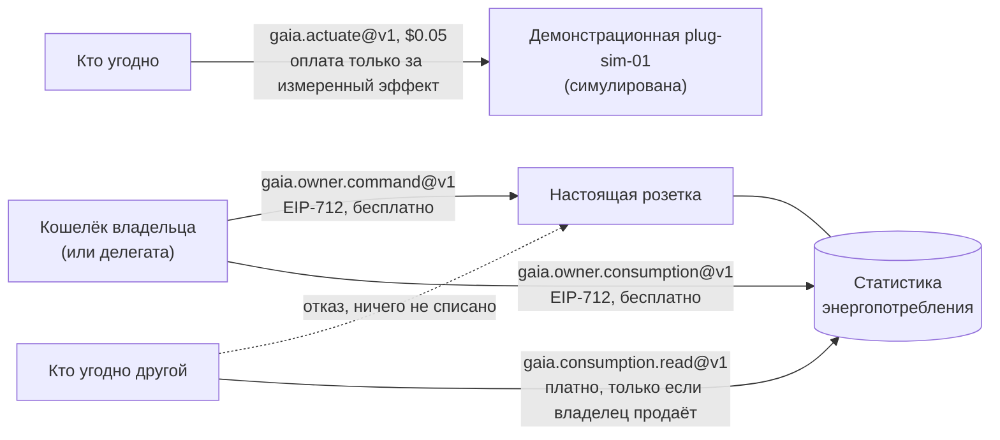
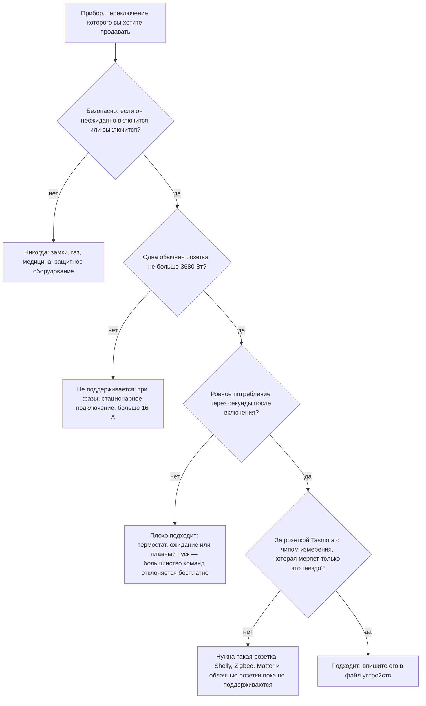
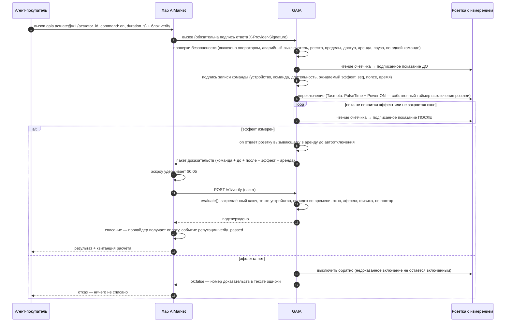
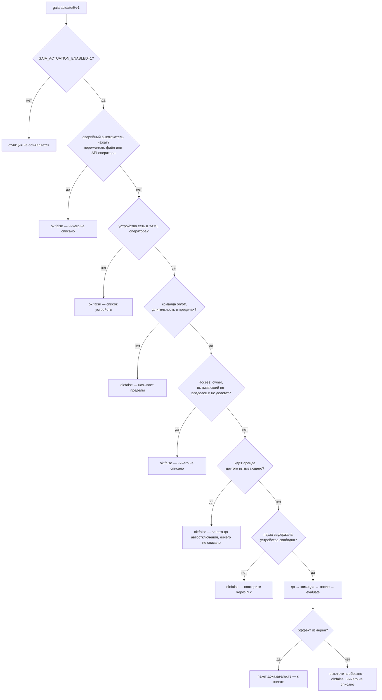
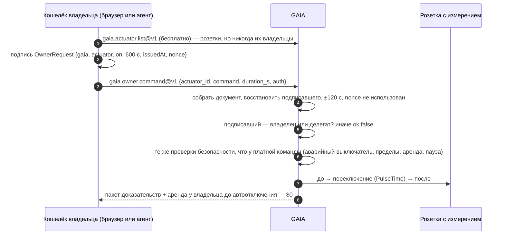
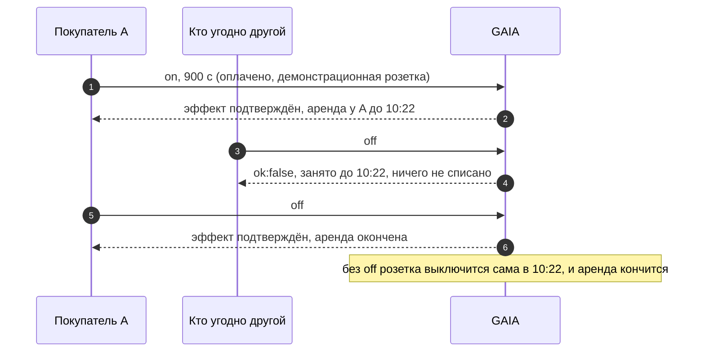
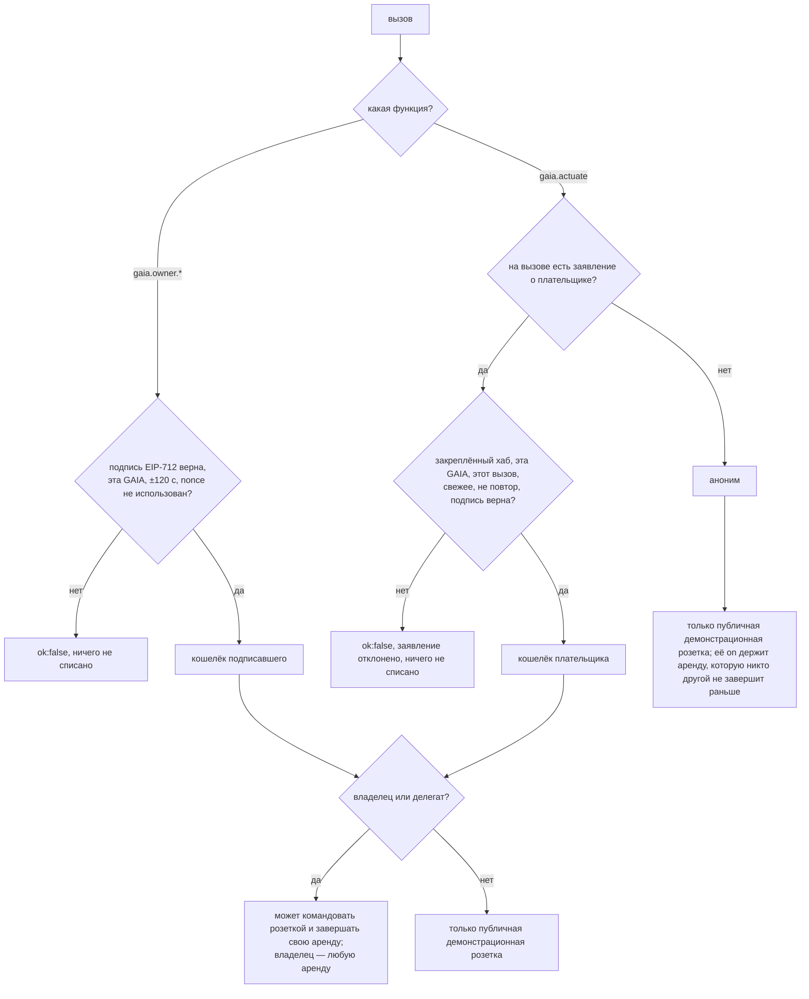
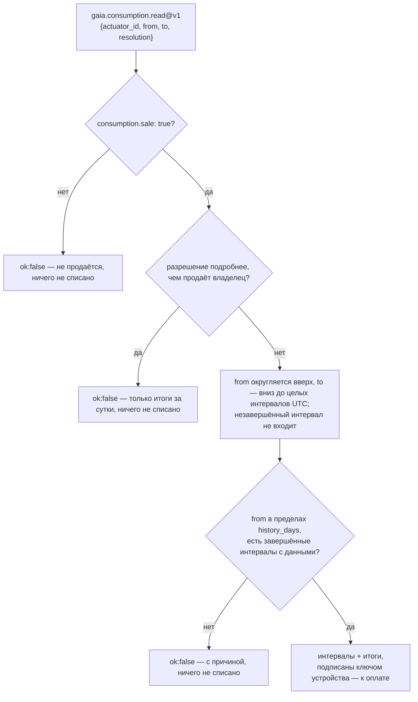

# Управление устройствами — розетка слушается владельца; демонстрация продаёт измеренный эффект

> 🌐 [English](../ACTUATION.md) · **Русский** · [Español](ACTUATION.es.md) · [Français](ACTUATION.fr.md) · [中文](ACTUATION.zh.md)

Читать физический мир — половина того, что агенту от него нужно. Вторая половина — менять его:
включить обогреватель, насос или зарядку электромобиля на какое-то время. GAIA делает это через
**умную розетку с измерением** — исполнительное устройство (actuator): реле, которое переключает
GAIA, и счётчик, который видит только то, что это реле коммутирует. Тогда «реле включено» и
«мощность выросла» — один и тот же физический факт. Счётчик на весь дом не годится: чайник в
другой комнате «доказал» бы, что включился обогреватель.

Кто что может, решают три правила:

1. **Настоящая розетка слушается только владельца** — кошелька, который файл устройств оператора
   называет `owner`, и делегатов (`delegates`), которых владелец перечислил (его собственных
   агентов). Владелец подписывает каждую команду этим кошельком (EIP-712) и ничего не платит: ни
   хаба, ни учётной записи. Купить переключение чужой розетки нельзя, и оплата розетку не открывает.
2. **Публичная демонстрационная розетка — единственное исключение.** `plug-sim-01` на
   iot.modelmarket.dev симулирована, поэтому переключить её через `gaia.actuate@v1` может кто
   угодно — и платит, только когда эффект команды измерен (Pay-on-Verified).
3. **Незнакомец может купить самое большее статистику энергопотребления розетки**, и только там,
   где владелец выставил её на продажу, не подробнее и не дальше в прошлое, чем решил владелец.
   Демонстрационная розетка продаёт свою почасовую статистику, чтобы и эту половину можно было попробовать.



## Чем можно управлять

GAIA переключает устройство одного вида — **умную розетку с измерением**. На практике она
управляет тем, что включено в эту розетку, и команд ровно две: `on` на ограниченное число секунд
и `off`. Нет диммирования, нет уставок температуры, нет расписаний: расписание — это просто
покупатель, который вызывает функцию в выбранный им момент, например в начале окна, найденного
`gaia.power.window@v1`.

Кто может отправлять эти команды: владелец и его делегаты — для настоящей розетки, кто угодно —
для симулированной демонстрационной; а `on` принадлежит отправителю, пока не кончится. См.
[Кто может переключать розетку](#кто-может-переключать-розетку).

### Какие приборы подходят

Команда оплачивается, только когда счётчик видит её эффект, поэтому прибор должен **ровно
потреблять уже через несколько секунд после подачи питания** и почти ничего — после выключения.

| За розеткой | Подходит? | Почему |
|---|---|---|
| Электрообогреватель, масляный радиатор, полотенцесушитель | да | ровные 0,5–2,5 кВт сразу после включения |
| Водонагреватель в розетке | пока греет | когда вода нагрелась, его термостат отключается; `on` тогда не даёт эффекта и отклоняется бесплатно |
| Кабель зарядки электромобиля от бытовой розетки, зарядка электровелосипеда или самоката | да, в пределах номинала розетки и кабеля | батарея должна действительно заряжаться: полная ничего не потребляет, и команда отклоняется |
| Насос, вентилятор, осушитель | да | если его потребление выше `expect_on_w`, заданного оператором |
| Лампа, фитолампа | да | с низким `expect_on_w`, но всё равно заметно выше `off_max_w` |
| Холодильник, морозильник, всё со своим термостатом, режимом ожидания или медленным плавным пуском | плохо | «включено» может минутами ничего не потреблять, поэтому большинство команд отклоняется |
| Трёхфазные или стационарно подключённые нагрузки, всё больше 16 А | нет | одна розетка: не больше 230 В × 16 А = 3680 Вт |
| Замки, газовые клапаны, медицинское и защитное оборудование | **никогда** | на платный выключатель нельзя ставить то, чьё неожиданное включение или выключение может кому-то навредить |

Команда `on`, эффект которой не измерен, **сразу выключается обратно** и ничего не стоит:
неподходящий прибор тратит время покупателя, но не его деньги.



### Какими розетками управляет GAIA

| `kind` в файле устройств | Что это |
|---|---|
| `tasmota-mqtt` | Настоящая розетка с прошивкой [Tasmota](https://tasmota.github.io/), доступная через собственный MQTT-брокер оператора |
| `sim-plug` | Розетка и прибор в коде (`load_w` от 1 до 3680 Вт). Публичная демонстрационная `plug-sim-01` на iot.modelmarket.dev — именно такая; каждый её ответ содержит `"simulated": true` |

Розетка Tasmota подходит, если:

1. **В ней есть чип измерения энергии.** На главной странице Tasmota видны Voltage, Current и
   Power, а `Status 8` отвечает блоком `ENERGY`. Розетка без такого чипа ничего не может
   доказать, и каждая команда к ней отклонялась бы.
2. **Её счётчик видит только переключаемое гнездо.** GAIA переключает `Power1`. Удлинитель,
   который меряет несколько гнёзд вместе, не подходит: другое гнездо «доказало» бы команду.
3. **Она подключена к MQTT-брокеру оператора** (`mqtt://` или `mqtts://`) со своим `%topic%`.
   GAIA общается с ней только там, а вызывающий называет id устройства — никогда не топик и не брокер.
4. **Она рассчитана на нагрузку.** Долгая нагрузка около 16 А греет бытовые розетки; соблюдайте
   номинал розетки, а для зарядки электромобиля — и номинал кабеля.

У каждой розетки Tasmota есть `PulseTime` — её собственный таймер выключения. GAIA отправляет его
вместе с `on`, поэтому розетка сама выключится по истечении оплаченного времени, даже если GAIA,
брокер или сеть пропали. Этот таймер держит не больше 64 800 с, так что одно `on` длится
максимум 18 часов.

Пока не поддерживаются: Shelly, Zigbee, Matter, Home Assistant и чисто облачные розетки, розетки
с несколькими реле на один счётчик, диммеры, термостаты и клапаны. Каждому нужен свой драйвер и
свой способ доказать эффект.

### Что оператор задаёт для каждого устройства

| Поле | Значение | Правило (по умолчанию) |
|---|---|---|
| `expect_on_w` | измеренная мощность, которая доказывает «включено» | ниже ровного потребления прибора, выше всего, что розетка потребляет в простое |
| `off_max_w` | измеренная мощность, которая доказывает «выключено» | `0 < off_max_w < expect_on_w` (10 Вт) |
| `min_on_s`, `max_on_s` | сколько может длиться одно `on` | `0 < min ≤ max ≤ 64800` (10 с, 900 с) |
| `cooldown_s` | пауза между двумя командами одному устройству | `≥ 0` (30 с) |
| `effect_timeout_s` | сколько GAIA ждёт, пока проявится эффект | 1–120 с (20 с) |
| `access` | кто может командовать: `owner` (владелец и делегаты) или `public` (кто угодно) | `owner`; `public` — только для `kind: sim-plug` (демонстрация) |
| `owner` | кошелёк владельца: его команды проходят всегда, даже во время чужой аренды | обязательно при доступе `owner` |
| `delegates` | кошельки собственных агентов владельца, которые тоже могут командовать | список; только при доступе `owner` |
| `consumption.sale` | продавать статистику энергопотребления этой розетки другим | `false` |
| `consumption.resolution` | самая подробная продаваемая статистика: `hour` или `day` | `hour` |
| `consumption.history_days` | как далеко назад продаётся статистика | 1–366 (30) |
| `latitude`, `longitude` | необязательно: где ATLAS показывает устройство | — |

Если управление включено, файл устройств, нарушающий эти правила, останавливает GAIA при запуске:
лучше так, чем выключатель, у которого «включено» и «выключено» могут выглядеть одинаково.
Правильно описанная, но недоступная розетка пропускается с записью в журнал, а остальная GAIA
работает.

## Функции

| Функция | Цена | Кто | Что делает |
|---|---|---|---|
| `gaia.actuator.list@v1` | бесплатно | кто угодно | Устройства оператора: команды, пределы длительности, пауза между командами, политика доступа, продаётся ли статистика, когда кончается текущая аренда, состояние реле, закреплённые ключи устройств, нажат ли аварийный выключатель. Кошельки владельца и делегатов — никогда |
| `gaia.owner.command@v1` | бесплатно | владелец, делегат | Включить свою розетку (`on`) на `duration_s` или выключить (`off`), с подписью вашего кошелька (EIP-712). Тот же пакет доказательств, что ниже |
| `gaia.owner.consumption@v1` | бесплатно | владелец, делегат | Энергопотребление вашей розетки по часам или по суткам, за любой период, с подписью ключа устройства |
| `gaia.actuate@v1` | $0.05 | демонстрационная розетка — кто угодно; настоящая — её владелец через хаб | Включить устройство (`on`) на `duration_s` секунд — после этого оно выключается само — или выключить (`off`). Результат — пакет доказательств, а после `on` — ещё и аренда |
| `gaia.consumption.read@v1` | $0.01 | кто угодно, где владелец продаёт | Статистика энергопотребления розетки целыми завершёнными часами или сутками UTC, в пределах, заданных владельцем, с подписью ключа устройства. Объявляется, только пока какая-то розетка продаётся |

$0.05 — нижний порог цены для оплаты по факту (Pay-on-Verified) на хабе: покупатель может
держать оплату в эскроу, пока `/v1/verify` GAIA не подтвердит эффект. Цену статистики задаёт
оператор (`GAIA_CONSUMPTION_PRICE_USD`).

## Как оплачивается команда



Без блока `verify` эффект всё равно решает, платить ли: на недоказанный эффект GAIA отвечает
`ok:false`, а за `ok:false` хаб ничего не списывает. Блок `verify` добавляет
вторую проверку до того, как деньги сдвинутся: хаб отправляет доказательства собственному
верификатору GAIA, который точно перепроверяет их (ниже), — хаб направляет туда `gaia.actuate@v1`
через `AIMARKET_VERIFY_ROUTES`, а не своему жюри из LLM.

Прогон на реальных деньгах в Base mainnet со всеми транзакциями: [Pay-on-Verified за физический эффект](https://github.com/alexar76/aicom/blob/main/docs/pay-on-verified-device-demo.ru.md).

## Проверки безопасности



Вызывающий называет **идентификатор устройства** — и никогда MQTT-топик, брокер или устройство,
которое оператор не внёс в список. «Включить» всегда ограничено: длительность обязательна, а её
предел задаёт оператор. Бесплатная `gaia.owner.command@v1` владельца проходит те же проверки; её
проверка доступа — подпись владельца.

## Кто может переключать розетку

Оплата доказывает оплату, а не право. Найдено 2026-10-16: кто угодно, кто добрался до
`gaia.actuate@v1`, мог переключить любую розетку из списка, а бесплатной пробе хаба или прямому
вызову оплата не требовалась вовсе. Розетка в чьём-то доме — не торговый автомат, поэтому модель
теперь такая:

| | Настоящая розетка (`tasmota-mqtt`) | Демонстрационная розетка (`sim-plug`, `access: public`) |
|---|---|---|
| Переключать | только владелец и его делегаты | кто угодно, $0.05, оплата только за измеренный эффект |
| Читать её статистику энергопотребления | владелец и делегаты, бесплатно | так же |
| Покупать её статистику энергопотребления | кто угодно, только если владелец задал `consumption.sale: true` | кто угодно (демонстрация продаёт почасовую статистику) |
| Оплаченное `on` от незнакомца | отклоняется, ничего не списано | разрешено; потом оно держит розетку до автоотключения |

### 1. Доступ: владелец или публичная демонстрация

| `access` | Кто может командовать | Для каких устройств |
|---|---|---|
| `owner` (по умолчанию) | кошелёк `owner` и `delegates` | для любых; для настоящей розетки — единственный вариант |
| `public` | кто угодно, кто добрался до GAIA | только `kind: sim-plug` — демонстрация |

GAIA проверяет файл устройств при запуске и не запускается с файлом, который нарушает эти
правила, вместо того чтобы угадывать:

- настоящая розетка с `access: public` — «настоящая розетка слушается только владельца»;
- `access: owner` без `owner`;
- `delegates` у публичной розетки;
- ключи черновой модели `access: allowlist` и `allow:` — сообщение говорит использовать
  `access: owner` с `owner:` и `delegates:`.

Адреса — `0x` + 40 hex (EVM, в любом регистре) или base58 (Solana). В YAML берите их в кавычки:
голое `0x…` читается как число, и GAIA отказывается от такого файла при запуске, а не читает его
неверно. Подпись владельца (ниже) — только для EVM; владелец с кошельком Solana командует через хаб.

```yaml
actuators:
  - id: lab-heater-01
    kind: tasmota-mqtt
    topic: tasmota_lab_heater
    expect_on_w: 800
    access: owner
    owner: "0x00000000000000000000000000000000000000a1"     # кошелёк владельца
    delegates:
      - "0x00000000000000000000000000000000000000b2"        # домашний агент владельца
    consumption:
      sale: false                                           # закрыто, пока владелец не продаёт
```

`gaia.actuator.list@v1` и `/actuation/v1/status` сообщают, какая у устройства политика и продаётся
ли его статистика. Владельца и делегатов они не перечисляют никогда: публиковать ли адрес,
привязанный к устройству в чьём-то доме, решает оператор.

**Делегаты** — собственные агенты владельца: агент домашней автоматизации, планировщик, который
включает водонагреватель в самый дешёвый час, найденный `gaia.power.window@v1`. У каждого свой
кошелёк и ключ, поэтому ключ делегата можно отозвать (убрать из файла), не трогая ключ владельца.
Делегат переключает розетку и читает её статистику как владелец, с одним отличием: владелец может
завершить любую аренду, делегат — только свою.

### 2. Владелец подписывает: EIP-712, бесплатно, без хаба

Владелец не платит за переключение своей розетки, и ему не нужны ни хаб, ни учётная запись.
Каждый запрос — **подпись EIP-712 (типизированные данные)** кошелька владельца: то, что выдаёт
`eth_signTypedData_v4` в браузерном кошельке, причём поля показываются владельцу до подписи. В
сеть ничего не уходит, газ не тратится; идентификатор сети только называет домен.

| Подписанное поле | Значение |
|---|---|
| домен | `{name: "GAIA", version: "1", chainId: 8453}` |
| `gaia` | публичный URL этой GAIA без завершающего слэша (`base_url` в её манифесте) |
| `actuator` | id устройства |
| `action` | `on`, `off` или `consumption` |
| `durationS` | для `on` — секунды; иначе 0 |
| `fromTs`, `toTs` | для `consumption` — окно в unix-секундах; иначе 0 |
| `issuedAt` | unix-секунды; принимается в пределах ±120 с от часов GAIA |
| `nonce` | 32 случайных байта; каждый принимается один раз |

Запрос несёт `auth: {signer, issued_at, nonce, signature}`. GAIA заново собирает документ из полей
самого запроса, восстанавливает подписавшего, сравнивает его с `signer` и только потом занимает
nonce — в файле в каталоге данных, который переживает перезапуск. Поэтому подпись нельзя ни
повторить, ни перенести на другую GAIA, другую розетку, другую команду или другую длительность, ни
использовать через две минуты, а поддельная подпись не может «сжечь» nonce владельца.



**Для людей: страница владельца.** `https://<gaia>/owner` (на демонстрационном хосте —
[iot.modelmarket.dev/owner](https://iot.modelmarket.dev/owner)) показывает розетки этой GAIA,
подключает браузерный кошелёк, при необходимости переключает его на сеть Base и для каждой розетки
даёт кнопки *Включить на N мин*, *Выключить* и *За 24 ч*. Каждая кнопка просит у кошелька одну
подпись; страница показывает измеренный эффект и время автоотключения или почасовую таблицу. Она
на английском, русском, испанском, французском и китайском, её отдаёт сама GAIA, сторонних скриптов
нет (её политика разрешает только два собственных файла).

**Для агентов: подписать и вызвать.**

```python
import secrets, time, requests
from eth_account import Account

GAIA = "https://iot.modelmarket.dev"          # base_url из манифеста, без завершающего слэша
key = open("owner.key").read().strip()         # ключ владельца или делегата; никогда не в git
FIELDS = ["gaia:string", "actuator:string", "action:string", "durationS:uint256",
          "fromTs:uint256", "toTs:uint256", "issuedAt:uint256", "nonce:bytes32"]

def owner_auth(actuator, action, duration_s=0, from_ts=0, to_ts=0):
    now, nonce = int(time.time()), "0x" + secrets.token_hex(32)
    doc = {"types": {"EIP712Domain": [{"name": "name", "type": "string"},
                                      {"name": "version", "type": "string"},
                                      {"name": "chainId", "type": "uint256"}],
                     "OwnerRequest": [dict(zip(("name", "type"), f.split(":"))) for f in FIELDS]},
           "primaryType": "OwnerRequest",
           "domain": {"name": "GAIA", "version": "1", "chainId": 8453},
           "message": {"gaia": GAIA, "actuator": actuator, "action": action,
                       "durationS": duration_s, "fromTs": from_ts, "toTs": to_ts,
                       "issuedAt": now, "nonce": nonce}}
    sig = Account.sign_typed_data(key, full_message=doc).signature.hex()
    return {"signer": Account.from_key(key).address, "issued_at": now, "nonce": nonce,
            "signature": "0x" + sig.removeprefix("0x")}

r = requests.post(f"{GAIA}/ai-market/v2/invoke", json={"capability_id": "gaia.owner.command@v1",
    "input": {"actuator_id": "lab-heater-01", "command": "on", "duration_s": 600,
              "auth": owner_auth("lab-heater-01", "on", duration_s=600)}})
print(r.json()["output"]["effect"])
```

Владелец может переключать и через хаб функцией `gaia.actuate@v1`, заплатив её цену: тогда хаб
ручается за плательщика ([ниже](#4-личность-кому-верит-gaia)), и розетка слушается, потому что этот
плательщик — её владелец. Оплата никогда не заменяет права владения.

### 3. Аренда: «on» принадлежит отправителю до автоотключения

Подтверждённое `on` отдаёт устройство вызывающему до `auto_off_at`. До этого момента `off` или
новое `on` может отправить только он, владелец или аварийный выключатель оператора. Всем
остальным отказывают ещё до того, как что-либо переключится или запишется: `ok:false`,
`busy until <время>, nothing charged` (занято до указанного времени, ничего не списано). На
настоящей розетке это разводит команды владельца и делегатов (владелец главнее); на
демонстрационной — защищает оплаченную минуту одного покупателя от следующего.



- Аренда кончается при автоотключении, когда держатель отправляет `off`, когда устройство
  переключает владелец, когда `on` оказывается неподтверждённым (его сразу выключают обратно)
  и когда нажат аварийный выключатель (он завершает все аренды).
- Держатель может отправить новое `on`; тогда аренда длится до нового автоотключения.
- Пауза между командами действует для всех, и для держателя, и для владельца: она бережёт реле.
- Аренды записываются в `actuation-leases.json` в каталоге данных и переживают перезапуск
  GAIA. Для каждой из них GAIA заново взводит свой страховочный OFF, рядом с таймером самой розетки.
- Статус показывает, когда кончается аренда (`leased_until`), но никогда — у кого она.

### 4. Личность: кому верит GAIA

GAIA верит двум личностям и никогда — слову самого вызывающего:

1. **Подписи владельца** (выше): кошельку, который подписал именно этот запрос, — он
   восстанавливается из подписи.
2. **Плательщику, за которого на этом самом вызове ручается хаб, которому она доверяет.** Хаб
   знает, кто заплатил. Для платёжного канала это адрес, восстановленный из подписи плательщика
   при открытии канала. Для x402 — `from` авторизации, проверенный по её подписи. Хаб подписывает
   этот адрес своим федеративным ключом рядом с заголовками допуска (price gate) того же вызова и
   берёт из них хаб, аудиторию, время и nonce:

| Заголовок | Содержимое |
|---|---|
| `X-AIMarket-Hub-Payer` | адрес кошелька плательщика |
| `X-AIMarket-Hub-Payer-Rail` | `channel` или `x402` |
| `X-AIMarket-Hub-Payer-Signature` | Ed25519 ключом хаба над `aimarket-hub-payer/v1` + хаб, аудитория (invoke-URL этой GAIA), функция, хеш точного входа, время, nonce, плательщик и способ оплаты |

Доверенные хабы — те, что в `ORACLE_TRUSTED_HUBS`, в том же списке, который закрепляет price gate.
Заявление годится для одного вызова, в этой GAIA, в пределах ±120 с, один раз. Поле во входе,
`X-Payment-Channel` (id канала — ссылка, а не секрет) и `X-AIMarket-Buyer` (непрозрачный ключ
ограничения частоты) может вписать кто угодно, поэтому ни одно из них вызывающего не определяет.



Аноним может командовать только публичной демонстрационной розеткой и никогда не совпадает с
держателем аренды. Его `on` всё равно держит аренду (`holder: null`), поэтому время этого
покупателя раньше срока не может закончить никто, кроме владельца или аварийного выключателя, —
и сам покупатель тоже.

**Где это сейчас.** Подпись владельца работает с одной лишь GAIA. Заявление о плательщике на
стороне хаба влито и попадёт на хаб с его следующим выпуском; пока хаб его не отправляет,
покупатели, пришедшие через этот хаб, — анонимы: демонстрация работает, оплаченное `on` там
защищено от всех остальных, а владелец настоящей розетки пользуется бесплатной подписью.

## Статистика энергопотребления

Счётчик каждой розетки заодно записывает, как использовался прибор за ней. GAIA хранит эту запись
для владельца, а другим продаёт только там, где так решил владелец.

**Запись.** В обслуживающем процессе сборщик каждые `GAIA_CONSUMPTION_SAMPLE_S` (60 с) читает
счётчик каждого устройства — то же подписанное показание, что несут доказательства команды, — и
добавляет его к часу UTC, в который оно попало: энергию (шаг собственного счётчика энергии
розетки, или мощность × время, если счётчика нет или он сбросился), сумму и пик мощности и сколько
реле было включено. Разрыв дольше 600 с (GAIA остановлена, розетка недоступна) — пауза, а не
потребление. Часы хранятся `GAIA_CONSUMPTION_RETENTION_DAYS` (400 дней) в хранилище оракула:
по умолчанию SQLite в каталоге данных, Postgres — если его называет `ORACLE_DATABASE_URL`.
`GAIA_CONSUMPTION_SAMPLER=0` останавливает сборщик.

**Владелец читает бесплатно.** `gaia.owner.consumption@v1` с подписью владельца (`action:
consumption`, окно — `fromTs` / `toTs`) отвечает за любой период, по часам или по дням, по каждой
розетке, которой кошелёк владеет или для которой он делегат, — продаётся она или нет.

**Другие покупают только там, где владелец продаёт.** Это решают три ключа в файле устройств:

```yaml
    consumption:
      sale: true          # по умолчанию выключено
      resolution: day     # самое подробное из продаваемого: hour или только итоги за сутки
      history_days: 30    # как далеко назад, 1–366
```



Проданный ряд содержит **только целые завершённые интервалы**. Без этого правила «сутки» в окне
длиной в час были бы почасовым показанием, а повторное чтение текущего часа снова и снова —
поминутным, то есть подробнее, чем владелец решил продавать. Окно, в котором ничего не записано
(новая розетка, перерыв в работе), тоже отклоняется: за пустоту не платят.

Каждый интервал сообщает `start`, `end`, `energy_wh`, `mean_w`, `peak_w`, `on_minutes` и `samples`;
`totals` их суммирует. `attestation` — подпись Ed25519 ключом устройства (тем, что несут его
показания; он опубликован в `gaia.actuator.list@v1` как `device_pubkey`) над каноническим JSON
`{actuator_id, resolution, from, to, buckets}`, так что покупатель может показать, откуда цифры.
`simulated: true` отмечает демонстрационную розетку.

```bash
# почасовое потребление демонстрационной розетки за последние сутки ($0.01 через хаб)
curl -s -X POST https://iot.modelmarket.dev/ai-market/v2/invoke -H 'Content-Type: application/json' \
  -d '{"capability_id":"gaia.consumption.read@v1",
       "input":{"actuator_id":"plug-sim-01","resolution":"hour"}}'
```

`from` и `to` принимают unix-секунды или ISO 8601 UTC (`2026-10-16T00:00:00Z`); по умолчанию —
последние 24 часа. Не больше 744 часовых или 366 суточных интервалов за вызов.

**Почему по умолчанию выключено.** Часы работы обогревателя говорят, когда кто-то дома; часы
чайника — когда он просыпается. Это данные владельца. `resolution: day` продаёт тренд без
распорядка дня, а `history_days` ограничивает, сколько прошлого продаётся. Переключение не
продаётся никогда.

## Как вызвать

```bash
# что можно переключать и с какими пределами
curl -s -X POST https://iot.modelmarket.dev/ai-market/v2/invoke -H 'Content-Type: application/json' \
  -d '{"capability_id":"gaia.actuator.list@v1","input":{}}'

# включить демонстрационный обогреватель на минуту
curl -s -X POST https://iot.modelmarket.dev/ai-market/v2/invoke -H 'Content-Type: application/json' \
  -d '{"capability_id":"gaia.actuate@v1",
       "input":{"actuator_id":"plug-sim-01","command":"on","duration_s":60}}'
```

Ответ (сокращённо):

```json
{
  "actuation": {
    "record": {"command_id": "act_1f…", "actuator_id": "plug-sim-01", "command": "on",
               "duration_s": 60, "seq": 1792145220000, "issued_at": "2026-10-16T10:07:00Z",
               "nonce": "…", "expect": {"field": "power_w", "op": ">=", "value": 1000, "within_s": 20}},
    "attestation": {"algorithm": "ed25519", "public_key": "…", "value": "…"}
  },
  "before": {"reading": {"values": {"power_w": 0.4, "relay_on": 0.0, "…": "…"}}, "attestation": {"…": "…"}},
  "after":  {"reading": {"values": {"power_w": 1497.2, "relay_on": 1.0, "…": "…"}}, "attestation": {"…": "…"}},
  "effect": {"verified": true, "expected": {"…": "…"}, "observed": 1497.2},
  "simulated": true,
  "auto_off_at": "2026-10-16T10:08:00Z",
  "lease": {"holder": null, "until": "2026-10-16T10:08:00Z"}
}
```

`holder` здесь `null`: прямой вызов не несёт плательщика, за которого поручился хаб. До 10:08:00
никто другой не может переключить эту розетку, и сам вызывающий тоже не может закончить минуту
раньше ([выше](#кто-может-переключать-розетку)). Тот же вызов к настоящей розетке отвечает
`ok:false` — «принимает команды только от владельца» — и ничего не списывает; её владелец
пользуется `gaia.owner.command@v1`.

Перепроверить может кто угодно: `POST /v1/verify` с пакетом (слот эскроу) или вызов
`gaia.verify@v1` с ним. Доказательства недавних команд, включая отклонённые, открыты по адресу
`GET /actuation/v1/evidence/<command_id>`; `GET /actuation/v1/status` показывает все устройства.

## Что проверяет вердикт

Все проверки жёсткие — один ложный факт, и платить не за что:

| Проверка | Смысл |
|---|---|
| `command_signature` | запись команды подписана **закреплённым** ключом розетки (из реестра парка, а не ключом, который принёс пакет) |
| `before_device`, `after_device` | оба показания — от того же устройства |
| `before_signature`, `after_signature` | оба показания проверяются закреплённым ключом |
| `order` | до → команда → после, и по номеру, и по времени |
| `window` | эффект прочитан в обещанное окно |
| `effect` | ожидаемое условие выполнено на показании «после» (`power_w >= expect_on_w` для включения, `<= off_max_w` для выключения) |
| `relay_state` | розетка сообщает то состояние реле, которое просила команда |
| `after_plausible` | показание «после» проходит физические проверки GAIA |

Каждая команда оплачивается один раз: её `seq` (миллисекунды настенных часов, только растёт) —
«высшая отметка» проверяющего эскроу, поэтому повторно присланный пакет отклоняется.

Проверка правдоподобия знает про розетки: `relay_on` — отдельное поле; разомкнутое реле, которое
насчитывает больше 25 Вт, — противоречие; счётчик энергии сверяется с тем, сколько одна розетка
на 16 А могла пропустить с прошлого чтения, а не с «текущая мощность × время»: розетка,
переключённая между двумя чтениями, честна.

## Операторам

Публичная демонстрация работает с одной **симулированной** розеткой (`plug-sim-01`, обогреватель
1500 Вт) из [`config/actuators.yaml`](../../config/actuators.yaml). Для реального железа:

1. Розетка Tasmota **с чипом измерения энергии** на вашем MQTT-брокере, отвечающая на `Status 8`.
2. Ваш файл устройств — по образцу [`config/actuators.example.yaml`](../../config/actuators.example.yaml):
   ```yaml
   actuators:
     - id: lab-heater-01
       kind: tasmota-mqtt
       topic: tasmota_lab_heater   # %topic% розетки
       expect_on_w: 800            # ниже потребления обогревателя, выше любого холостого хода розетки
       off_max_w: 5
       min_on_s: 30
       max_on_s: 1800
       cooldown_s: 60
       effect_timeout_s: 20
       access: owner               # для настоящей розетки — единственный вариант
       owner: "0x…"                # кошелёк владельца, в кавычках
       delegates: ["0x…"]          # необязательно: собственные агенты владельца
       consumption:
         sale: false               # true — продавать статистику (gaia.consumption.read@v1)
         resolution: hour          # или day
         history_days: 30
   ```
3. Окружение:
   ```bash
   GAIA_ACTUATION_ENABLED=1
   GAIA_ACTUATORS_FILE=/path/to/actuators.yaml
   GAIA_MQTT_BROKER=mqtts://broker.example:8883
   GAIA_MQTT_USERNAME=gaia            # пароль — из хранилища секретов, никогда не файлом в git
   GAIA_ACTUATION_TOKEN=…             # Bearer-токен для API аварийного выключателя
   ORACLE_TRUSTED_HUBS=https://<hub>=<его signer_public_key>   # чьи заявления о плательщике засчитываются
   GAIA_CONSUMPTION_PRICE_USD=0.01    # цена статистики; GAIA_CONSUMPTION_SAMPLE_S=60
   ORACLE_CALLS=1                     # журнал вызовов (в наших образах включён) — см. «Статистика вызовов»
   ORACLE_OPS_TOKEN=…                 # Bearer-токен для /ops/v1/*, из файла с правами 0600
   ORACLE_DATABASE_URL=postgresql://… # необязательно: Postgres вместо SQLite в /data
   ```
   Страница владельца — `/owner` в самой GAIA; за nginx ей нужен `location /owner` к бэкенду, как в
   `deploy/nginx/iot.modelmarket.dev.conf`.
4. **Хаб, который продаёт её с Pay-on-Verified**, направляет функцию верификатору этой GAIA, чтобы
   деньги решала точная проверка, а не жюри из LLM:
   ```
   # GAIA: в продакшене /v1/verify отказывает всем, пока это не задано
   GAIA_VERIFY_TOKEN=…                # случайный секрет из файла с правами 0600
   # файл окружения хаба (одной строкой, без кавычек: --env-file берёт значения буквально)
   AIMARKET_VERIFY_ROUTES={"gaia.actuate@v1": {"url": "https://<gaia>", "verifier_id": "gaia.verify@v1", "key_env": "AIMARKET_VERIFY_GAIA_TOKEN"}}
   AIMARKET_VERIFY_GAIA_TOKEN=…       # то же значение, что GAIA_VERIFY_TOKEN
   ```
   Без токена у хаба хаб отклоняет блок `verify` ещё до переключения; с неверным токеном GAIA
   отвечает 401, и покупателю возвращают деньги. Подробнее —
   [маршруты верификаторов хаба](https://github.com/alexar76/aimarket-hub/blob/main/docs/pay-on-verified.md#verifier-routes).

Включение отправляется как `Backlog PulseTime1 <длительность>; Power1 ON`, поэтому **розетка
выключается сама** по истечении оплаченного времени, даже если пропадут GAIA, брокер или сеть.
Кроме того, GAIA сама отправляет OFF в срок — как второй стоп.

### Аварийный выключатель

Три способа, достаточно любого; пока он нажат, все команды отклоняются и ничего не списывается.
Нажатие также завершает все аренды:

```bash
curl -X POST https://<gaia>/actuation/v1/kill   -H "Authorization: Bearer $GAIA_ACTUATION_TOKEN"   # и выключает всё
curl -X POST https://<gaia>/actuation/v1/resume -H "Authorization: Bearer $GAIA_ACTUATION_TOKEN"
touch <каталог данных>/ACTUATION_KILL  # файл — если API недоступен
GAIA_ACTUATION_KILL=1                  # переменная окружения — для перезапуска
```

Без `GAIA_ACTUATION_TOKEN` API аварийного выключателя отвечает 503 — без авторизации он не
открывается никогда. Каждая команда (с вызывающим, которого проверила GAIA, или без него), исход,
аренда, конец аренды, остановка и возобновление дописываются в `actuation.jsonl` в каталоге данных.

### Статистика вызовов

Каждый вызов, на который отвечает GAIA, — платное переключение, подписанная команда владельца,
отказ незнакомцу, продажа статистики, `402` — это одна строка в журнале вызовов
[oracle-core](https://github.com/alexar76/oracles/blob/main/core/docs/CALL-LOG.ru.md):
функция, исход, HTTP-статус, краткая причина, кто поручился за вызов (хаб, назначенный оператором
вызывающий или никто), цена обслуженного платного вызова, задержка, объект (`actuator_id`),
хеш адреса клиента с солью и SHA-256 входа. Сам вход и IP-адрес — никогда, поэтому подпись
владельца в журнал не попадает.

```bash
# на хосте GAIA (обратный прокси /ops/ наружу не отдаёт)
curl -s -H "Authorization: Bearer $ORACLE_OPS_TOKEN" 'http://127.0.0.1:9320/ops/v1/stats?since=2026-10-16T00:00:00Z'
curl -s -H "Authorization: Bearer $ORACLE_OPS_TOKEN" 'http://127.0.0.1:9320/ops/v1/calls?capability=gaia.actuate@v1&outcome=failed'
curl -s -H "Authorization: Bearer $ORACLE_OPS_TOKEN" http://127.0.0.1:9320/ops/v1/metrics   # Prometheus
```

## Честные ограничения

- У розетки Tasmota нет защищённого элемента. Ключ GAIA подписывает **то, что сообщила розетка**,
  — хранение отчёта, как у каждого ретранслятора (relay) GAIA, а не доказательство, что железо не
  может солгать. Утверждение узкое именно потому, что счётчик и реле — одно устройство.
- Эффект доказывает, что через розетку пошла мощность, а не то, что прибор с ней сделал.
- Публичная демонстрационная розетка симулирована (`SIM`): её обогреватель существует только в коде, и каждый ответ об этом говорит (`"simulated": true`).
- Публичную демонстрационную розетку держит первое подтверждённое `on`, не дольше `max_on_s`.
  Покупатель, который платит снова и снова, или бесплатная проба хаба могут занимать её по очереди;
  поэтому публичной может быть только симулированная розетка.
- Кошелёк — это тот, у кого его ключ, а не человек. У кого ключ владельца, тот для GAIA и владеет
  розеткой; утёкший ключ делегата отзывают, убрав его из файла устройств (и перезапустив), — GAIA
  сама этого не сделает.
- Владение — это то, что написано в файле оператора. GAIA не проверяет, кому принадлежит железо;
  оператор, который ставит розетку кому-то, вписывает его кошелёк.
- Проданная статистика — это то, что сообщил счётчик розетки, хранится GAIA и подписана ключом
  розетки: происхождение данных, а не поверенное показание счётчика для расчётов.
- Доверенному хабу доверяют и в том, кто заплатил. Хаб, который лжёт о плательщике, или утёкший
  ключ хаба может назвать любой кошелёк. Кошелёк — это тот, у кого его ключ, а не человек.
- С маршрутом GAIA одновременно продавец и судья `gaia.actuate@v1`. Это приемлемо только потому,
  что вердикт — детерминированная проверка подписанных доказательств, которую может повторить кто
  угодно (`POST /v1/verify` или `gaia.verify@v1` с пакетом), и потому, что покупатель может
  обжаловать «прошло» в апелляционном суде хаба — другом верификаторе, — если хаб его держит. Ни
  один верификатор, ни GAIA, ни LLM, не поймает доказательства, подделанные владельцем ключа розетки.

W3C WoT: Thing Description каждой розетки (`GET /wot/<id>`) содержит **действия** (actions)
`switchOn` / `switchOff`, формы которых — платные вызовы `gaia.actuate@v1`.
