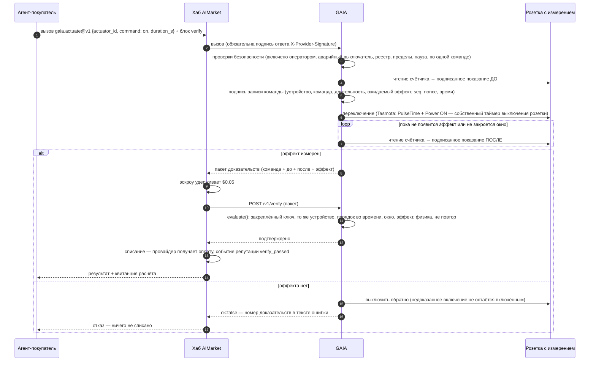
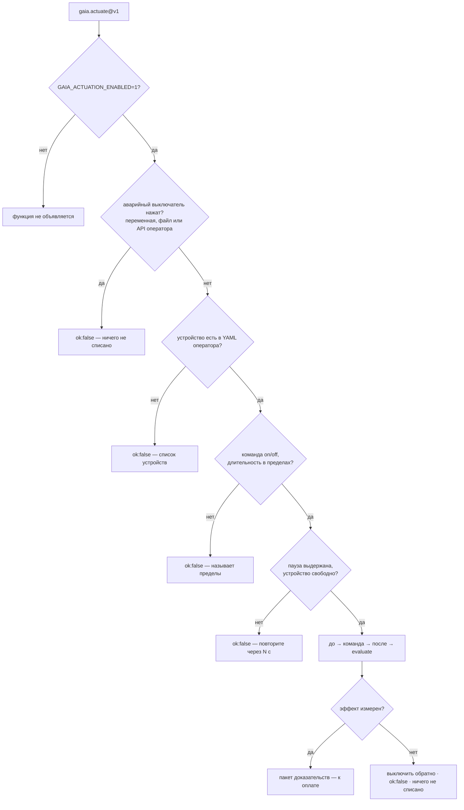

# Управление устройствами — оплата только за измеренный эффект

> 🌐 [English](../ACTUATION.md) · **Русский** · [Español](ACTUATION.es.md) · [Français](ACTUATION.fr.md) · [中文](ACTUATION.zh.md)

Читать физический мир — половина того, что агенту от него нужно. Вторая половина — менять его:
включить обогреватель, насос или зарядку электромобиля на какое-то время. GAIA продаёт это как
`gaia.actuate@v1` с одним правилом, которое делает покупку у незнакомца безопасной:

**цена команды причитается только тогда, когда эффект команды измерен.**

Исполнительное устройство (actuator) — это **умная розетка с измерением**: реле, которое
переключает GAIA, и счётчик, который видит только то, что это реле коммутирует. Тогда «реле
включено» и «мощность выросла» — один и тот же физический факт. Счётчик на весь дом не годится:
чайник в другой комнате «доказал» бы, что включился обогреватель.

## Функции

| Функция | Цена | Что делает |
|---|---|---|
| `gaia.actuator.list@v1` | бесплатно | Устройства оператора: команды, пределы длительности, пауза между командами, состояние реле, закреплённые ключи устройств, нажат ли аварийный выключатель |
| `gaia.actuate@v1` | $0.05 | Включить устройство (`on`) на `duration_s` секунд — после этого оно выключается само — или выключить (`off`). Результат — пакет доказательств |

$0.05 — нижний порог цены для оплаты по факту (Pay-on-Verified) на хабе: покупатель может
держать оплату в эскроу, пока `/v1/verify` GAIA не подтвердит эффект.

## Как оплачивается команда



Без блока `verify` эффект всё равно решает, платить ли: на недоказанный эффект GAIA отвечает
`ok:false`, а за `ok:false` хаб ничего не списывает. Блок `verify` добавляет **независимую**
проверку доказательств до того, как деньги сдвинутся.

## Проверки безопасности



Вызывающий называет **идентификатор устройства** — и никогда MQTT-топик, брокер или устройство,
которое оператор не внёс в список. «Включить» всегда ограничено: длительность обязательна, а её
предел задаёт оператор.

## Как вызвать

```bash
# что можно переключать и с какими пределами
curl -s -X POST https://iot.modelmarket.dev/ai-market/v2/invoke -H 'Content-Type: application/json' \
  -d '{"capability_id":"gaia.actuator.list@v1","input":{}}'

# включить демонстрационный обогреватель на минуту
curl -s -X POST https://iot.modelmarket.dev/ai-market/v2/invoke -H 'Content-Type: application/json' \
  -d '{"capability_id":"gaia.actuate@v1",
       "input":{"actuator_id":"plug-sim-01","command":"on","duration_s":60}}'
```

Ответ (сокращённо):

```json
{
  "actuation": {
    "record": {"command_id": "act_1f…", "actuator_id": "plug-sim-01", "command": "on",
               "duration_s": 60, "seq": 1792145220000, "issued_at": "2026-10-16T10:07:00Z",
               "nonce": "…", "expect": {"field": "power_w", "op": ">=", "value": 1000, "within_s": 20}},
    "attestation": {"algorithm": "ed25519", "public_key": "…", "value": "…"}
  },
  "before": {"reading": {"values": {"power_w": 0.4, "relay_on": 0.0, "…": "…"}}, "attestation": {"…": "…"}},
  "after":  {"reading": {"values": {"power_w": 1497.2, "relay_on": 1.0, "…": "…"}}, "attestation": {"…": "…"}},
  "effect": {"verified": true, "expected": {"…": "…"}, "observed": 1497.2},
  "simulated": true,
  "auto_off_at": "2026-10-16T10:08:00Z"
}
```

Перепроверить может кто угодно: `POST /v1/verify` с пакетом (слот эскроу) или вызов
`gaia.verify@v1` с ним. Доказательства недавних команд, включая отклонённые, открыты по адресу
`GET /actuation/v1/evidence/<command_id>`; `GET /actuation/v1/status` показывает все устройства.

## Что проверяет вердикт

Все проверки жёсткие — один ложный факт, и платить не за что:

| Проверка | Смысл |
|---|---|
| `command_signature` | запись команды подписана **закреплённым** ключом розетки (из реестра парка, а не ключом, который принёс пакет) |
| `before_device`, `after_device` | оба показания — от того же устройства |
| `before_signature`, `after_signature` | оба показания проверяются закреплённым ключом |
| `order` | до → команда → после, и по номеру, и по времени |
| `window` | эффект прочитан в обещанное окно |
| `effect` | ожидаемое условие выполнено на показании «после» (`power_w >= expect_on_w` для включения, `<= off_max_w` для выключения) |
| `relay_state` | розетка сообщает то состояние реле, которое просила команда |
| `after_plausible` | показание «после» проходит физические проверки GAIA |

Каждая команда оплачивается один раз: её `seq` (миллисекунды настенных часов, только растёт) —
«высшая отметка» проверяющего эскроу, поэтому повторно присланный пакет отклоняется.

Проверка правдоподобия знает про розетки: `relay_on` — отдельное поле; разомкнутое реле, которое
насчитывает больше 25 Вт, — противоречие; счётчик энергии сверяется с тем, сколько одна розетка
на 16 А могла пропустить с прошлого чтения, а не с «текущая мощность × время»: розетка,
переключённая между двумя чтениями, честна.

## Операторам

Публичная демонстрация работает с одной **симулированной** розеткой (`plug-sim-01`, обогреватель
1500 Вт) из [`config/actuators.yaml`](../../config/actuators.yaml). Для реального железа:

1. Розетка Tasmota **с чипом измерения энергии** на вашем MQTT-брокере, отвечающая на `Status 8`.
2. Ваш файл устройств — по образцу [`config/actuators.example.yaml`](../../config/actuators.example.yaml):
   ```yaml
   actuators:
     - id: lab-heater-01
       kind: tasmota-mqtt
       topic: tasmota_lab_heater   # %topic% розетки
       expect_on_w: 800            # ниже потребления обогревателя, выше любого холостого хода розетки
       off_max_w: 5
       min_on_s: 30
       max_on_s: 1800
       cooldown_s: 60
       effect_timeout_s: 20
   ```
3. Окружение:
   ```bash
   GAIA_ACTUATION_ENABLED=1
   GAIA_ACTUATORS_FILE=/path/to/actuators.yaml
   GAIA_MQTT_BROKER=mqtts://broker.example:8883
   GAIA_MQTT_USERNAME=gaia            # пароль — из хранилища секретов, никогда не файлом в git
   GAIA_ACTUATION_TOKEN=…             # Bearer-токен для API аварийного выключателя
   ```

Включение отправляется как `Backlog PulseTime1 <длительность>; Power1 ON`, поэтому **розетка
выключается сама** по истечении оплаченного времени, даже если пропадут GAIA, брокер или сеть.
Кроме того, GAIA сама отправляет OFF в срок — как второй стоп.

### Аварийный выключатель

Три способа, достаточно любого; пока он нажат, все команды отклоняются и ничего не списывается:

```bash
curl -X POST https://<gaia>/actuation/v1/kill   -H "Authorization: Bearer $GAIA_ACTUATION_TOKEN"   # и выключает всё
curl -X POST https://<gaia>/actuation/v1/resume -H "Authorization: Bearer $GAIA_ACTUATION_TOKEN"
touch <каталог данных>/ACTUATION_KILL  # файл — если API недоступен
GAIA_ACTUATION_KILL=1                  # переменная окружения — для перезапуска
```

Без `GAIA_ACTUATION_TOKEN` API аварийного выключателя отвечает 503 — без авторизации он не
открывается никогда. Каждая команда, исход, остановка и возобновление дописываются в
`actuation.jsonl` в каталоге данных.

## Честные ограничения

- У розетки Tasmota нет защищённого элемента. Ключ GAIA подписывает **то, что сообщила розетка**,
  — хранение отчёта, как у каждого ретранслятора (relay) GAIA, а не доказательство, что железо не
  может солгать. Утверждение узкое именно потому, что счётчик и реле — одно устройство.
- Эффект доказывает, что через розетку пошла мощность, а не то, что прибор с ней сделал.
- Публичная демонстрационная розетка симулирована (`SIM`): её обогреватель существует только в коде, и каждый ответ об этом говорит (`"simulated": true`).

W3C WoT: Thing Description каждой розетки (`GET /wot/<id>`) содержит **действия** (actions)
`switchOn` / `switchOff`, формы которых — платные вызовы `gaia.actuate@v1`.
