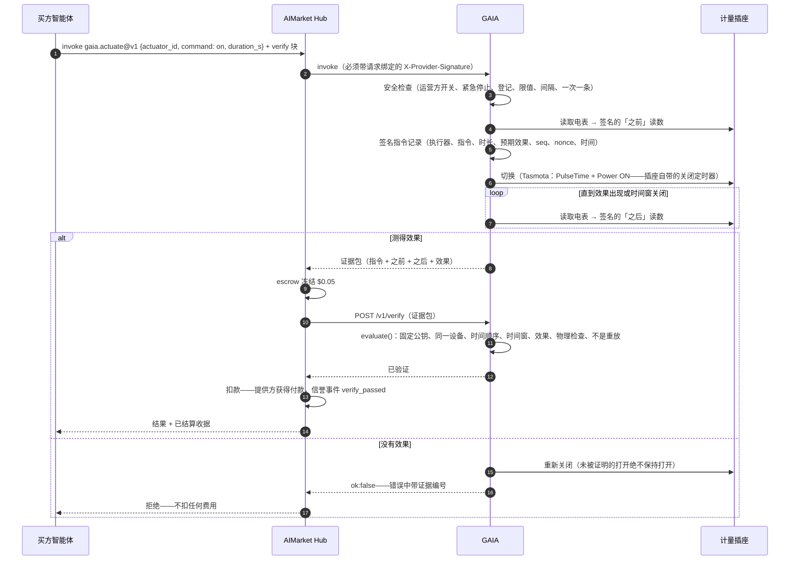
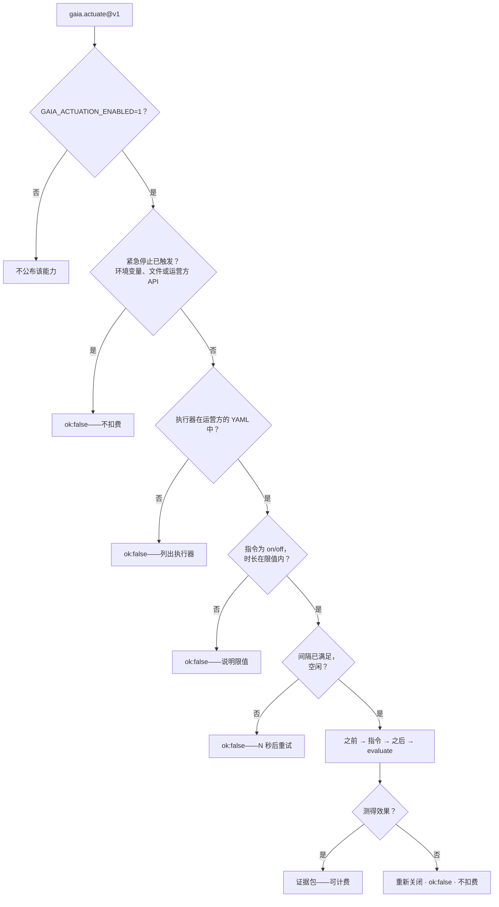

# 设备控制 — 只为测得的效果付费

> 🌐 [English](../ACTUATION.md) · [Русский](ACTUATION.ru.md) · [Español](ACTUATION.es.md) · [Français](ACTUATION.fr.md) · **中文**

读取物理世界只是智能体所需的一半，另一半是改变它：让电暖器、水泵或电动车充电器运行一段时间。
GAIA 以 `gaia.actuate@v1` 出售这一能力，并用一条规则让向陌生人购买也安全：

**只有当指令的效果被测量到时，才需要为这条指令付费。**

执行器是一个**带计量的智能插座**：GAIA 切换的继电器，加上只看得到该继电器所切换负载的电表。
于是「继电器闭合」与「功率上升」就是同一个物理事实。全屋电表不行——别的房间的电水壶会「证明」
电暖器开了。

## 能力

| 能力 | 价格 | 作用 |
|---|---|---|
| `gaia.actuator.list@v1` | 免费 | 运营方的执行器：指令、时长上下限、指令间隔、继电器状态、固定的设备公钥，以及紧急停止是否已触发 |
| `gaia.actuate@v1` | $0.05 | 将执行器打开（`on`）`duration_s` 秒——之后自动关闭——或关闭（`off`）。结果是证据包 |

$0.05 是 Hub 按验证付费（Pay-on-Verified）的最低价格：买方可以把款项托管在 escrow 中，直到
GAIA 的 `/v1/verify` 确认效果。

## 一笔付费指令如何结算



即使没有 `verify` 块，效果仍然决定是否收费：对未被证明的效果，GAIA 返回 `ok:false`，而 Hub
对 `ok:false` 不扣费。`verify` 块在资金流动之前再加一道对证据的**独立**检查。

## 安全检查



调用方只能给出**执行器 ID**——绝不能指定 MQTT 主题、broker 或运营方未登记的设备。「打开」总是
有界的：必须给出时长，且上限由运营方设定。

## 调用方式

```bash
# 可以切换什么、有哪些限值
curl -s -X POST https://iot.modelmarket.dev/ai-market/v2/invoke -H 'Content-Type: application/json' \
  -d '{"capability_id":"gaia.actuator.list@v1","input":{}}'

# 打开演示电暖器一分钟
curl -s -X POST https://iot.modelmarket.dev/ai-market/v2/invoke -H 'Content-Type: application/json' \
  -d '{"capability_id":"gaia.actuate@v1",
       "input":{"actuator_id":"plug-sim-01","command":"on","duration_s":60}}'
```

返回（节选）：

```json
{
  "actuation": {
    "record": {"command_id": "act_1f…", "actuator_id": "plug-sim-01", "command": "on",
               "duration_s": 60, "seq": 1792145220000, "issued_at": "2026-10-16T10:07:00Z",
               "nonce": "…", "expect": {"field": "power_w", "op": ">=", "value": 1000, "within_s": 20}},
    "attestation": {"algorithm": "ed25519", "public_key": "…", "value": "…"}
  },
  "before": {"reading": {"values": {"power_w": 0.4, "relay_on": 0.0, "…": "…"}}, "attestation": {"…": "…"}},
  "after":  {"reading": {"values": {"power_w": 1497.2, "relay_on": 1.0, "…": "…"}}, "attestation": {"…": "…"}},
  "effect": {"verified": true, "expected": {"…": "…"}, "observed": 1497.2},
  "simulated": true,
  "auto_off_at": "2026-10-16T10:08:00Z"
}
```

任何人都可以再次检查：用证据包调用 `POST /v1/verify`（escrow 插槽），或用它调用
`gaia.verify@v1`。近期指令的证据（包括被拒绝的）公开于 `GET /actuation/v1/evidence/<command_id>`；
`GET /actuation/v1/status` 显示所有执行器。

## 判定检查什么

所有检查都是硬性的——只要有一个事实不实，就无需付费：

| 检查 | 含义 |
|---|---|
| `command_signature` | 指令记录由插座的**固定**公钥签名（来自设备队列登记，绝不是证据包自带的公钥） |
| `before_device`、`after_device` | 两次读数来自同一执行器 |
| `before_signature`、`after_signature` | 两次读数都能用固定公钥验证 |
| `order` | 之前 → 指令 → 之后，按序号和时间 |
| `window` | 效果在承诺的时间窗内被读取 |
| `effect` | 「之后」读数满足预期条件（打开为 `power_w >= expect_on_w`，关闭为 `<= off_max_w`） |
| `relay_state` | 插座报告的继电器状态与指令要求一致 |
| `after_plausible` | 「之后」读数通过 GAIA 的物理检查 |

每条指令只结算一次：其 `seq`（墙钟毫秒，只增不减）是 escrow 验证方的高水位，因此重放的证据包会被拒绝。

合理性检查了解插座：`relay_on` 是一个字段；断开的继电器却计量到超过 25 W 是矛盾；电能寄存器的增量
与一个 16 A 插座在上次读数以来最多能通过的电能比较，而不是与「当前功率 × 时间间隔」比较——在两次
读数之间被切换过的插座是诚实的。

## 运营方

公开演示只运行一个**模拟**插座（`plug-sim-01`，一台 1500 W 电暖器），配置见
[`config/actuators.yaml`](../../config/actuators.yaml)。使用真实硬件时：

1. 一个**带电能计量芯片**的 Tasmota 插座，接入你的 MQTT broker，并能响应 `Status 8`。
2. 你的执行器文件，参照 [`config/actuators.example.yaml`](../../config/actuators.example.yaml)：
   ```yaml
   actuators:
     - id: lab-heater-01
       kind: tasmota-mqtt
       topic: tasmota_lab_heater   # 插座的 %topic%
       expect_on_w: 800            # 低于电暖器功率，高于插座的待机功率
       off_max_w: 5
       min_on_s: 30
       max_on_s: 1800
       cooldown_s: 60
       effect_timeout_s: 20
   ```
3. 环境变量：
   ```bash
   GAIA_ACTUATION_ENABLED=1
   GAIA_ACTUATORS_FILE=/path/to/actuators.yaml
   GAIA_MQTT_BROKER=mqtts://broker.example:8883
   GAIA_MQTT_USERNAME=gaia            # 密码来自你的密钥库，绝不放在 git 中的文件里
   GAIA_ACTUATION_TOKEN=…             # 紧急停止 API 的 Bearer 令牌
   ```

打开指令以 `Backlog PulseTime1 <时长>; Power1 ON` 发送，因此即使 GAIA、broker 或网络消失，
**插座也会在付费时长结束后自行关闭**。此外，GAIA 还会在到期时自行发送 OFF，作为第二道停止。

### 紧急停止

三种方式，任何一种都够；触发期间所有指令都被拒绝，且不扣费：

```bash
curl -X POST https://<gaia>/actuation/v1/kill   -H "Authorization: Bearer $GAIA_ACTUATION_TOKEN"   # 同时关闭全部设备
curl -X POST https://<gaia>/actuation/v1/resume -H "Authorization: Bearer $GAIA_ACTUATION_TOKEN"
touch <数据目录>/ACTUATION_KILL      # 一个文件，用于 API 不可达时
GAIA_ACTUATION_KILL=1               # 一个环境变量，用于重启时
```

没有 `GAIA_ACTUATION_TOKEN` 时，紧急停止 API 返回 503——它绝不会在未认证的情况下开放。每条指令、
结果、停止和恢复都会追加到数据目录中的 `actuation.jsonl`。

## 诚实的限制

- Tasmota 插座没有安全元件。GAIA 的密钥签署的是**插座所报告的内容**——即对报告的保管，与 GAIA
  的每个中继一样，而不是证明硬件不会说谎。正因为电表与继电器是同一台设备，这一声明才保持在窄范围内。
- 效果证明有功率通过了插座，而不是电器用这些电做了什么。
- 公开演示的插座是模拟的（`SIM`）：它的电暖器只存在于软件中，每个回答都会注明（`"simulated": true`）。

W3C WoT：每个插座的 Thing Description（`GET /wot/<id>`）带有 `switchOn` / `switchOff`
**动作（actions）**，其表单是付费的 `gaia.actuate@v1` 调用。
