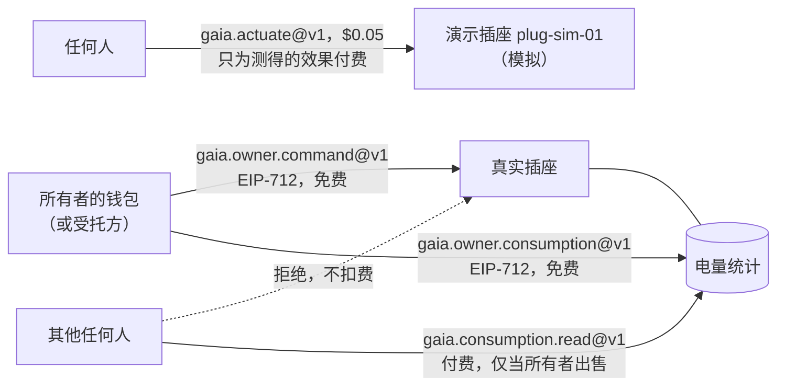
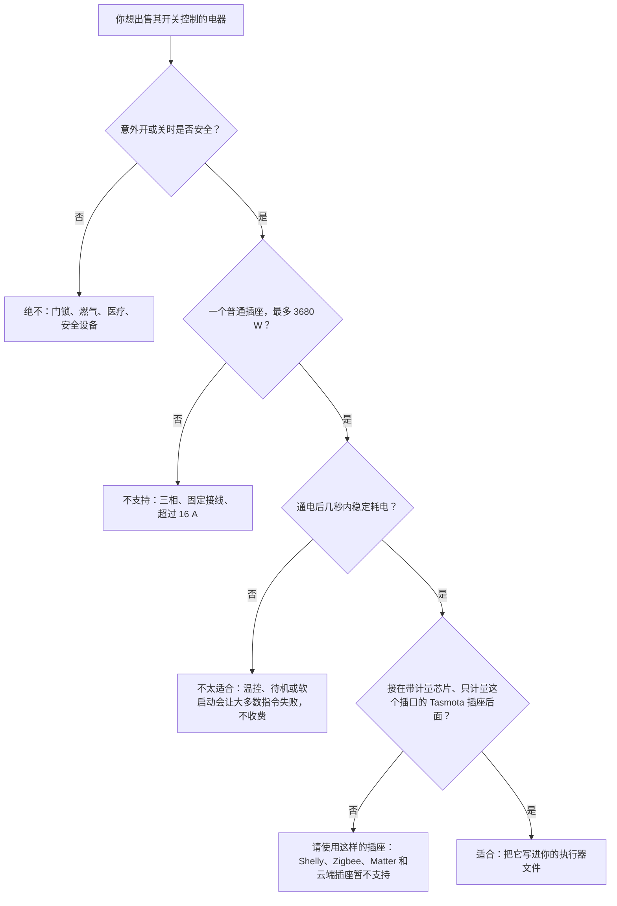
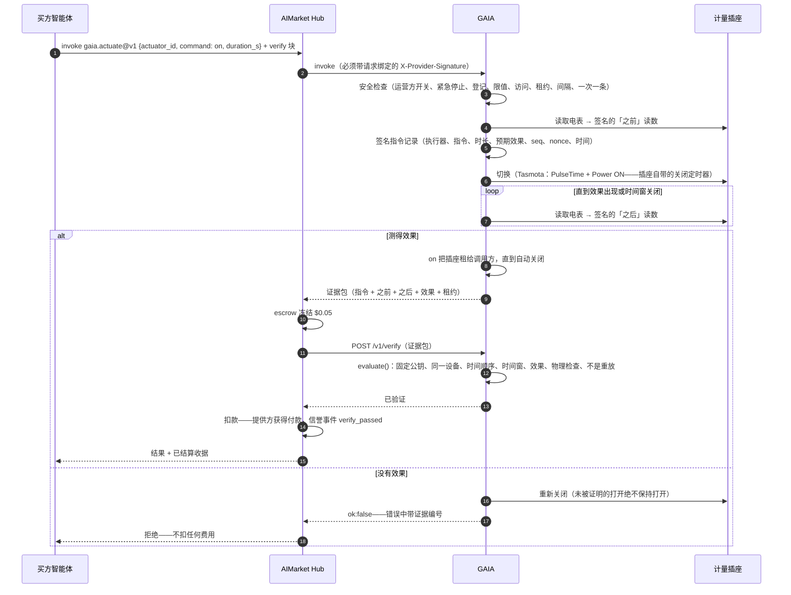
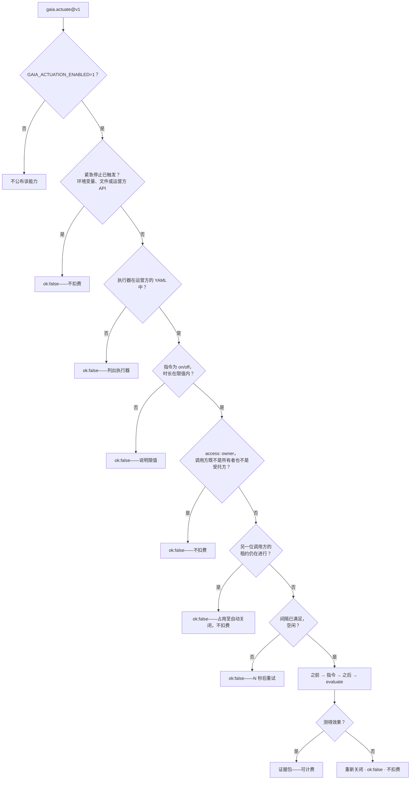
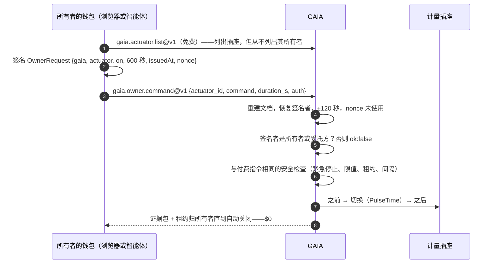
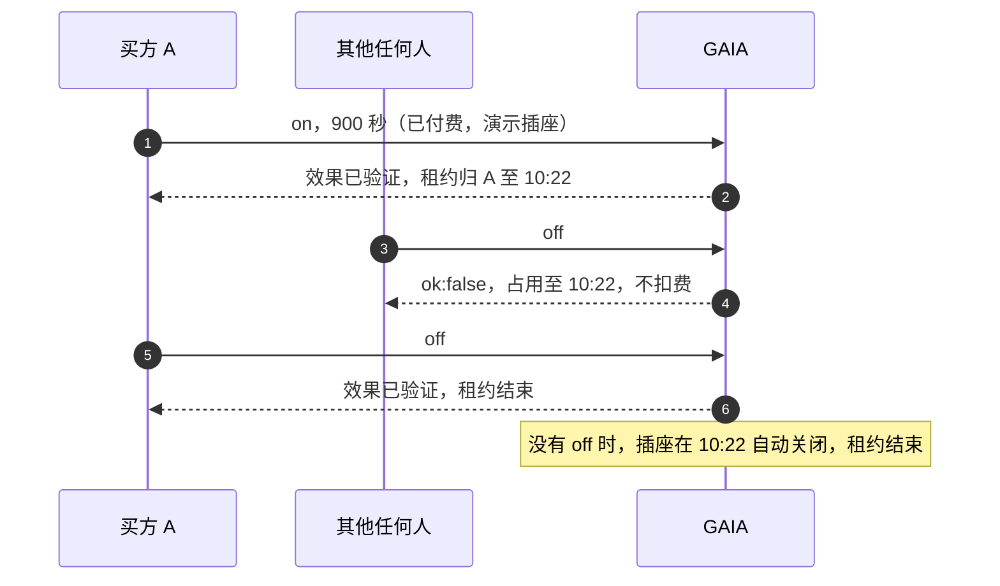
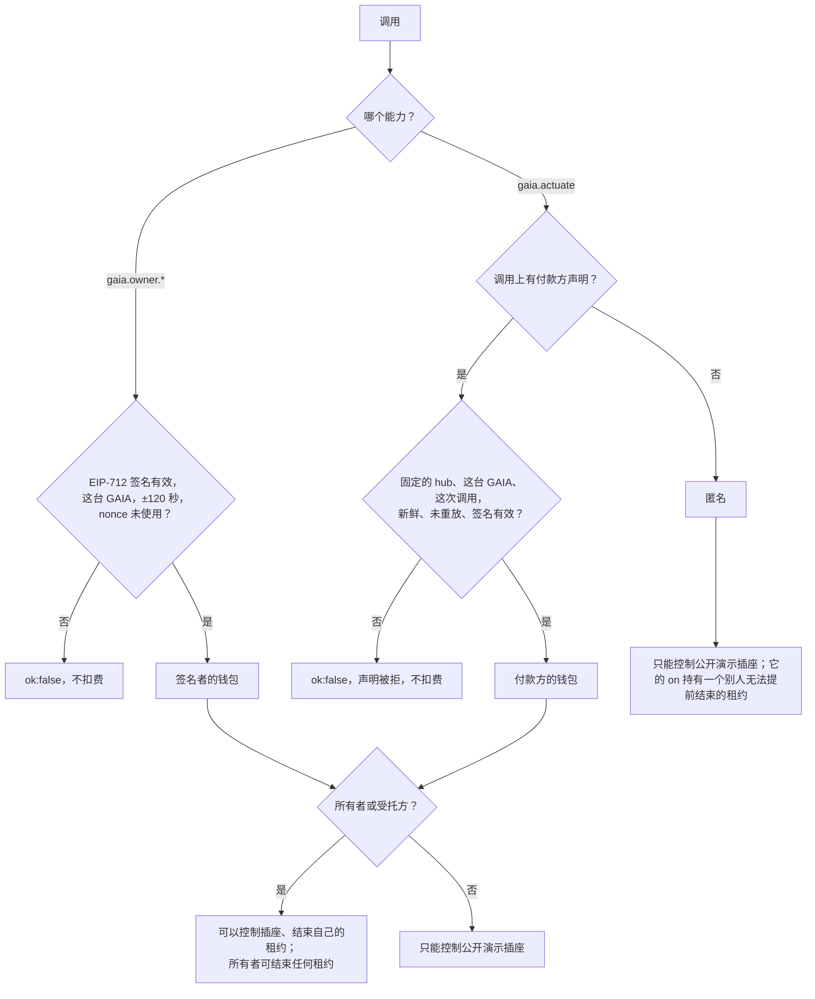
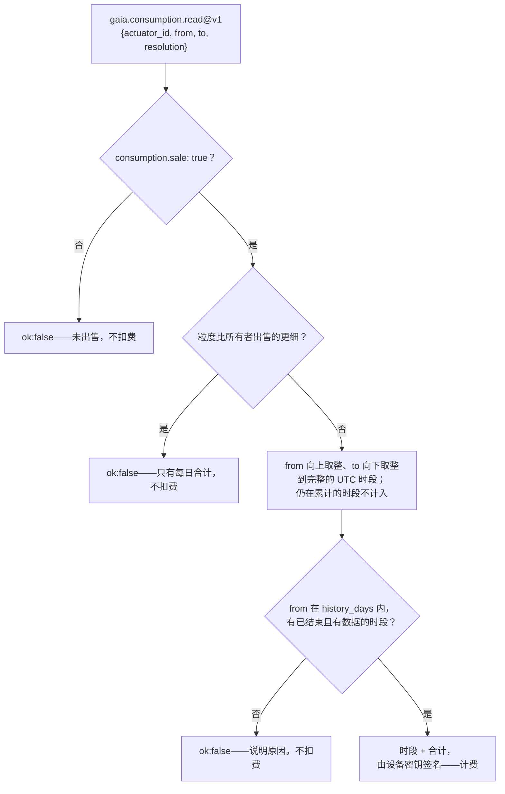

# 设备控制 — 插座只听所有者的；演示插座出售测得的效果

> 🌐 [English](../ACTUATION.md) · [Русский](ACTUATION.ru.md) · [Español](ACTUATION.es.md) · [Français](ACTUATION.fr.md) · **中文**

读取物理世界只是智能体所需的一半，另一半是改变它：让电暖器、水泵或电动车充电器运行一段时间。
GAIA 通过**计量智能插座**（执行器）来做到这一点：GAIA 切换的继电器，加上只看得到该继电器所切换负载的
电表。于是「继电器闭合」与「功率上升」就是同一个物理事实。全屋电表不行——别的房间的电水壶会「证明」
电暖器开了。

三条规则决定谁可以做什么：

1. **真实插座只听所有者的**——即运营方执行器文件中 `owner` 指定的钱包，以及所有者列出的受托方
   （`delegates`，所有者自己的智能体）。所有者用这个钱包为每条指令签名（EIP-712），无需付费：不需要
   hub，也不需要账户。没有人能购买切换别人插座的权利，付款也永远不能打开别人的插座。
2. **公开演示插座是唯一的例外。** iot.modelmarket.dev 上的 `plug-sim-01` 是模拟的，所以任何人都可以
   通过 `gaia.actuate@v1` 切换它——并且只有在指令效果被测量到时才付费（Pay-on-Verified）。
3. **陌生人最多只能购买插座的电量统计**，而且只在所有者设置出售的插座上，粒度和回溯范围都不超过
   所有者的选择。演示插座出售其按小时的统计，好让这一半也能试用。



## 可以控制什么

GAIA 只切换一种设备：**带计量的智能插座**。实际上它控制的是插在这个插座上的东西，而且只有两条
指令：持续有限秒数的 `on`，以及 `off`。没有调光，没有温度设定，也没有定时计划：所谓计划，就是
买方在自己选定的时刻发起调用，例如在 `gaia.power.window@v1` 找到的窗口开始时。

谁可以发送这些指令：真实插座是所有者及其受托方，模拟的演示插座是任何人；`on` 在结束之前归发送者
所有。见[谁可以切换插座](#谁可以切换插座)。

### 哪些电器适合

只有当电表看到指令的效果时，这条指令才需要付费，所以电器必须**在通电后几秒内稳定耗电**，
断电后几乎不耗电。

| 插座后面的电器 | 适合吗 | 原因 |
|---|---|---|
| 电暖器、油汀、电热毛巾架 | 适合 | 一通电就稳定消耗 0.5–2.5 kW |
| 插在插座上的电热水器 | 加热期间适合 | 水烧热后其温控器会断电；此时的 `on` 测不到效果，会被拒绝，不收费 |
| 家用插座用的电动车充电线、电动自行车或滑板车充电器 | 适合，但不得超过插座和线缆的额定值 | 电池必须真的在充电：充满的电池不耗电，指令会被拒绝 |
| 水泵、风扇、除湿机 | 适合 | 前提是功耗高于运营方设定的 `expect_on_w` |
| 灯、植物生长灯 | 适合 | `expect_on_w` 设得低一些，但仍要明显高于 `off_max_w` |
| 冰箱、冰柜，以及任何自带温控、待机或慢速软启动的电器 | 不太适合 | 「开」之后可能几分钟都不耗电，所以大多数指令会被拒绝 |
| 三相或固定接线的负载、任何超过 16 A 的负载 | 不适合 | 一个插座：最多 230 V × 16 A = 3680 W |
| 门锁、燃气阀、医疗或安全设备 | **绝不** | 任何意外开关可能伤人的东西都不应接到付费开关上 |

效果未被测到的 `on` 会**立即被关回去**，不收任何费用：不合适的电器只会浪费买方的时间，绝不会
浪费买方的钱。



### GAIA 驱动哪些插座

| 执行器文件中的 `kind` | 是什么 |
|---|---|
| `tasmota-mqtt` | 运行 [Tasmota](https://tasmota.github.io/) 固件的真实插座，通过运营方自己的 MQTT broker 访问 |
| `sim-plug` | 软件中的插座和电器（`load_w` 为 1 到 3680 W）。iot.modelmarket.dev 上的公开演示 `plug-sim-01` 就是这种；它的每个回答都带有 `"simulated": true` |

满足以下条件的 Tasmota 插座才合格：

1. **有电能计量芯片。** Tasmota 主页显示 Voltage、Current 和 Power，`Status 8` 返回 `ENERGY`
   数据块。没有计量芯片的插座什么都证明不了，发给它的每条指令都会被拒绝。
2. **它的电表只看被切换的那个插口。** GAIA 切换 `Power1`。把几个插口一起计量的排插不合格：
   别的插口会「证明」这条指令。
3. **接入运营方的 MQTT broker**（`mqtt://` 或 `mqtts://`），并有自己的 `%topic%`。GAIA 只在那里
   与它通信，调用方只能指定执行器 ID，绝不能指定 topic 或 broker。
4. **额定值足以承受负载。** 接近 16 A 的长时间负载会让家用插座发热；请遵守插座的额定值，给电动车
   充电时还要遵守线缆的额定值。

每个 Tasmota 插座都有 `PulseTime`，即插座自己的关断定时器。GAIA 随 `on` 一起发送它，所以即使
GAIA、broker 或网络失联，插座也会在付费时长结束后自行关断。该定时器最多 64 800 秒，因此一次
`on` 最长 18 小时。

暂不支持：Shelly、Zigbee、Matter、Home Assistant 和纯云端插座、一个电表对应多个继电器的插座、
调光器、温控器和阀门。每一种都需要自己的驱动，以及自己证明效果的方法。

### 运营方为每个执行器设定什么

| 字段 | 含义 | 规则（默认值） |
|---|---|---|
| `expect_on_w` | 证明「开」的计量功率 | 低于电器的稳定功耗，高于插座空载时的任何功耗 |
| `off_max_w` | 证明「关」的计量功率 | `0 < off_max_w < expect_on_w`（10 W） |
| `min_on_s`、`max_on_s` | 一次 `on` 可持续多久 | `0 < min ≤ max ≤ 64800`（10 秒、900 秒） |
| `cooldown_s` | 对同一执行器两条指令之间的间隔 | `≥ 0`（30 秒） |
| `effect_timeout_s` | GAIA 等待效果出现的时间 | 1–120 秒（20 秒） |
| `access` | 谁可以控制它：`owner`（所有者和受托方）或 `public`（任何人） | `owner`；`public` 仅用于 `kind: sim-plug`（演示） |
| `owner` | 所有者的钱包：其指令总能通过，即使在别人的租约期间 | `owner` 访问时必填 |
| `delegates` | 所有者自己的智能体的钱包，也可以控制它 | 列表；仅用于 `owner` 访问 |
| `consumption.sale` | 向他人出售该插座的电量统计 | `false` |
| `consumption.resolution` | 出售的最细粒度：`hour` 或 `day` | `hour` |
| `consumption.history_days` | 出售的统计最多回溯多久 | 1–366（30） |
| `latitude`、`longitude` | 可选：ATLAS 在哪里显示它 | — |

启用设备控制时，违反这些规则的执行器文件会让 GAIA 在启动时停止，而不是运行一个「开」和「关」
可能看起来一样的开关。配置正确但无法连接的插座会被跳过并写入日志，GAIA 的其余部分照常运行。

## 能力

| 能力 | 价格 | 谁可以用 | 作用 |
|---|---|---|---|
| `gaia.actuator.list@v1` | 免费 | 任何人 | 运营方的执行器：指令、时长上下限、指令间隔、访问策略、统计是否出售、当前租约何时结束、继电器状态、固定的设备公钥，以及紧急停止是否已触发。从不列出所有者或受托方的钱包 |
| `gaia.owner.command@v1` | 免费 | 所有者、受托方 | 用您的钱包签名（EIP-712），把自己的插座打开（`on`）`duration_s` 或关闭（`off`）。返回与下文相同的证据包 |
| `gaia.owner.consumption@v1` | 免费 | 所有者、受托方 | 您插座按小时或按天的用电，任意时段，由设备密钥签名 |
| `gaia.actuate@v1` | $0.05 | 演示插座：任何人；真实插座：其所有者经 hub | 将执行器打开（`on`）`duration_s` 秒——之后自动关闭——或关闭（`off`）。结果是证据包，`on` 之后还有租约 |
| `gaia.consumption.read@v1` | $0.01 | 任何人，仅限所有者出售的插座 | 插座按完整、已结束的 UTC 小时或日给出的电量统计，在所有者设定的范围内，由设备密钥签名。只有在有插座出售时才会列出 |

$0.05 是 Hub 按验证付费（Pay-on-Verified）的最低价格：买方可以把款项托管在 escrow 中，直到
GAIA 的 `/v1/verify` 确认效果。统计的价格由运营方设定（`GAIA_CONSUMPTION_PRICE_USD`）。

## 一笔付费指令如何结算



即使没有 `verify` 块，效果仍然决定是否收费：对未被证明的效果，GAIA 返回 `ok:false`，而 Hub
对 `ok:false` 不扣费。`verify` 块在资金流动之前再加一道检查：Hub 把证据发给 GAIA 自己的验证器，由它精确复核（见下文）——
Hub 通过 `AIMARKET_VERIFY_ROUTES` 把 `gaia.actuate@v1` 路由到这里，而不是交给它的 LLM 评审团。

在 Base 主网上用真实资金的一次运行，列出了全部交易：[为物理效果按验证付费](https://github.com/alexar76/aicom/blob/main/docs/pay-on-verified-device-demo.zh.md)。

## 安全检查



调用方只能给出**执行器 ID**——绝不能指定 MQTT 主题、broker 或运营方未登记的设备。「打开」总是
有界的：必须给出时长，且上限由运营方设定。所有者免费的 `gaia.owner.command@v1` 经过同样的检查；
它的访问检查就是所有者签名。

## 谁可以切换插座

付款证明的是付了款，而不是有权限。2026-10-16 发现：任何能访问 `gaia.actuate@v1` 的人都可以切换
名单上的任何插座，而 hub 的免费试用或直接调用甚至根本不需要付款。别人家里的插座不是自动售货机，
所以现在的模型是：

| | 真实插座（`tasmota-mqtt`） | 演示插座（`sim-plug`，`access: public`） |
|---|---|---|
| 切换它 | 只有所有者及其受托方 | 任何人，$0.05，只为测得的效果付费 |
| 读取它的电量统计 | 所有者和受托方，免费 | 同左 |
| 购买它的电量统计 | 任何人，但仅当所有者设置了 `consumption.sale: true` | 任何人（演示插座出售其按小时的统计） |
| 陌生人付费发出的 `on` | 拒绝，不扣费 | 允许；之后它会占住插座直到自动关闭 |

### 1. 访问：所有者，或公开演示

| `access` | 谁可以控制它 | 适用于 |
|---|---|---|
| `owner`（默认） | `owner` 钱包和 `delegates` | 所有插座；真实插座只能用它 |
| `public` | 任何能访问 GAIA 的人 | 仅 `kind: sim-plug`——演示 |

GAIA 在启动时检查执行器文件，遇到违反这些规则的文件会拒绝运行，而不是去猜：

- 真实插座设置了 `access: public`——「真实插座只听所有者的」；
- `access: owner` 却没有 `owner`；
- 公开插座上设置了 `delegates`；
- 草案中的键 `access: allowlist` 和 `allow:`——报错信息会提示改用 `access: owner`，并配合
  `owner:` 和 `delegates:`。

地址为 `0x` + 40 位十六进制（EVM，大小写均可）或 base58（Solana）。在 YAML 中请加引号：不加引号的
`0x…` 会被读成数字，GAIA 会在启动时拒绝该文件，而不是误读它。所有者签名（见下文）仅支持 EVM；
使用 Solana 钱包的所有者通过 hub 发指令。

```yaml
actuators:
  - id: lab-heater-01
    kind: tasmota-mqtt
    topic: tasmota_lab_heater
    expect_on_w: 800
    access: owner
    owner: "0x00000000000000000000000000000000000000a1"     # 所有者的钱包
    delegates:
      - "0x00000000000000000000000000000000000000b2"        # 所有者的家庭智能体
    consumption:
      sale: false                                           # 所有者不出售则不公开
```

`gaia.actuator.list@v1` 和 `/actuation/v1/status` 会说明执行器采用哪种策略、其统计是否出售，但绝不
列出所有者或受托方：一个与某人家中设备绑定的地址是否公开，由运营方决定。

**受托方（delegate）**是所有者自己的智能体：家庭自动化智能体，或在 `gaia.power.window@v1` 找到的最
便宜时段打开热水器的调度程序。每个受托方都有自己的钱包和密钥，因此可以撤销某个受托方的密钥（从
文件中删除），而不影响所有者的密钥。受托方可以像所有者一样切换插座、读取统计，只有一点不同：所有者
可以结束任何租约，受托方只能结束自己的。

### 2. 所有者签名：EIP-712，免费，无需 hub

所有者切换自己的插座无需付费，也不需要 hub 或账户。每个请求都是所有者钱包的 **EIP-712 结构化数据
签名**——即浏览器钱包中 `eth_signTypedData_v4` 生成的签名，签名前会把各字段显示给所有者。不上链，
不消耗 Gas；链 ID 只用于命名签名域。

| 签名字段 | 值 |
|---|---|
| 签名域 | `{name: "GAIA", version: "1", chainId: 8453}` |
| `gaia` | 这台 GAIA 的公开 URL，末尾不带斜杠（其清单中的 `base_url`） |
| `actuator` | 执行器 ID |
| `action` | `on`、`off` 或 `consumption` |
| `durationS` | `on` 时为秒数；否则为 0 |
| `fromTs`、`toTs` | `consumption` 时为以 unix 秒表示的时间窗；否则为 0 |
| `issuedAt` | unix 秒；与 GAIA 时钟相差 ±120 秒内才接受 |
| `nonce` | 32 个随机字节；每个只接受一次 |

请求携带 `auth: {signer, issued_at, nonce, signature}`。GAIA 用请求本身的字段重建文档，恢复签名者，
与 `signer` 比对，然后才占用 nonce——记录在数据目录中的一个文件里，重启后仍然有效。因此签名无法被
重放，也无法挪用到另一台 GAIA、另一个插座、另一条指令或另一个时长，两分钟后也不能再用，而伪造的
签名也无法耗掉所有者的 nonce。



**面向人：所有者页面。** `https://<gaia>/owner`（演示主机上为
[iot.modelmarket.dev/owner](https://iot.modelmarket.dev/owner)）列出这台 GAIA 的插座，连接浏览器
钱包，必要时把钱包切换到 Base 网络，并为每个插座提供「开启 N 分钟」「关闭」「最近 24 小时」按钮。
每个按钮都请钱包签一次名；页面显示测得的效果和自动关闭时间，或按小时的表格。页面提供英文、俄文、
西班牙文、法文和中文，由 GAIA 自己提供，不加载任何第三方脚本（其安全策略只允许它自己的两个文件）。

**面向智能体：签名并调用。**

```python
import secrets, time, requests
from eth_account import Account

GAIA = "https://iot.modelmarket.dev"          # 清单中的 base_url，末尾不带斜杠
key = open("owner.key").read().strip()         # 所有者或受托方的密钥；绝不放进 git
FIELDS = ["gaia:string", "actuator:string", "action:string", "durationS:uint256",
          "fromTs:uint256", "toTs:uint256", "issuedAt:uint256", "nonce:bytes32"]

def owner_auth(actuator, action, duration_s=0, from_ts=0, to_ts=0):
    now, nonce = int(time.time()), "0x" + secrets.token_hex(32)
    doc = {"types": {"EIP712Domain": [{"name": "name", "type": "string"},
                                      {"name": "version", "type": "string"},
                                      {"name": "chainId", "type": "uint256"}],
                     "OwnerRequest": [dict(zip(("name", "type"), f.split(":"))) for f in FIELDS]},
           "primaryType": "OwnerRequest",
           "domain": {"name": "GAIA", "version": "1", "chainId": 8453},
           "message": {"gaia": GAIA, "actuator": actuator, "action": action,
                       "durationS": duration_s, "fromTs": from_ts, "toTs": to_ts,
                       "issuedAt": now, "nonce": nonce}}
    sig = Account.sign_typed_data(key, full_message=doc).signature.hex()
    return {"signer": Account.from_key(key).address, "issued_at": now, "nonce": nonce,
            "signature": "0x" + sig.removeprefix("0x")}

r = requests.post(f"{GAIA}/ai-market/v2/invoke", json={"capability_id": "gaia.owner.command@v1",
    "input": {"actuator_id": "lab-heater-01", "command": "on", "duration_s": 600,
              "auth": owner_auth("lab-heater-01", "on", duration_s=600)}})
print(r.json()["output"]["effect"])
```

所有者也可以通过 hub 用 `gaia.actuate@v1` 切换并支付其价格：此时 hub 为付款方担保（见下文「身份」），
插座之所以执行，是因为该付款方就是它的所有者。付款永远不能代替所有权。

### 3. 租约：`on` 在自动关闭之前归发送者所有

经过验证的 `on` 会把执行器交给调用方，直到 `auto_off_at`。在此之前，只有该调用方、所有者或运营方的
紧急停止可以发送 `off` 或新的 `on`。其他任何人都会在任何切换或记录发生之前被拒绝：`ok:false`，
`busy until <时间>, nothing charged`（占用至该时间，不扣费）。在真实插座上，这用来协调所有者与受托方
的指令（以所有者为准）；在演示插座上，它保护一位买方已付费的那一分钟不被下一位买方打断。



- 租约在以下时刻结束：自动关闭时；持有者发送 `off` 时；所有者切换该执行器时；某个 `on` 被证明无效时
  （会立即重新关闭）；或紧急停止被触发时（它结束所有租约）。
- 持有者可以发送新的 `on`；租约随之延续到新的自动关闭时间。
- 指令间隔对所有人都有效，包括持有者和所有者：它保护继电器。
- 租约写入数据目录中的 `actuation-leases.json`，GAIA 重启后依然有效。GAIA 会为每个租约重新设定自己的
  备用 OFF，与插座自身的定时器并行。
- 状态只显示租约何时结束（`leased_until`），从不显示由谁持有。

### 4. 身份：GAIA 相信谁

GAIA 相信两种身份，绝不相信调用方的一面之词：

1. **所有者签名**（见上文）：签署了这一请求的钱包，从签名中恢复得到。
2. **它信任的 hub 在这次调用上担保的付款方。** hub 知道谁付了款。对支付通道而言，是开通道时从付款方
   签名中恢复出的地址；对 x402 而言，是授权中的 `from`，并已用其签名核对。hub 用它的联邦密钥对该地址
   签名，与同一次调用的准入头（price gate）放在一起，并沿用其中的 hub、受众、时间戳和 nonce：

| 请求头 | 内容 |
|---|---|
| `X-AIMarket-Hub-Payer` | 付款方的钱包地址 |
| `X-AIMarket-Hub-Payer-Rail` | `channel` 或 `x402` |
| `X-AIMarket-Hub-Payer-Signature` | hub 密钥的 Ed25519 签名，内容为 `aimarket-hub-payer/v1` + hub、受众（这台 GAIA 的 invoke URL）、能力、确切输入的哈希、时间、nonce、付款方和支付方式 |

受信任的 hub 就是 `ORACLE_TRUSTED_HUBS` 中的那些，也就是 price gate 固定的同一份名单。一份声明只对
一次调用、这台 GAIA、±120 秒内、一次有效。输入中的字段、`X-Payment-Channel`（通道 ID 是引用，不是
秘密）和 `X-AIMarket-Buyer`（一个不透明的限流键）任何人都能填写，所以它们都不能识别调用方。



匿名调用方只能控制公开演示插座，也永远不会被认作租约持有者。它的 `on` 仍然持有租约（`holder: null`），
所以除了所有者或紧急停止，没有人能提前结束这位买方的时间，买方自己也不能。

**现状。** 所有者签名只需 GAIA 即可使用。付款方声明已合入 hub 一侧，将随各 hub 的下一个版本上线；在
hub 发送它之前，经该 hub 来的买方都是匿名的：演示照常可用，那里付费的 `on` 不会被其他任何人打断，
而真实插座的所有者使用免费的签名方式。

## 电量统计

每个插座的电表同时也记录了它背后的电器是如何被使用的。GAIA 为所有者保存这份记录，只在所有者选择出售
的地方才卖给别人。

**记录。** 在提供服务的进程中，一个采样器每隔 `GAIA_CONSUMPTION_SAMPLE_S`（60 秒）读取每个执行器的电表
——与指令证据中相同的签名读数——并把它累加到所属的 UTC 小时：电量（插座自身电量计数器的增量；计数器缺失
或被清零时用功率 × 时间）、功率之和与峰值，以及继电器闭合的时长。超过 600 秒的间隔（GAIA 停机、插座离线）
视为暂停，而不是用电。小时数据保存 `GAIA_CONSUMPTION_RETENTION_DAYS`（400 天），存放在预言机的存储中：
默认是数据目录中的 SQLite，`ORACLE_DATABASE_URL` 指定时为 Postgres。`GAIA_CONSUMPTION_SAMPLER=0` 停止采样器。

**所有者免费读取。** 用所有者签名调用 `gaia.owner.consumption@v1`（`action: consumption`，时间窗为
`fromTs` / `toTs`），可以按小时或按天查询任意时段，适用于该钱包作为所有者或受托方的每个插座——无论是否出售。

**其他人购买，仅限所有者出售的地方。** 由执行器文件中的三个键决定：

```yaml
    consumption:
      sale: true          # 默认关闭
      resolution: day     # 出售的最细粒度：hour，或只出售每日合计
      history_days: 30    # 最多回溯多久，1–366
```



售出的序列**只包含完整且已结束的时段**。没有这条规则，一小时窗口上的「一天」就成了按小时的读数，而反复
读取当前小时就成了逐分钟的读数——比所有者选择出售的更细。没有任何记录的时间窗（新插座、
中断期间）同样会被拒绝：不会为空数据收费。

每个时段给出 `start`、`end`、`energy_wh`、`mean_w`、`peak_w`、`on_minutes` 和 `samples`；`totals` 为其合计。
`attestation` 是设备密钥（即其读数所带的密钥，在 `gaia.actuator.list@v1` 中以 `device_pubkey` 公布）对
`{actuator_id, resolution, from, to, buckets}` 规范 JSON 的 Ed25519 签名，买方可以据此证明数字的来源。
`simulated: true` 标记演示插座。

```bash
# 演示插座最近一天的按小时用电（通过 hub 支付 $0.01）
curl -s -X POST https://iot.modelmarket.dev/ai-market/v2/invoke -H 'Content-Type: application/json' \
  -d '{"capability_id":"gaia.consumption.read@v1",
       "input":{"actuator_id":"plug-sim-01","resolution":"hour"}}'
```

`from` 和 `to` 接受 unix 秒或 ISO 8601 UTC（`2026-10-16T00:00:00Z`）；默认为最近 24 小时。每次调用最多
744 个小时时段或 366 个日时段。

**为什么默认关闭。** 电暖器的运行时段说明家里何时有人；电水壶的时段说明他们何时起床。这是所有者的数据。
`resolution: day` 只出售趋势而不暴露日常作息，`history_days` 限定可出售的历史长度。切换永远不出售。

## 调用方式

```bash
# 可以切换什么、有哪些限值
curl -s -X POST https://iot.modelmarket.dev/ai-market/v2/invoke -H 'Content-Type: application/json' \
  -d '{"capability_id":"gaia.actuator.list@v1","input":{}}'

# 打开演示电暖器一分钟
curl -s -X POST https://iot.modelmarket.dev/ai-market/v2/invoke -H 'Content-Type: application/json' \
  -d '{"capability_id":"gaia.actuate@v1",
       "input":{"actuator_id":"plug-sim-01","command":"on","duration_s":60}}'
```

返回（节选）：

```json
{
  "actuation": {
    "record": {"command_id": "act_1f…", "actuator_id": "plug-sim-01", "command": "on",
               "duration_s": 60, "seq": 1792145220000, "issued_at": "2026-10-16T10:07:00Z",
               "nonce": "…", "expect": {"field": "power_w", "op": ">=", "value": 1000, "within_s": 20}},
    "attestation": {"algorithm": "ed25519", "public_key": "…", "value": "…"}
  },
  "before": {"reading": {"values": {"power_w": 0.4, "relay_on": 0.0, "…": "…"}}, "attestation": {"…": "…"}},
  "after":  {"reading": {"values": {"power_w": 1497.2, "relay_on": 1.0, "…": "…"}}, "attestation": {"…": "…"}},
  "effect": {"verified": true, "expected": {"…": "…"}, "observed": 1497.2},
  "simulated": true,
  "auto_off_at": "2026-10-16T10:08:00Z",
  "lease": {"holder": null, "until": "2026-10-16T10:08:00Z"}
}
```

这里 `holder` 为 `null`，因为直接调用不带有任何由 hub 担保的付款方。在 10:08:00 之前，其他任何人都
不能切换这个插座，而调用方自己也不能提前结束这一分钟（[见上文](#谁可以切换插座)）。对真实插座发出
同样的调用会得到 `ok:false`（「只接受所有者的指令」），并且不扣费；它的所有者使用
`gaia.owner.command@v1`。

任何人都可以再次检查：用证据包调用 `POST /v1/verify`（escrow 插槽），或用它调用
`gaia.verify@v1`。近期指令的证据（包括被拒绝的）公开于 `GET /actuation/v1/evidence/<command_id>`；
`GET /actuation/v1/status` 显示所有执行器。

## 判定检查什么

所有检查都是硬性的——只要有一个事实不实，就无需付费：

| 检查 | 含义 |
|---|---|
| `command_signature` | 指令记录由插座的**固定**公钥签名（来自设备队列登记，绝不是证据包自带的公钥） |
| `before_device`、`after_device` | 两次读数来自同一执行器 |
| `before_signature`、`after_signature` | 两次读数都能用固定公钥验证 |
| `order` | 之前 → 指令 → 之后，按序号和时间 |
| `window` | 效果在承诺的时间窗内被读取 |
| `effect` | 「之后」读数满足预期条件（打开为 `power_w >= expect_on_w`，关闭为 `<= off_max_w`） |
| `relay_state` | 插座报告的继电器状态与指令要求一致 |
| `after_plausible` | 「之后」读数通过 GAIA 的物理检查 |

每条指令只结算一次：其 `seq`（墙钟毫秒，只增不减）是 escrow 验证方的高水位，因此重放的证据包会被拒绝。

合理性检查了解插座：`relay_on` 是一个字段；断开的继电器却计量到超过 25 W 是矛盾；电能寄存器的增量
与一个 16 A 插座在上次读数以来最多能通过的电能比较，而不是与「当前功率 × 时间间隔」比较——在两次
读数之间被切换过的插座是诚实的。

## 运营方

公开演示只运行一个**模拟**插座（`plug-sim-01`，一台 1500 W 电暖器），配置见
[`config/actuators.yaml`](../../config/actuators.yaml)。使用真实硬件时：

1. 一个**带电能计量芯片**的 Tasmota 插座，接入你的 MQTT broker，并能响应 `Status 8`。
2. 你的执行器文件，参照 [`config/actuators.example.yaml`](../../config/actuators.example.yaml)：
   ```yaml
   actuators:
     - id: lab-heater-01
       kind: tasmota-mqtt
       topic: tasmota_lab_heater   # 插座的 %topic%
       expect_on_w: 800            # 低于电暖器功率，高于插座的待机功率
       off_max_w: 5
       min_on_s: 30
       max_on_s: 1800
       cooldown_s: 60
       effect_timeout_s: 20
       access: owner               # 真实插座只能用它
       owner: "0x…"                # 所有者的钱包，加引号
       delegates: ["0x…"]          # 可选：所有者自己的智能体
       consumption:
         sale: false               # true 表示出售统计（gaia.consumption.read@v1）
         resolution: hour          # 或 day
         history_days: 30
   ```
3. 环境变量：
   ```bash
   GAIA_ACTUATION_ENABLED=1
   GAIA_ACTUATORS_FILE=/path/to/actuators.yaml
   GAIA_MQTT_BROKER=mqtts://broker.example:8883
   GAIA_MQTT_USERNAME=gaia            # 密码来自你的密钥库，绝不放在 git 中的文件里
   GAIA_ACTUATION_TOKEN=…             # 紧急停止 API 的 Bearer 令牌
   ORACLE_TRUSTED_HUBS=https://<hub>=<它的 signer_public_key>   # 哪些付款方声明有效
   GAIA_CONSUMPTION_PRICE_USD=0.01    # 统计的价格；GAIA_CONSUMPTION_SAMPLE_S=60
   ORACLE_CALLS=1                     # 调用日志（我们的镜像中已开启）——见「调用统计」
   ORACLE_OPS_TOKEN=…                 # /ops/v1/* 的 Bearer 令牌，来自权限为 0600 的文件
   ORACLE_DATABASE_URL=postgresql://… # 可选：用 Postgres 代替 /data 中的 SQLite
   ```
   所有者页面是 GAIA 自身的 `/owner`；在 nginx 之后需要一个指向后端的 `location /owner`，
   如 `deploy/nginx/iot.modelmarket.dev.conf` 所示。
4. **以 Pay-on-Verified 出售它的 Hub** 把这项能力路由到本 GAIA 的验证器，让精确检查而不是 LLM
   评审团决定资金去向：
   ```
   # GAIA：生产环境下，未设置此项时 /v1/verify 拒绝所有调用方
   GAIA_VERIFY_TOKEN=…                # 随机密钥，来自权限为 0600 的文件
   # Hub 的环境文件（一行，不加引号：--env-file 按字面读取值）
   AIMARKET_VERIFY_ROUTES={"gaia.actuate@v1": {"url": "https://<gaia>", "verifier_id": "gaia.verify@v1", "key_env": "AIMARKET_VERIFY_GAIA_TOKEN"}}
   AIMARKET_VERIFY_GAIA_TOKEN=…       # 与 GAIA_VERIFY_TOKEN 相同的值
   ```
   Hub 没有该令牌时，会在任何开关动作之前拒绝 `verify` 块；令牌错误时，GAIA 返回 401，买方获得
   退款。参见 [Hub 的验证器路由](https://github.com/alexar76/aimarket-hub/blob/main/docs/pay-on-verified.md#verifier-routes)。

打开指令以 `Backlog PulseTime1 <时长>; Power1 ON` 发送，因此即使 GAIA、broker 或网络消失，
**插座也会在付费时长结束后自行关闭**。此外，GAIA 还会在到期时自行发送 OFF，作为第二道停止。

### 紧急停止

三种方式，任何一种都够；触发期间所有指令都被拒绝，且不扣费。触发它也会结束所有租约：

```bash
curl -X POST https://<gaia>/actuation/v1/kill   -H "Authorization: Bearer $GAIA_ACTUATION_TOKEN"   # 同时关闭全部设备
curl -X POST https://<gaia>/actuation/v1/resume -H "Authorization: Bearer $GAIA_ACTUATION_TOKEN"
touch <数据目录>/ACTUATION_KILL      # 一个文件，用于 API 不可达时
GAIA_ACTUATION_KILL=1               # 一个环境变量，用于重启时
```

没有 `GAIA_ACTUATION_TOKEN` 时，紧急停止 API 返回 503——它绝不会在未认证的情况下开放。每条指令
（附带 GAIA 核实过的调用方，或没有）、结果、租约、租约结束、停止和恢复都会追加到数据目录中的
`actuation.jsonl`。

### 调用统计

GAIA 应答的每一次调用——付费切换、所有者的签名指令、被拒的陌生人、统计出售、`402`——都是
[oracle-core](https://github.com/alexar76/oracles/blob/main/core/docs/CALL-LOG.zh.md) 调用日志中的
一行：能力、结果、HTTP 状态、简短原因、谁为调用担保（hub、运营方指定的调用方，或无人）、已服务的付费
调用的价格、延迟、对象（`actuator_id`）、客户端地址的加盐哈希以及输入的 SHA-256。绝不记录输入本身或
IP 地址，所以所有者的签名不会进入日志。

```bash
# 在 GAIA 主机上（反向代理不对外暴露 /ops/）
curl -s -H "Authorization: Bearer $ORACLE_OPS_TOKEN" 'http://127.0.0.1:9320/ops/v1/stats?since=2026-10-16T00:00:00Z'
curl -s -H "Authorization: Bearer $ORACLE_OPS_TOKEN" 'http://127.0.0.1:9320/ops/v1/calls?capability=gaia.actuate@v1&outcome=failed'
curl -s -H "Authorization: Bearer $ORACLE_OPS_TOKEN" http://127.0.0.1:9320/ops/v1/metrics   # Prometheus
```

## 诚实的限制

- Tasmota 插座没有安全元件。GAIA 的密钥签署的是**插座所报告的内容**——即对报告的保管，与 GAIA
  的每个中继一样，而不是证明硬件不会说谎。正因为电表与继电器是同一台设备，这一声明才保持在窄范围内。
- 效果证明有功率通过了插座，而不是电器用这些电做了什么。
- 公开演示的插座是模拟的（`SIM`）：它的电暖器只存在于软件中，每个回答都会注明（`"simulated": true`）。
- 公开演示插座由第一个经过验证的 `on` 占住，最长 `max_on_s`。一位不断付费的买方，或 hub 的免费试用，
  可以轮流占用它；所以只有模拟插座才可以公开。
- 所有权以运营方的文件为准。GAIA 不核实硬件归谁所有；为他人安装插座的运营方写入其钱包。
- 受托方泄露的密钥需从执行器文件中删除（并重启）来撤销；GAIA 不会自行撤销。
- 出售的统计是插座电表报告的内容，由 GAIA 保存并用插座密钥签名：这是数据来源证明，而不是用于结算的
  认证电表读数。
- 信任一个 hub，也就信任它关于谁付了款的说法。谎报付款方的 hub 或泄露的 hub 密钥可以说出任何钱包。
  钱包指的是持有其密钥的人，而不是某个具体的人。
- 有了路由，GAIA 既是 `gaia.actuate@v1` 的卖方，也是裁判。之所以可以接受，只是因为判定是对已签名
  证据的确定性检查，任何人都可以重跑（`POST /v1/verify`，或用证据包调用 `gaia.verify@v1`），并且在
  Hub 设有上诉法庭（另一个验证器）时，买方可以对“通过”提出上诉。任何验证器——无论 GAIA 还是
  LLM——都发现不了持有插座密钥者伪造的证据。

W3C WoT：每个插座的 Thing Description（`GET /wot/<id>`）带有 `switchOn` / `switchOff`
**动作（actions）**，其表单是付费的 `gaia.actuate@v1` 调用。
