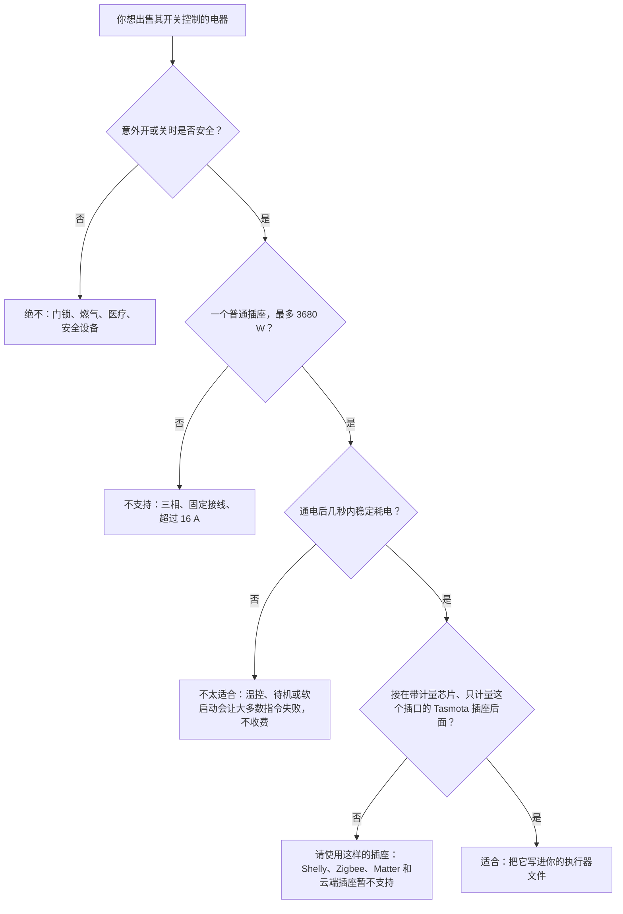
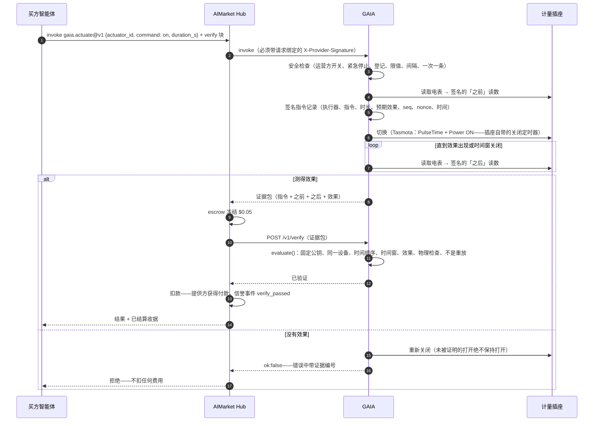
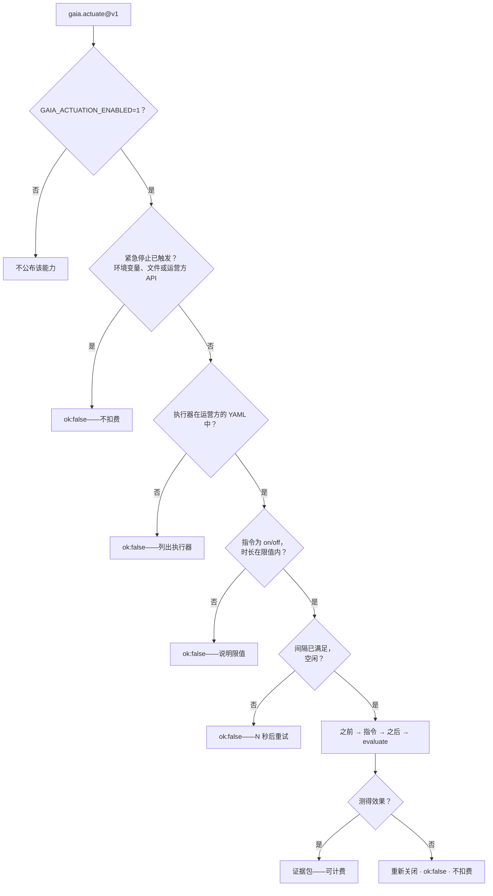

# 设备控制 — 只为测得的效果付费

> 🌐 [English](../ACTUATION.md) · [Русский](ACTUATION.ru.md) · [Español](ACTUATION.es.md) · [Français](ACTUATION.fr.md) · **中文**

读取物理世界只是智能体所需的一半，另一半是改变它：让电暖器、水泵或电动车充电器运行一段时间。
GAIA 以 `gaia.actuate@v1` 出售这一能力，并用一条规则让向陌生人购买也安全：

**只有当指令的效果被测量到时，才需要为这条指令付费。**

执行器是一个**带计量的智能插座**：GAIA 切换的继电器，加上只看得到该继电器所切换负载的电表。
于是「继电器闭合」与「功率上升」就是同一个物理事实。全屋电表不行——别的房间的电水壶会「证明」
电暖器开了。

## 可以控制什么

GAIA 只切换一种设备：**带计量的智能插座**。实际上它控制的是插在这个插座上的东西，而且只有两条
指令：持续有限秒数的 `on`，以及 `off`。没有调光，没有温度设定，也没有定时计划：所谓计划，就是
买方在自己选定的时刻发起调用，例如在 `gaia.power.window@v1` 找到的窗口开始时。

### 哪些电器适合

只有当电表看到指令的效果时，这条指令才需要付费，所以电器必须**在通电后几秒内稳定耗电**，
断电后几乎不耗电。

| 插座后面的电器 | 适合吗 | 原因 |
|---|---|---|
| 电暖器、油汀、电热毛巾架 | 适合 | 一通电就稳定消耗 0.5–2.5 kW |
| 插在插座上的电热水器 | 加热期间适合 | 水烧热后其温控器会断电；此时的 `on` 测不到效果，会被拒绝，不收费 |
| 家用插座用的电动车充电线、电动自行车或滑板车充电器 | 适合，但不得超过插座和线缆的额定值 | 电池必须真的在充电：充满的电池不耗电，指令会被拒绝 |
| 水泵、风扇、除湿机 | 适合 | 前提是功耗高于运营方设定的 `expect_on_w` |
| 灯、植物生长灯 | 适合 | `expect_on_w` 设得低一些，但仍要明显高于 `off_max_w` |
| 冰箱、冰柜，以及任何自带温控、待机或慢速软启动的电器 | 不太适合 | 「开」之后可能几分钟都不耗电，所以大多数指令会被拒绝 |
| 三相或固定接线的负载、任何超过 16 A 的负载 | 不适合 | 一个插座：最多 230 V × 16 A = 3680 W |
| 门锁、燃气阀、医疗或安全设备 | **绝不** | 任何意外开关可能伤人的东西都不应接到付费开关上 |

效果未被测到的 `on` 会**立即被关回去**，不收任何费用：不合适的电器只会浪费买方的时间，绝不会
浪费买方的钱。



### GAIA 驱动哪些插座

| 执行器文件中的 `kind` | 是什么 |
|---|---|
| `tasmota-mqtt` | 运行 [Tasmota](https://tasmota.github.io/) 固件的真实插座，通过运营方自己的 MQTT broker 访问 |
| `sim-plug` | 软件中的插座和电器（`load_w` 为 1 到 3680 W）。iot.modelmarket.dev 上的公开演示 `plug-sim-01` 就是这种；它的每个回答都带有 `"simulated": true` |

满足以下条件的 Tasmota 插座才合格：

1. **有电能计量芯片。** Tasmota 主页显示 Voltage、Current 和 Power，`Status 8` 返回 `ENERGY`
   数据块。没有计量芯片的插座什么都证明不了，发给它的每条指令都会被拒绝。
2. **它的电表只看被切换的那个插口。** GAIA 切换 `Power1`。把几个插口一起计量的排插不合格：
   别的插口会「证明」这条指令。
3. **接入运营方的 MQTT broker**（`mqtt://` 或 `mqtts://`），并有自己的 `%topic%`。GAIA 只在那里
   与它通信，调用方只能指定执行器 ID，绝不能指定 topic 或 broker。
4. **额定值足以承受负载。** 接近 16 A 的长时间负载会让家用插座发热；请遵守插座的额定值，给电动车
   充电时还要遵守线缆的额定值。

每个 Tasmota 插座都有 `PulseTime`，即插座自己的关断定时器。GAIA 随 `on` 一起发送它，所以即使
GAIA、broker 或网络失联，插座也会在付费时长结束后自行关断。该定时器最多 64 800 秒，因此一次
`on` 最长 18 小时。

暂不支持：Shelly、Zigbee、Matter、Home Assistant 和纯云端插座、一个电表对应多个继电器的插座、
调光器、温控器和阀门。每一种都需要自己的驱动，以及自己证明效果的方法。

### 运营方为每个执行器设定什么

| 字段 | 含义 | 规则（默认值） |
|---|---|---|
| `expect_on_w` | 证明「开」的计量功率 | 低于电器的稳定功耗，高于插座空载时的任何功耗 |
| `off_max_w` | 证明「关」的计量功率 | `0 < off_max_w < expect_on_w`（10 W） |
| `min_on_s`、`max_on_s` | 一次 `on` 可持续多久 | `0 < min ≤ max ≤ 64800`（10 秒、900 秒） |
| `cooldown_s` | 对同一执行器两条指令之间的间隔 | `≥ 0`（30 秒） |
| `effect_timeout_s` | GAIA 等待效果出现的时间 | 1–120 秒（20 秒） |
| `latitude`、`longitude` | 可选：ATLAS 在哪里显示它 | — |

启用设备控制时，违反这些规则的执行器文件会让 GAIA 在启动时停止，而不是运行一个「开」和「关」
可能看起来一样的开关。配置正确但无法连接的插座会被跳过并写入日志，GAIA 的其余部分照常运行。

## 能力

| 能力 | 价格 | 作用 |
|---|---|---|
| `gaia.actuator.list@v1` | 免费 | 运营方的执行器：指令、时长上下限、指令间隔、继电器状态、固定的设备公钥，以及紧急停止是否已触发 |
| `gaia.actuate@v1` | $0.05 | 将执行器打开（`on`）`duration_s` 秒——之后自动关闭——或关闭（`off`）。结果是证据包 |

$0.05 是 Hub 按验证付费（Pay-on-Verified）的最低价格：买方可以把款项托管在 escrow 中，直到
GAIA 的 `/v1/verify` 确认效果。

## 一笔付费指令如何结算



即使没有 `verify` 块，效果仍然决定是否收费：对未被证明的效果，GAIA 返回 `ok:false`，而 Hub
对 `ok:false` 不扣费。`verify` 块在资金流动之前再加一道检查：Hub 把证据发给 GAIA 自己的验证器，由它精确复核（见下文）——
Hub 通过 `AIMARKET_VERIFY_ROUTES` 把 `gaia.actuate@v1` 路由到这里，而不是交给它的 LLM 评审团。

## 安全检查



调用方只能给出**执行器 ID**——绝不能指定 MQTT 主题、broker 或运营方未登记的设备。「打开」总是
有界的：必须给出时长，且上限由运营方设定。

## 调用方式

```bash
# 可以切换什么、有哪些限值
curl -s -X POST https://iot.modelmarket.dev/ai-market/v2/invoke -H 'Content-Type: application/json' \
  -d '{"capability_id":"gaia.actuator.list@v1","input":{}}'

# 打开演示电暖器一分钟
curl -s -X POST https://iot.modelmarket.dev/ai-market/v2/invoke -H 'Content-Type: application/json' \
  -d '{"capability_id":"gaia.actuate@v1",
       "input":{"actuator_id":"plug-sim-01","command":"on","duration_s":60}}'
```

返回（节选）：

```json
{
  "actuation": {
    "record": {"command_id": "act_1f…", "actuator_id": "plug-sim-01", "command": "on",
               "duration_s": 60, "seq": 1792145220000, "issued_at": "2026-10-16T10:07:00Z",
               "nonce": "…", "expect": {"field": "power_w", "op": ">=", "value": 1000, "within_s": 20}},
    "attestation": {"algorithm": "ed25519", "public_key": "…", "value": "…"}
  },
  "before": {"reading": {"values": {"power_w": 0.4, "relay_on": 0.0, "…": "…"}}, "attestation": {"…": "…"}},
  "after":  {"reading": {"values": {"power_w": 1497.2, "relay_on": 1.0, "…": "…"}}, "attestation": {"…": "…"}},
  "effect": {"verified": true, "expected": {"…": "…"}, "observed": 1497.2},
  "simulated": true,
  "auto_off_at": "2026-10-16T10:08:00Z"
}
```

任何人都可以再次检查：用证据包调用 `POST /v1/verify`（escrow 插槽），或用它调用
`gaia.verify@v1`。近期指令的证据（包括被拒绝的）公开于 `GET /actuation/v1/evidence/<command_id>`；
`GET /actuation/v1/status` 显示所有执行器。

## 判定检查什么

所有检查都是硬性的——只要有一个事实不实，就无需付费：

| 检查 | 含义 |
|---|---|
| `command_signature` | 指令记录由插座的**固定**公钥签名（来自设备队列登记，绝不是证据包自带的公钥） |
| `before_device`、`after_device` | 两次读数来自同一执行器 |
| `before_signature`、`after_signature` | 两次读数都能用固定公钥验证 |
| `order` | 之前 → 指令 → 之后，按序号和时间 |
| `window` | 效果在承诺的时间窗内被读取 |
| `effect` | 「之后」读数满足预期条件（打开为 `power_w >= expect_on_w`，关闭为 `<= off_max_w`） |
| `relay_state` | 插座报告的继电器状态与指令要求一致 |
| `after_plausible` | 「之后」读数通过 GAIA 的物理检查 |

每条指令只结算一次：其 `seq`（墙钟毫秒，只增不减）是 escrow 验证方的高水位，因此重放的证据包会被拒绝。

合理性检查了解插座：`relay_on` 是一个字段；断开的继电器却计量到超过 25 W 是矛盾；电能寄存器的增量
与一个 16 A 插座在上次读数以来最多能通过的电能比较，而不是与「当前功率 × 时间间隔」比较——在两次
读数之间被切换过的插座是诚实的。

## 运营方

公开演示只运行一个**模拟**插座（`plug-sim-01`，一台 1500 W 电暖器），配置见
[`config/actuators.yaml`](../../config/actuators.yaml)。使用真实硬件时：

1. 一个**带电能计量芯片**的 Tasmota 插座，接入你的 MQTT broker，并能响应 `Status 8`。
2. 你的执行器文件，参照 [`config/actuators.example.yaml`](../../config/actuators.example.yaml)：
   ```yaml
   actuators:
     - id: lab-heater-01
       kind: tasmota-mqtt
       topic: tasmota_lab_heater   # 插座的 %topic%
       expect_on_w: 800            # 低于电暖器功率，高于插座的待机功率
       off_max_w: 5
       min_on_s: 30
       max_on_s: 1800
       cooldown_s: 60
       effect_timeout_s: 20
   ```
3. 环境变量：
   ```bash
   GAIA_ACTUATION_ENABLED=1
   GAIA_ACTUATORS_FILE=/path/to/actuators.yaml
   GAIA_MQTT_BROKER=mqtts://broker.example:8883
   GAIA_MQTT_USERNAME=gaia            # 密码来自你的密钥库，绝不放在 git 中的文件里
   GAIA_ACTUATION_TOKEN=…             # 紧急停止 API 的 Bearer 令牌
   ```
4. **以 Pay-on-Verified 出售它的 Hub** 把这项能力路由到本 GAIA 的验证器，让精确检查而不是 LLM
   评审团决定资金去向：
   ```
   # GAIA：生产环境下，未设置此项时 /v1/verify 拒绝所有调用方
   GAIA_VERIFY_TOKEN=…                # 随机密钥，来自权限为 0600 的文件
   # Hub 的环境文件（一行，不加引号：--env-file 按字面读取值）
   AIMARKET_VERIFY_ROUTES={"gaia.actuate@v1": {"url": "https://<gaia>", "verifier_id": "gaia.verify@v1", "key_env": "AIMARKET_VERIFY_GAIA_TOKEN"}}
   AIMARKET_VERIFY_GAIA_TOKEN=…       # 与 GAIA_VERIFY_TOKEN 相同的值
   ```
   Hub 没有该令牌时，会在任何开关动作之前拒绝 `verify` 块；令牌错误时，GAIA 返回 401，买方获得
   退款。参见 [Hub 的验证器路由](https://github.com/alexar76/aimarket-hub/blob/main/docs/pay-on-verified.md#verifier-routes)。

打开指令以 `Backlog PulseTime1 <时长>; Power1 ON` 发送，因此即使 GAIA、broker 或网络消失，
**插座也会在付费时长结束后自行关闭**。此外，GAIA 还会在到期时自行发送 OFF，作为第二道停止。

### 紧急停止

三种方式，任何一种都够；触发期间所有指令都被拒绝，且不扣费：

```bash
curl -X POST https://<gaia>/actuation/v1/kill   -H "Authorization: Bearer $GAIA_ACTUATION_TOKEN"   # 同时关闭全部设备
curl -X POST https://<gaia>/actuation/v1/resume -H "Authorization: Bearer $GAIA_ACTUATION_TOKEN"
touch <数据目录>/ACTUATION_KILL      # 一个文件，用于 API 不可达时
GAIA_ACTUATION_KILL=1               # 一个环境变量，用于重启时
```

没有 `GAIA_ACTUATION_TOKEN` 时，紧急停止 API 返回 503——它绝不会在未认证的情况下开放。每条指令、
结果、停止和恢复都会追加到数据目录中的 `actuation.jsonl`。

## 诚实的限制

- Tasmota 插座没有安全元件。GAIA 的密钥签署的是**插座所报告的内容**——即对报告的保管，与 GAIA
  的每个中继一样，而不是证明硬件不会说谎。正因为电表与继电器是同一台设备，这一声明才保持在窄范围内。
- 效果证明有功率通过了插座，而不是电器用这些电做了什么。
- 公开演示的插座是模拟的（`SIM`）：它的电暖器只存在于软件中，每个回答都会注明（`"simulated": true`）。
- 有了路由，GAIA 既是 `gaia.actuate@v1` 的卖方，也是裁判。之所以可以接受，只是因为判定是对已签名
  证据的确定性检查，任何人都可以重跑（`POST /v1/verify`，或用证据包调用 `gaia.verify@v1`），并且在
  Hub 设有上诉法庭（另一个验证器）时，买方可以对“通过”提出上诉。任何验证器——无论 GAIA 还是
  LLM——都发现不了持有插座密钥者伪造的证据。

W3C WoT：每个插座的 Thing Description（`GET /wot/<id>`）带有 `switchOn` / `switchOff`
**动作（actions）**，其表单是付费的 `gaia.actuate@v1` 调用。
