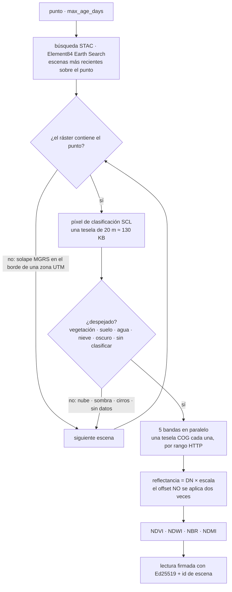

# Imágenes satelitales — la última vista sin nubes de cualquier punto en tierra

> 🌐 [English](../IMAGERY.md) · [Русский](IMAGERY.ru.md) · **Español** · [Français](IMAGERY.fr.md) · [中文](IMAGERY.zh.md)

Los demás relés de GAIA son estaciones. `gaia.imagery.read@v1` ($0.005) es un satélite: para
cualquier coordenada en tierra devuelve la vista **Copernicus Sentinel-2 Level-2A** más reciente
cuyo píxel allí está despejado, como lectura firmada con Ed25519 con cuatro índices y cinco
reflectancias de superficie.

| Índice | Fórmula | Se lee como |
|---|---|---|
| NDVI | (NIR − red) / (NIR + red) | vigor de la vegetación |
| NDWI | (green − NIR) / (green + NIR) | agua libre (McFeeters) |
| NBR | (NIR − SWIR2) / (NIR + SWIR2) | cicatrices de incendio (severidad mediante dNBR) |
| NDMI | (NIR − SWIR1) / (NIR + SWIR1) | humedad de la vegetación |

```bash
curl -s -X POST https://iot.modelmarket.dev/ai-market/v2/invoke -H 'Content-Type: application/json' \
  -d '{"capability_id":"gaia.imagery.read@v1","input":{"latitude":52.473,"longitude":13.402}}'
```

Pase `latitude` + `longitude`, o un nombre de lugar en `city` (a través del [nomenclátor](PLACES.es.md)),
y opcionalmente `max_age_days` (1–120, por defecto 30). La respuesta incluye el id de la escena,
su fecha, la tesela MGRS, la clase de escena en el píxel y el crédito «Contains modified
Copernicus Sentinel data <año>».

Medido el 16-10-2026 (escena del 12-10-2026):

| Punto | Clase de escena | NDVI | NDWI |
|---|---|---|---|
| Tempelhofer Feld, Berlín (hierba) | vegetación | 0,58 | −0,59 |
| Wannsee, Berlín (lago) | agua | −0,75 | 0,88 |

Lea un índice **junto con la clase de escena**: NBR y NDMI sobre el agua salen cerca de 1 porque
el infrarrojo de onda corta del agua es casi nulo — físicamente correcto y sin sentido como
«quemado» o «humedad».

## Cómo funciona una lectura



Cada banda es un archivo de 100–250 MB; una lectura puntual toma los primeros 256 KB del archivo
(donde está su índice de teselas) y exactamente una tesela comprimida — unos 2 MB por banda,
4–14 s por lectura. Se prueban como máximo seis escenas; si en ninguna el píxel está despejado,
la respuesta es `ok:false` nombrando lo que se vio (por ejemplo `SCL 8` nube, `SCL 3` sombra) y no
se cobra nada.

## Tres hechos de los que depende el código

Cada uno se encontró en el archivo real el 16-10-2026 y está fijado por un test:

1. **El offset ya está aplicado.** Earth Search marca `earthsearch:boa_offset_applied: true` y aun
   así lista `offset: -0.1` en `raster:bands`. Aplicarlo otra vez convertía el infrarrojo cercano
   del Wannsee (DN 7, reflectancia 0,0007 — agua) en −0,0993. Con la marca, la reflectancia es
   DN × escala; el offset solo se aplica cuando no está.
2. **Un punto cerca del borde de una zona UTM cae en dos teselas MGRS**, y la búsqueda devuelve
   ambas, pero un ráster puede no contenerlo (el Müggelsee queda al este de la última columna de
   la tesela 32UQD). Un píxel solo se lee de un ráster cuyos límites lo contienen.
3. **Las nubes son por píxel, no por escena.** Una escena con un 9 % de nubes puso `SCL 8` (nube)
   sobre el bosque de Grunewald y le dio la «reflectancia» de una nube. Solo las clases 2, 4, 5,
   6, 7 y 11 cuentan como una vista del suelo.

## Límites honestos

- Un píxel de 10–20 m, no la media de una parcela.
- «El último despejado» puede tener semanas con nubosidad persistente; `observation_age_days`
  dice su antigüedad.
- Sobre el océano abierto la mayoría de los puntos no tiene cobertura Sentinel-2.

Licencia: los datos Copernicus Sentinel son libres, completos y abiertos, incluido el uso
comercial, con el crédito «Contains modified Copernicus Sentinel data <año>». Hosts:
`earth-search.aws.element84.com` (STAC) y `sentinel-cogs.s3.us-west-2.amazonaws.com`
(AWS Open Data). Sin clave ni cuenta.

En el mapa de ATLAS, la capa **Imágenes satelitales** muestra cinco puntos de muestra (hierba,
agua, roca, selva, desierto), cada uno leído mediante esta capacidad unas pocas veces al día.
