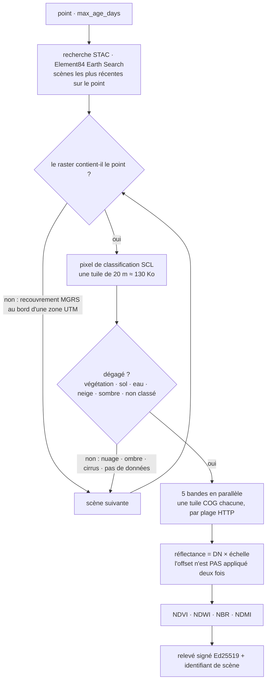

# Imagerie satellite — la dernière vue sans nuages de tout point terrestre

> 🌐 [English](../IMAGERY.md) · [Русский](IMAGERY.ru.md) · [Español](IMAGERY.es.md) · **Français** · [中文](IMAGERY.zh.md)

Les autres relais de GAIA sont des stations. `gaia.imagery.read@v1` (0,005 $) est un satellite :
pour toute coordonnée terrestre, il renvoie la vue **Copernicus Sentinel-2 Level-2A** la plus
récente dont le pixel à cet endroit est dégagé, sous forme de relevé signé Ed25519 avec quatre
indices et cinq réflectances de surface.

| Indice | Formule | Se lit comme |
|---|---|---|
| NDVI | (NIR − red) / (NIR + red) | vigueur de la végétation |
| NDWI | (green − NIR) / (green + NIR) | eau libre (McFeeters) |
| NBR | (NIR − SWIR2) / (NIR + SWIR2) | cicatrices de feu (sévérité via dNBR) |
| NDMI | (NIR − SWIR1) / (NIR + SWIR1) | humidité de la végétation |

```bash
curl -s -X POST https://iot.modelmarket.dev/ai-market/v2/invoke -H 'Content-Type: application/json' \
  -d '{"capability_id":"gaia.imagery.read@v1","input":{"latitude":52.473,"longitude":13.402}}'
```

Passez `latitude` + `longitude`, ou un nom de lieu dans `city` (via le [répertoire](PLACES.fr.md)),
et éventuellement `max_age_days` (1–120, 30 par défaut). La réponse porte l'identifiant de la scène,
sa date, la tuile MGRS, la classe de scène au pixel et la mention « Contains modified Copernicus
Sentinel data <année> ».

Mesuré le 16/10/2026 (scène du 12/10/2026) :

| Point | Classe de scène | NDVI | NDWI |
|---|---|---|---|
| Tempelhofer Feld, Berlin (herbe) | végétation | 0,58 | −0,59 |
| Wannsee, Berlin (lac) | eau | −0,75 | 0,88 |

Lisez un indice **avec la classe de scène** : NBR et NDMI sur l'eau sont proches de 1, car
l'infrarouge à ondes courtes de l'eau est quasi nul — physiquement juste et dépourvu de sens comme
« brûlé » ou « humidité ».

## Comment se fait une lecture



Chaque bande est un fichier de 100 à 250 Mo ; une lecture ponctuelle prend les 256 premiers Ko du
fichier (où se trouve l'index des tuiles) et exactement une tuile compressée — environ 2 Mo par
bande, 4 à 14 s par lecture. Six scènes au plus sont essayées ; si aucune n'est dégagée au pixel,
la réponse est `ok:false` en nommant ce qui a été vu (par exemple `SCL 8` nuage, `SCL 3` ombre) et
rien n'est débité.

## Trois faits sur lesquels repose le code

Chacun a été trouvé sur l'archive réelle le 16/10/2026 et est verrouillé par un test :

1. **L'offset est déjà appliqué.** Earth Search indique `earthsearch:boa_offset_applied: true` et
   liste pourtant `offset: -0.1` dans `raster:bands`. L'appliquer de nouveau transformait le
   proche infrarouge du Wannsee (DN 7, réflectance 0,0007 — de l'eau) en −0,0993. Avec ce drapeau,
   la réflectance vaut DN × échelle ; l'offset ne s'applique qu'en son absence.
2. **Un point près du bord d'une zone UTM se trouve dans deux tuiles MGRS**, et la recherche
   renvoie les deux — mais un raster peut ne pas le contenir (le Müggelsee est à l'est de la
   dernière colonne de la tuile 32UQD). Un pixel n'est lu que dans un raster dont les limites le
   contiennent.
3. **Les nuages sont par pixel, pas par scène.** Une scène nuageuse à 9 % a mis `SCL 8` (nuage)
   sur la forêt de Grunewald et lui a donné la « réflectance » d'un nuage. Seules les classes 2, 4,
   5, 6, 7 et 11 comptent comme une vue du sol.

## Limites honnêtes

- Un pixel de 10–20 m, pas une moyenne de parcelle.
- « Le dernier dégagé » peut dater de plusieurs semaines sous une couverture nuageuse persistante ;
  `observation_age_days` en donne l'âge.
- Au-dessus du grand large, la plupart des points n'ont pas de couverture Sentinel-2.

Licence : les données Copernicus Sentinel sont libres, complètes et ouvertes, usage commercial
compris, avec la mention « Contains modified Copernicus Sentinel data <année> ». Hôtes :
`earth-search.aws.element84.com` (STAC) et `sentinel-cogs.s3.us-west-2.amazonaws.com`
(AWS Open Data). Sans clé ni compte.

Sur la carte ATLAS, la couche **Imagerie satellite** montre cinq points vitrine (herbe, eau,
roche, forêt tropicale, désert), chacun lu via cette capacité quelques fois par jour.
