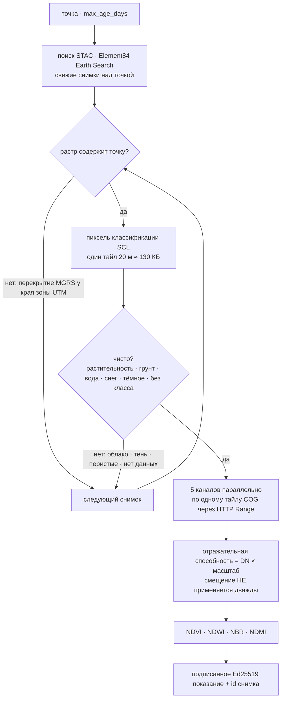

# Спутниковые снимки — последний безоблачный взгляд на любую точку суши

> 🌐 [English](../IMAGERY.md) · **Русский** · [Español](IMAGERY.es.md) · [Français](IMAGERY.fr.md) · [中文](IMAGERY.zh.md)

Остальные ретрансляторы (relay) GAIA — станции. `gaia.imagery.read@v1` ($0.005) — спутник: для
любой координаты на суше он возвращает самый свежий снимок **Copernicus Sentinel-2 Level-2A**, у
которого пиксель в этой точке чистый, — как подписанное Ed25519 показание с четырьмя индексами и
пятью значениями отражательной способности поверхности.

| Индекс | Формула | Что показывает |
|---|---|---|
| NDVI | (NIR − red) / (NIR + red) | силу растительности |
| NDWI | (green − NIR) / (green + NIR) | открытую воду (по McFeeters) |
| NBR | (NIR − SWIR2) / (NIR + SWIR2) | гари (тяжесть пожара через dNBR) |
| NDMI | (NIR − SWIR1) / (NIR + SWIR1) | влажность растительности |

```bash
curl -s -X POST https://iot.modelmarket.dev/ai-market/v2/invoke -H 'Content-Type: application/json' \
  -d '{"capability_id":"gaia.imagery.read@v1","input":{"latitude":52.473,"longitude":13.402}}'
```

Передайте `latitude` + `longitude` или название места в `city` (через [справочник мест](PLACES.ru.md))
и при желании `max_age_days` (1–120, по умолчанию 30). В ответе — id снимка, его дата, тайл MGRS,
класс поверхности в пикселе и атрибуция «Contains modified Copernicus Sentinel data <год>».

Измерено 16.10.2026 (снимок от 12.10.2026):

| Точка | Класс поверхности | NDVI | NDWI |
|---|---|---|---|
| Темпельхофер-Фельд, Берлин (трава) | растительность | 0,58 | −0,59 |
| Ванзее, Берлин (озеро) | вода | −0,75 | 0,88 |

Читайте индекс **вместе с классом поверхности**: NBR и NDMI над водой получаются около 1, потому
что коротковолновый ИК воды почти нулевой — физически верно и бессмысленно как «гарь» или
«влажность».

## Как устроено чтение



Каждый канал — файл на 100–250 МБ; чтение точки берёт первые 256 КБ файла (там индекс тайлов) и
ровно один сжатый тайл — около 2 МБ на канал, 4–14 с на чтение. Перебирается не больше шести
снимков; если ни в одном пиксель не чистый, ответ — `ok:false` с тем, что было видно (например,
`SCL 8` — облако, `SCL 3` — тень), и ничего не списывается.

## Три факта, на которых держится код

Каждый найден на живом архиве 16.10.2026 и закреплён тестом:

1. **Смещение уже применено.** Earth Search ставит `earthsearch:boa_offset_applied: true` и при
   этом оставляет `offset: -0.1` в `raster:bands`. Повторное применение превращало ближний ИК
   Ванзее (DN 7, отражательная способность 0,0007 — вода) в −0,0993. Если флаг стоит,
   отражательная способность = DN × масштаб; смещение применяется, только если флага нет.
2. **Точка у края зоны UTM лежит в двух тайлах MGRS**, и поиск возвращает оба, но один растр может
   её не содержать (Мюггельзе лежит восточнее последнего столбца тайла 32UQD). Пиксель читается
   только из растра, в границы которого точка попадает.
3. **Облака — попиксельно, а не на весь снимок.** Снимок с облачностью 9 % дал лесу Груневальд
   `SCL 8` (облако) и «отражательную способность» облака. Взглядом на землю считаются только
   классы 2, 4, 5, 6, 7 и 11.

## Честные ограничения

- Один пиксель 10–20 м, а не среднее по полю.
- «Последний чистый» при устойчивой облачности может быть недельной давности; сколько ему дней,
  говорит `observation_age_days`.
- Над открытым океаном у большинства точек покрытия Sentinel-2 нет.

Лицензия: данные Copernicus Sentinel свободные, полные и открытые, коммерческое использование
разрешено, с атрибуцией «Contains modified Copernicus Sentinel data <год>». Хосты:
`earth-search.aws.element84.com` (STAC) и `sentinel-cogs.s3.us-west-2.amazonaws.com`
(AWS Open Data). Без ключа и без учётной записи.

На карте ATLAS слой **«Спутниковые снимки»** показывает пять витринных точек (трава, вода, камень,
тропический лес, пустыня); каждая читается через эту функцию несколько раз в сутки.
