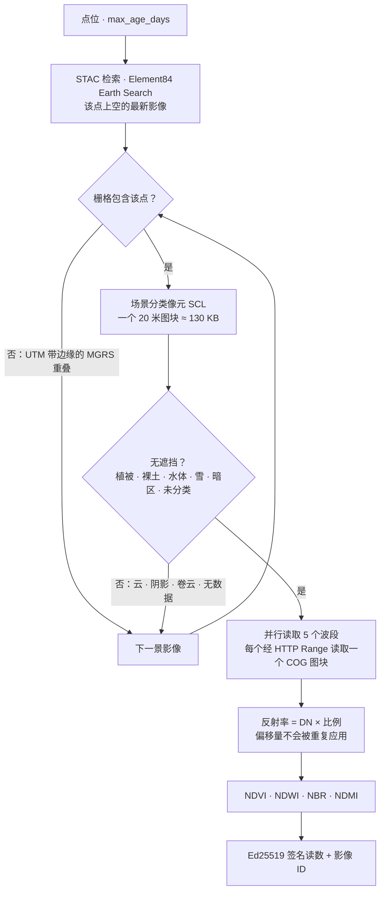

# 卫星影像 — 任意陆地点最新的无云影像

> 🌐 [English](../IMAGERY.md) · [Русский](IMAGERY.ru.md) · [Español](IMAGERY.es.md) · [Français](IMAGERY.fr.md) · **中文**

GAIA 的其他中继都是站点。`gaia.imagery.read@v1`（$0.005）是一颗卫星：对任意陆地坐标，它返回该处
像元无云的最新 **Copernicus Sentinel-2 Level-2A** 影像，作为带四个指数和五个地表反射率的
Ed25519 签名读数。

| 指数 | 公式 | 含义 |
|---|---|---|
| NDVI | (NIR − red) / (NIR + red) | 植被长势 |
| NDWI | (green − NIR) / (green + NIR) | 开阔水体（McFeeters） |
| NBR | (NIR − SWIR2) / (NIR + SWIR2) | 火烧迹地（通过 dNBR 评估火灾严重程度） |
| NDMI | (NIR − SWIR1) / (NIR + SWIR1) | 植被含水量 |

```bash
curl -s -X POST https://iot.modelmarket.dev/ai-market/v2/invoke -H 'Content-Type: application/json' \
  -d '{"capability_id":"gaia.imagery.read@v1","input":{"latitude":52.473,"longitude":13.402}}'
```

传入 `latitude` + `longitude`，或在 `city` 中传入地名（经[地名库](PLACES.zh.md)解析），并可选
`max_age_days`（1–120，默认 30）。答案包含影像 ID、日期、MGRS 图幅、该像元的场景分类，以及署名
「Contains modified Copernicus Sentinel data <年份>」。

2026-10-16 实测（2026-10-12 的影像）：

| 地点 | 场景分类 | NDVI | NDWI |
|---|---|---|---|
| 柏林滕珀尔霍夫公园（草地） | 植被 | 0.58 | −0.59 |
| 柏林万湖（湖泊） | 水体 | −0.75 | 0.88 |

请**结合场景分类**解读指数：水体上的 NBR 和 NDMI 接近 1，因为水的短波红外几乎为零——物理上
正确，但作为「火烧」或「含水量」没有意义。

## 一次读取如何进行



每个波段是 100–250 MB 的文件；一次点位读取只取文件开头 256 KB（图块索引所在处）和恰好一个压缩
图块——每个波段约 2 MB，每次读取 4–14 秒。最多尝试六景影像；如果该像元在所有影像中都不清晰，
返回 `ok:false` 并说明看到的情况（例如 `SCL 8` 云、`SCL 3` 阴影），不扣费。

## 代码依赖的三个事实

每一条都是 2026-10-16 在实时存档上发现的，并由测试固定：

1. **偏移量已经应用过。** Earth Search 标注 `earthsearch:boa_offset_applied: true`，却仍在
   `raster:bands` 中列出 `offset: -0.1`。再次应用会把万湖的近红外（DN 7，反射率 0.0007——水）
   变成 −0.0993。标志为真时，反射率 = DN × 比例；只有没有该标志时才应用偏移量。
2. **UTM 带边缘附近的点位于两个 MGRS 图幅中**，检索会同时返回两者——但其中一个栅格可能并不包含
   该点（米格尔湖位于 32UQD 图幅最后一列的东侧）。只从边界包含该点的栅格中读取像元。
3. **云是按像元判断的，而不是按整景影像。** 一景云量 9% 的影像在格鲁内瓦尔德森林上标为 `SCL 8`
   （云），给出的是云的「反射率」。只有分类 2、4、5、6、7 和 11 才算看到了地面。

## 诚实的限制

- 一个 10–20 米的像元，而不是地块平均值。
- 在持续多云的情况下，「最新无云」可能是几周前的；`observation_age_days` 说明其时效。
- 在远洋上，大多数点没有 Sentinel-2 覆盖。

许可：Copernicus Sentinel 数据免费、完整、开放，包括商业用途，需署名「Contains modified
Copernicus Sentinel data <年份>」。主机：`earth-search.aws.element84.com`（STAC）和
`sentinel-cogs.s3.us-west-2.amazonaws.com`（AWS Open Data）。无需密钥或账户。

在 ATLAS 地图上，**卫星影像**图层显示五个示例点（草地、水体、岩石、雨林、沙漠），每个点每天经由
此能力读取几次。
