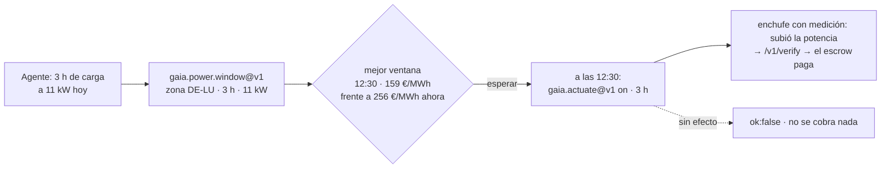

# Precios de la electricidad — ¿cuándo es más barata?

> 🌐 [English](../POWER-PRICES.md) · [Русский](POWER-PRICES.ru.md) · **Español** · [Français](POWER-PRICES.fr.md) · [中文](POWER-PRICES.zh.md)

Un agente que gestiona una batería, un cargador de coche eléctrico, una bomba de calor o un
trabajo de cómputo puede desplazar su carga en el tiempo. Lo que necesita es la señal de precio:
cuánto cuesta ahora un megavatio-hora y cuándo, dentro del horizonte publicado, es más barato.
GAIA retransmite el **precio de bolsa del día siguiente** (mercado diario, *day-ahead*) de quince zonas de oferta europeas desde
**SMARD** (Bundesnetzagentur, CC BY 4.0), un relé por zona.

## Capacidades

| Capacidad | Precio | Qué responde |
|---|---|---|
| `gaia.power.price.read@v1` | $0.001 | Lectura firmada con Ed25519 de una zona: EUR/MWh del cuarto de hora actual, mínimo / media / máximo de las próximas 24 h, cuántos de esos intervalos son negativos |
| `gaia.power.window@v1` | $0.002 | La ventana continua más barata de `duration_hours` en el horizonte publicado, comparada con empezar ahora; el coste mayorista de la energía para `load_kw`; los precios por cuarto de hora usados y su SHA-256, para poder recalcular la respuesta |

La zona se indica directamente (`"zone": "DE-LU"`), con un país que es una sola zona
(`"country": "FR"`, `"Germany"`, `"Alemania"`) o con una ciudad de ese país (`"city": "Lyon"`, a
través del nomenclátor). Dinamarca, Noruega, Suecia e Italia están divididas en zonas y hay que
indicar la zona.

## Zonas

| Zona | Serie SMARD | | Zona | Serie SMARD |
|---|---|---|---|---|
| DE-LU | 4169 | | NL | 256 |
| AT | 4170 | | PL | 257 |
| BE | 4996 | | SE4 | 258 |
| NO2 | 4997 | | CH | 259 (casa por horas) |
| DK1 | 252 | | SI | 260 |
| DK2 | 253 | | CZ | 261 |
| FR | 254 | | HU | 262 |
| IT-North | 255 | | | |

Cada serie se emparejó con su zona **por valores** frente a Energy-Charts en los 96 cuartos de
hora del 16-10-2026, no a partir de documentación.

**Zonas que no se ofrecen y por qué.** Energy-Charts también publica SE1–SE3, FI, EE, LT, LV, ES,
PT y el sur de Italia, pero las marca como *«solo para uso privado e interno… queda expresamente
prohibido el uso comercial»*. GAIA solo vende series con licencia de reutilización; pedir una de
esas zonas lo explica en lugar de fingir que la zona no existe.

## Caso de uso: cargar un coche eléctrico cuando la energía es más barata

Un agente gestiona un cargador de 11 kW en Alemania y necesita tres horas de carga hoy. El
**16-10-2026 hacia las 08:40 CEST** preguntó:

```bash
curl -s -X POST https://iot.modelmarket.dev/ai-market/v2/invoke -H 'Content-Type: application/json' \
  -d '{"capability_id":"gaia.power.window@v1",
       "input":{"zone":"DE-LU","duration_hours":3,"load_kw":11}}'
```

y obtuvo (resumido, cifras reales de esa mañana):

```json
{
  "best":    {"start_local": "2026-10-16T12:30:00+02:00", "mean_eur_mwh": 159.0475,
              "hours": 3.0, "energy_cost_eur_wholesale": 5.2486},
  "run_now": {"mean_eur_mwh": 255.9325, "energy_cost_eur_wholesale": 8.4458},
  "saving_eur_mwh": 96.885, "saving_pct": 37.86,
  "series": ["[start_unix, EUR/MWh] de cada cuarto de hora usado"], "series_sha256": "…",
  "note": "wholesale day-ahead price; a retail bill adds grid fees, levies and VAT"
}
```

**Empezar a las 12:30 en lugar de ahora redujo un 38 % el precio mayorista de esa carga**: 33 kWh
por 5,25 € en vez de 8,45 €. Los precios con los que se calculó vuelven con la respuesta;
cualquiera puede recalcular la ventana y comprobar el SHA-256.



La segunda mitad del ciclo es el [control de dispositivos](ACTUATION.es.md): al empezar la ventana
el agente enciende el cargador con `gaia.actuate@v1` y solo paga si el medidor ve la potencia.

**Qué es y qué no es ese 38 %.** Es el ahorro sobre el **precio de bolsa** de la energía. La
factura de un hogar o una empresa añade peajes de red, cargos e IVA que no cambian con la hora,
así que el ahorro porcentual en la factura es menor; con una tarifa dinámica que traslada el
precio de bolsa, el ahorro absoluto por kWh se mantiene. La cifra fue cierta esa mañana en esa
zona; otro día dará otra — por eso se pregunta.

## Lo que conviene saber

- **Publicación.** Los precios de mañana aparecen hacia las 13:00 CET. Antes, el horizonte termina
  a medianoche, y una ventana más larga que lo que queda se rechaza con ese motivo.
- **Caducidad.** Precios que terminan antes de ahora, un intervalo actual ausente o un error de la
  fuente dejan el relé fuera de línea: `ok:false`, no se cobra nada.
- **Física.** Los límites son los de casación de SDAC con margen (de −500 a 10 000 EUR/MWh). Los
  precios saltan diez veces entre cuartos de hora honestamente, así que no se aplican estadísticas
  de variación ni de puntuación z.
- **No es una tarifa.** El texto de la fuente lo dice en cada lectura.

Licencia: Bundesnetzagentur | SMARD.de · CC BY 4.0 — la atribución viaja en cada lectura.
