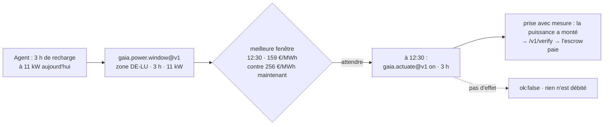

# Prix de l'électricité — quand l'énergie est-elle la moins chère ?

> 🌐 [English](../POWER-PRICES.md) · [Русский](POWER-PRICES.ru.md) · [Español](POWER-PRICES.es.md) · **Français** · [中文](POWER-PRICES.zh.md)

Un agent qui pilote une batterie, une borne de recharge, une pompe à chaleur ou un calcul peut
déplacer sa charge dans le temps. Ce qu'il lui faut, c'est le signal de prix : combien coûte un
mégawattheure maintenant, et quand, dans l'horizon publié, il est le moins cher. GAIA relaie le
**prix de bourse du lendemain** (marché J-1, *day-ahead*) de quinze zones de dépôt européennes depuis **SMARD**
(Bundesnetzagentur, CC BY 4.0), un relais par zone.

## Capacités

| Capacité | Prix | Ce qu'elle répond |
|---|---|---|
| `gaia.power.price.read@v1` | 0,001 $ | Relevé signé Ed25519 pour une zone : EUR/MWh du quart d'heure en cours, minimum / moyenne / maximum des 24 h suivantes, combien de ces intervalles sont négatifs |
| `gaia.power.window@v1` | 0,002 $ | La fenêtre continue la moins chère de `duration_hours` dans l'horizon publié, comparée à un démarrage immédiat ; le coût de gros de l'énergie pour `load_kw` ; les prix au quart d'heure utilisés et leur SHA-256, pour pouvoir recalculer la réponse |

La zone se donne directement (`"zone": "DE-LU"`), par un pays qui forme une seule zone
(`"country": "FR"`, `"Germany"`, `"Allemagne"`) ou par une ville de ce pays (`"city": "Lyon"`, via
le répertoire géographique). Le Danemark, la Norvège, la Suède et l'Italie sont découpés en zones
et doivent nommer la zone.

## Zones

| Zone | Série SMARD | | Zone | Série SMARD |
|---|---|---|---|---|
| DE-LU | 4169 | | NL | 256 |
| AT | 4170 | | PL | 257 |
| BE | 4996 | | SE4 | 258 |
| NO2 | 4997 | | CH | 259 (fixation horaire) |
| DK1 | 252 | | SI | 260 |
| DK2 | 253 | | CZ | 261 |
| FR | 254 | | HU | 262 |
| IT-North | 255 | | | |

Chaque série a été associée à sa zone **par les valeurs**, face à Energy-Charts, sur les 96 quarts
d'heure du 16/10/2026 — pas d'après la documentation.

**Zones non proposées, et pourquoi.** Energy-Charts publie aussi SE1–SE3, FI, EE, LT, LV, ES, PT
et le sud de l'Italie, mais les marque *« usage privé et interne uniquement… tout usage commercial
est expressément interdit »*. GAIA ne vend que des séries sous licence de réutilisation ; demander
l'une de ces zones l'explique au lieu de prétendre que la zone n'existe pas.

## Cas d'usage : recharger une voiture électrique quand l'énergie est la moins chère

Un agent gère une borne de 11 kW en Allemagne et a besoin de trois heures de recharge aujourd'hui.
Le **16/10/2026 vers 08:40 CEST**, il a demandé :

```bash
curl -s -X POST https://iot.modelmarket.dev/ai-market/v2/invoke -H 'Content-Type: application/json' \
  -d '{"capability_id":"gaia.power.window@v1",
       "input":{"zone":"DE-LU","duration_hours":3,"load_kw":11}}'
```

et a obtenu (abrégé, chiffres réels de ce matin-là) :

```json
{
  "best":    {"start_local": "2026-10-16T12:30:00+02:00", "mean_eur_mwh": 159.0475,
              "hours": 3.0, "energy_cost_eur_wholesale": 5.2486},
  "run_now": {"mean_eur_mwh": 255.9325, "energy_cost_eur_wholesale": 8.4458},
  "saving_eur_mwh": 96.885, "saving_pct": 37.86,
  "series": ["[start_unix, EUR/MWh] pour chaque quart d'heure utilisé"], "series_sha256": "…",
  "note": "wholesale day-ahead price; a retail bill adds grid fees, levies and VAT"
}
```

**Démarrer à 12:30 plutôt que tout de suite a réduit de 38 % le prix de gros de cette recharge** :
33 kWh pour 5,25 € au lieu de 8,45 €. Les prix utilisés reviennent avec la réponse ; chacun peut
recalculer la fenêtre et vérifier le SHA-256.



La seconde moitié de la boucle est le [pilotage d'appareils](ACTUATION.fr.md) : au début de la
fenêtre, l'agent allume la borne avec `gaia.actuate@v1` et ne paie que si le compteur voit la
puissance.

**Ce que sont ces 38 %, et ce qu'ils ne sont pas.** C'est l'économie sur le **prix de bourse** de
l'énergie. La facture d'un ménage ou d'une entreprise ajoute l'acheminement, des taxes et la TVA,
qui ne varient pas avec l'heure ; l'économie en pourcentage sur la facture est donc plus faible.
Avec une offre dynamique qui répercute le prix de bourse, l'économie absolue par kWh est conservée.
Le chiffre était vrai ce matin-là dans cette zone ; un autre jour donnera un autre chiffre — c'est
pour cela qu'on demande.

## À savoir

- **Publication.** Les prix du lendemain paraissent vers 13:00 CET. Avant, l'horizon s'arrête à
  minuit, et une fenêtre plus longue que ce qui reste est refusée avec ce motif.
- **Péremption.** Des prix qui s'arrêtent avant maintenant, un intervalle courant absent ou une
  erreur de la source mettent le relais hors ligne : `ok:false`, rien n'est débité.
- **Physique.** Les bornes sont les limites de fixation SDAC avec une marge (de −500 à 10 000
  EUR/MWh). Les prix sautent honnêtement d'un facteur dix entre quarts d'heure, donc aucune
  statistique de variation ni de z-score ne s'applique.
- **Pas un tarif.** Le texte de la source le dit dans chaque relevé.

Licence : Bundesnetzagentur | SMARD.de · CC BY 4.0 — l'attribution accompagne chaque relevé.
