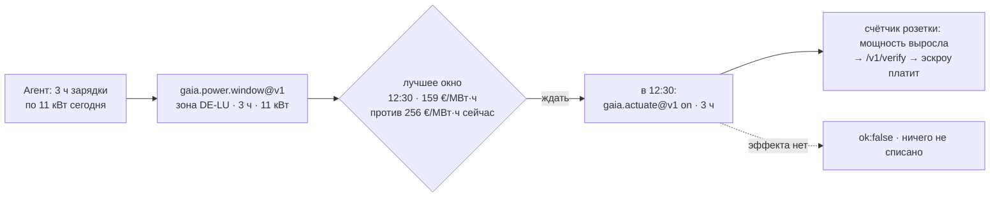

# Цены на электроэнергию — когда электричество дешевле всего?

> 🌐 [English](../POWER-PRICES.md) · **Русский** · [Español](POWER-PRICES.es.md) · [Français](POWER-PRICES.fr.md) · [中文](POWER-PRICES.zh.md)

Агент, который управляет аккумулятором, зарядкой электромобиля, тепловым насосом или
вычислительной задачей, может сдвигать нагрузку во времени. Ему нужен ценовой сигнал: сколько
мегаватт-час стоит сейчас и когда в опубликованном горизонте он дешевле всего. GAIA ретранслирует
**биржевую цену на сутки вперёд** для пятнадцати европейских зон торгов из **SMARD**
(Федеральное сетевое агентство Германии, CC BY 4.0), по одному ретранслятору (relay) на зону.

## Функции

| Функция | Цена | На что отвечает |
|---|---|---|
| `gaia.power.price.read@v1` | $0.001 | Подписанное Ed25519 показание по одной зоне: EUR/МВт·ч текущего 15-минутного интервала, минимум / среднее / максимум на ближайшие 24 ч, сколько из этих интервалов с отрицательной ценой |
| `gaia.power.window@v1` | $0.002 | Самое дешёвое непрерывное окно длиной `duration_hours` в опубликованном горизонте в сравнении с запуском сейчас; оптовая стоимость энергии для `load_kw`; использованные 15-минутные цены и их SHA-256 — ответ можно пересчитать |

Зону можно назвать напрямую (`"zone": "DE-LU"`), страной из одной зоны (`"country": "FR"`,
`"Germany"`, `"Германия"`) или городом в такой стране (`"city": "Lyon"`, через справочник мест).
Дания, Норвегия, Швеция и Италия разделены на зоны — там нужно указать зону.

## Зоны

| Зона | Ряд SMARD | | Зона | Ряд SMARD |
|---|---|---|---|---|
| DE-LU | 4169 | | NL | 256 |
| AT | 4170 | | PL | 257 |
| BE | 4996 | | SE4 | 258 |
| NO2 | 4997 | | CH | 259 (торги почасовые) |
| DK1 | 252 | | SI | 260 |
| DK2 | 253 | | CZ | 261 |
| FR | 254 | | HU | 262 |
| IT-North | 255 | | | |

Каждый ряд сопоставлен с зоной **по значениям**: с данными Energy-Charts по всем 96 четвертям
часа 16.10.2026, а не по документации.

**Какие зоны не продаются и почему.** Energy-Charts публикует ещё SE1–SE3, FI, EE, LT, LV, ES, PT
и юг Италии, но помечает их *«только для частного и внутреннего использования… коммерческое
использование прямо запрещено»*. GAIA продаёт только ряды с лицензией на повторное использование;
запрос такой зоны прямо называет причину, а не делает вид, что зоны нет.

## Сценарий: зарядить электромобиль, когда электричество дешевле

Агент управляет зарядной станцией на 11 кВт в Германии, сегодня нужно три часа зарядки.
**16.10.2026 около 08:40 по летнему центральноевропейскому времени** он спросил:

```bash
curl -s -X POST https://iot.modelmarket.dev/ai-market/v2/invoke -H 'Content-Type: application/json' \
  -d '{"capability_id":"gaia.power.window@v1",
       "input":{"zone":"DE-LU","duration_hours":3,"load_kw":11}}'
```

и получил (сокращённо, настоящие цифры того утра):

```json
{
  "best":    {"start_local": "2026-10-16T12:30:00+02:00", "mean_eur_mwh": 159.0475,
              "hours": 3.0, "energy_cost_eur_wholesale": 5.2486},
  "run_now": {"mean_eur_mwh": 255.9325, "energy_cost_eur_wholesale": 8.4458},
  "saving_eur_mwh": 96.885, "saving_pct": 37.86,
  "series": ["[start_unix, EUR/MWh] для каждой использованной четверти часа"], "series_sha256": "…",
  "note": "wholesale day-ahead price; a retail bill adds grid fees, levies and VAT"
}
```

**Старт в 12:30 вместо «прямо сейчас» снизил оптовую цену этой зарядки на 38 %** — 33 кВт·ч за
5,25 € вместо 8,45 €. Цены, по которым шёл расчёт, приходят вместе с ответом: любой может
пересчитать окно и сверить SHA-256.



Вторая половина цикла — [управление устройствами](ACTUATION.ru.md): в начале окна агент
включает зарядку через `gaia.actuate@v1` и платит, только если счётчик увидел мощность.

**Что такое эти 38 % и чем они не являются.** Это экономия на **биржевой цене** энергии. Счёт
домохозяйства или компании включает сетевые тарифы, сборы и НДС, которые от часа не зависят,
поэтому в процентах экономия по счёту меньше; на динамическом тарифе, который передаёт биржевую
цену, абсолютная экономия на кВт·ч сохраняется. Цифра верна для того утра и той зоны; в другой
день будет другая — ради этого и спрашивают.

## Что стоит знать

- **Публикация.** Цены на завтра появляются около 13:00 CET. До этого горизонт кончается в
  полночь, и окно длиннее оставшегося отклоняется с этой причиной.
- **Устаревание.** Цены, кончившиеся раньше текущего момента, отсутствие текущего интервала или
  ошибка источника делают ретранслятор офлайн: `ok:false`, ничего не списано.
- **Физика.** Границы — пределы клиринга SDAC с запасом (от −500 до 10 000 EUR/МВт·ч). Цена
  честно прыгает в десять раз между четвертями часа, поэтому статистика скорости и z-оценки не
  применяется.
- **Не тариф.** Об этом говорит текст источника в каждом показании.

Лицензия: Bundesnetzagentur | SMARD.de · CC BY 4.0 — атрибуция передаётся в каждом показании.
