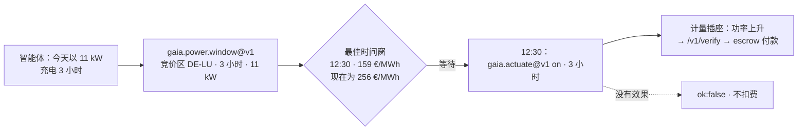

# 电价 — 什么时候用电最便宜？

> 🌐 [English](../POWER-PRICES.md) · [Русский](POWER-PRICES.ru.md) · [Español](POWER-PRICES.es.md) · [Français](POWER-PRICES.fr.md) · **中文**

管理电池、电动车充电器、热泵或计算任务的智能体，可以在时间上挪动负载。它需要的是价格信号：
现在一兆瓦时多少钱，以及在已公布的时间范围内何时最便宜。GAIA 从 **SMARD**（德国联邦网络局，
CC BY 4.0）中继欧洲十五个竞价区的**日前交易所电价**，每个区一个中继。

## 能力

| 能力 | 价格 | 回答什么 |
|---|---|---|
| `gaia.power.price.read@v1` | $0.001 | 某一竞价区的 Ed25519 签名读数：当前 15 分钟时段的 EUR/MWh，未来 24 小时的最低 / 平均 / 最高价，以及其中负电价时段的数量 |
| `gaia.power.window@v1` | $0.002 | 在已公布范围内长度为 `duration_hours` 的最便宜连续时间窗，并与「现在就开始」比较；`load_kw` 负载的批发电能成本；所用的每 15 分钟电价及其 SHA-256，答案可被复算 |

竞价区可以直接给出（`"zone": "DE-LU"`），也可以用单一竞价区的国家给出（`"country": "FR"`、
`"Germany"`、`"德国"`），或用该国的城市给出（`"city": "Lyon"`，经地名库解析）。丹麦、挪威、瑞典
和意大利分为多个竞价区，必须指明竞价区。

## 竞价区

| 竞价区 | SMARD 序列 | | 竞价区 | SMARD 序列 |
|---|---|---|---|---|
| DE-LU | 4169 | | NL | 256 |
| AT | 4170 | | PL | 257 |
| BE | 4996 | | SE4 | 258 |
| NO2 | 4997 | | CH | 259（按小时出清） |
| DK1 | 252 | | SI | 260 |
| DK2 | 253 | | CZ | 261 |
| FR | 254 | | HU | 262 |
| IT-North | 255 | | | |

每个序列都是**按数值**与 Energy-Charts 在 2026-10-16 全部 96 个刻钟上逐一比对后对应到竞价区的，
而不是照搬文档。

**哪些竞价区不提供，以及原因。** Energy-Charts 还发布 SE1–SE3、FI、EE、LT、LV、ES、PT 和意大利
南部，但标注为「*仅限私人和内部使用……明确禁止商业用途*」。GAIA 只出售允许再利用的序列；请求这些
竞价区时会直接说明原因，而不是假装该竞价区不存在。

## 用例：在电价最低时给电动车充电

一个智能体管理着德国的一台 11 kW 充电桩，今天需要充电三小时。**2026-10-16 约 08:40（中欧夏令时）**，
它发出了请求：

```bash
curl -s -X POST https://iot.modelmarket.dev/ai-market/v2/invoke -H 'Content-Type: application/json' \
  -d '{"capability_id":"gaia.power.window@v1",
       "input":{"zone":"DE-LU","duration_hours":3,"load_kw":11}}'
```

并得到（节选，当天上午的真实数字）：

```json
{
  "best":    {"start_local": "2026-10-16T12:30:00+02:00", "mean_eur_mwh": 159.0475,
              "hours": 3.0, "energy_cost_eur_wholesale": 5.2486},
  "run_now": {"mean_eur_mwh": 255.9325, "energy_cost_eur_wholesale": 8.4458},
  "saving_eur_mwh": 96.885, "saving_pct": 37.86,
  "series": ["所用每个刻钟的 [start_unix, EUR/MWh]"], "series_sha256": "…",
  "note": "wholesale day-ahead price; a retail bill adds grid fees, levies and VAT"
}
```

**从 12:30 而不是现在开始，这次充电的批发电价降低了 38%**——33 kWh 花 5.25 欧元而不是 8.45 欧元。
计算所用的电价随答案一起返回，任何人都可以复算时间窗并核对 SHA-256。



循环的后半部分是[设备控制](ACTUATION.zh.md)：在时间窗开始时，智能体用 `gaia.actuate@v1` 打开
充电器，只有电表看到功率时才付费。

**这 38% 是什么、不是什么。** 它是电能**交易所价格**上的节省。家庭或企业的电费账单还包括不随时段
变化的电网费、附加费和增值税，所以账单上的百分比节省更小；如果使用直接传导交易所电价的动态电价，
每千瓦时的绝对节省会保留。这个数字只对那天上午、那个竞价区成立；换一天会是另一个数字——这正是要
查询的原因。

## 值得了解的行为

- **发布时间。** 次日电价约在中欧时间 13:00 公布。此前时间范围止于午夜，超过剩余长度的时间窗会被
  拒绝并说明原因。
- **过期。** 电价在当前时刻之前就已结束、缺少当前时段或数据源出错时，中继离线：`ok:false`，不扣费。
- **物理检查。** 边界是 SDAC 出清上下限并留有余量（−500 到 10 000 EUR/MWh）。电价在相邻刻钟之间
  诚实地跳变十倍，因此不使用变化率和 z 分数统计。
- **不是零售电价。** 每条读数中的来源说明都写明了这一点。

许可：Bundesnetzagentur | SMARD.de · CC BY 4.0——署名随每条读数一起传递。
