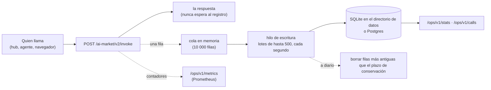

# Registro de llamadas — cada invocación, por escrito

> 🌐 [English](CALL-LOG.md) · [Русский](CALL-LOG.ru.md) · **Español** · [Français](CALL-LOG.fr.md) · [中文](CALL-LOG.zh.md)

Un oráculo que vende capacidades tiene que responder en todo momento a tres preguntas: qué se
llamó, cómo terminó y cuánto ganó. Hasta la 0.6.0 el único registro era el log del proceso. Ahora
cada `POST /ai-market/v2/invoke` es **una fila en un registro de llamadas duradero**, termine como
termine: servida, rechazada por el price gate, por encima de un límite, fallida. El operador lo lee
como estadísticas, como filas y como métricas de Prometheus.



## Qué contiene una fila

| Columna | Contenido |
|---|---|
| `ts` | cuándo terminó la llamada (segundos unix; la API muestra ISO 8601 UTC) |
| `service` | el product id del oráculo |
| `capability_id` | qué se llamó (también un id desconocido, para que se vea el sondeo) |
| `outcome` | véase abajo |
| `http_status` | 200, 401, 402, 429, … |
| `reason` | el texto del error, como mucho 240 caracteres, **sin ninguna cadena que enviara quien llama** |
| `caller_kind` | `hub` (un hub de confianza firmó la llamada), `paid_tier` (un llamante designado por el operador) o `anonymous` |
| `caller_hub` | para `hub`: qué hub |
| `client_hash` | los primeros 16 hex de SHA-256(sal + dirección del cliente): cuenta clientes distintos, nunca guarda una dirección |
| `price_usd` | el precio de catálogo de una llamada de pago **servida** que firmó un hub; si no, 0 |
| `latency_ms` | tiempo de respuesta |
| `input_sha256` | SHA-256 del JSON canónico de la entrada: dos peticiones iguales coinciden, la entrada nunca se guarda |
| `subject` | el dispositivo al que se refería la llamada (`actuator_id` o `device_id`), cuando la entrada lo nombra |

| `outcome` | Cuándo |
|---|---|
| `ok` | servida (`200`, `ok: true`) |
| `failed` | respondida `200` con `ok: false`: un rechazo o error del manejador, una capacidad desconocida |
| `payment_required` | `402`: una capacidad de pago sin la firma de un hub |
| `unauthorized` | `401`: una firma de hub que no se sostiene |
| `refused` | `403` |
| `rate_limited` | `429` |
| `invalid` | `400`, `404`, `422` |
| `error` | cualquier otra cosa |

Los **ingresos** cuentan solo una llamada de pago servida que firmó un hub, al precio de catálogo,
la cobrara el hub o la diera como su prueba gratuita. Una llamada de un llamante designado por el
operador (`paid_tier`: el propio ATLAS del operador, un proxy de pago) y una llamada anónima que un
gate en modo `off` o `report` deja pasar se sirven, pero nunca cuentan como ganadas. El hub sigue
siendo el libro del dinero; esto es la vista propia del oráculo.

## Qué no se guarda nunca

- **La entrada.** Solo su SHA-256. Los mensajes de error que citan la entrada (un número de IVA,
  una dirección, una firma) se limpian antes de escribir la fila: cada cadena que envió quien llama
  se sustituye por `‹input›`, incluida una cita que el manejador recortó.
- **Una dirección IP.** Solo un prefijo de hash con sal. La sal son 16 bytes aleatorios en
  `calls.salt` del directorio de datos (permisos 0600), así que sin ese archivo los hashes no se
  pueden revertir probando todas las direcciones. Es seudonimización, no anonimización: quien tenga
  la sal y una dirección sospechosa puede comprobarla, que es lo que necesita un operador que
  rastrea un abuso.
- **Nada más antiguo que el plazo de conservación.** Las filas de más de
  `ORACLE_CALLS_RETENTION_DAYS` (90 días) se borran una vez al día.

## Fiabilidad

- **El registro nunca ralentiza ni rompe una respuesta.** La fila va a una cola y la respuesta
  sale; un hilo de escritura inserta lotes. Si la base de datos va lenta o está caída, la cola se
  llena y las filas siguientes se descartan y se cuentan (`oracle_calls_dropped_total`,
  `write_errors`), nunca se las espera.
- **SQLite** (por defecto): `<ORACLE_DATA_DIR>/oracle.sqlite` en modo WAL con 30 s de espera por
  bloqueo, así que varios componentes de un mismo oráculo pueden compartir el archivo.
- **Postgres**: defina `ORACLE_DATABASE_URL=postgresql://…` e instale el extra
  (`aimarket-oracle-core[postgres]`, psycopg 3). Una conexión caída (un reinicio, un tiempo de
  inactividad) se reabre en la siguiente escritura.
- Las tablas y los índices se crean al arrancar (`oracle_calls`, indexada por tiempo y por capacidad
  y tiempo). Varias réplicas pueden escribir en un mismo Postgres; cada fila lleva su `service`.

## La API del operador

Tres rutas, todas tras `Authorization: Bearer $ORACLE_OPS_TOKEN`. Sin token configurado responden
`503`, con uno incorrecto `401`; con el registro desactivado, `503`. Manténgalas en loopback:
nuestras configuraciones de proxy inverso no exponen `/ops/`.

| Ruta | Responde |
|---|---|
| `GET /ops/v1/stats?since=&until=` | llamadas, clientes distintos, llamadas por tipo de llamante, ingresos y, por capacidad: llamadas, resultados, ingresos, latencia media y máxima. Ventana por defecto: las últimas 24 h |
| `GET /ops/v1/calls?since=&until=&capability=&outcome=&limit=` | las filas mismas, las más recientes primero, como mucho 1000 |
| `GET /ops/v1/metrics` | texto de Prometheus: `oracle_calls_total{service,capability,outcome}`, `oracle_call_duration_seconds` (histograma), `oracle_revenue_usd_total{service,capability}`, `oracle_calls_dropped_total{service}`, desde que arrancó el proceso |

`since` y `until` aceptan segundos unix o ISO 8601 (`2026-10-16T00:00:00Z`).

```bash
curl -s -H "Authorization: Bearer $ORACLE_OPS_TOKEN" 'http://127.0.0.1:9320/ops/v1/stats?since=2026-10-16T00:00:00Z'
```

```json
{
  "service": "gaia.gateway", "from": "2026-10-16T00:00:00Z", "to": "2026-10-16T18:00:00Z",
  "calls": 1412, "distinct_clients": 37,
  "by_caller": {"anonymous": 1288, "hub": 124},
  "revenue_usd": 1.94,
  "capabilities": {
    "gaia.actuate@v1": {"calls": 41, "outcomes": {"ok": 30, "failed": 6, "payment_required": 5},
                        "revenue_usd": 1.5, "latency_ms_mean": 1412.3, "latency_ms_max": 4120.0}
  }
}
```

Un scrape de Prometheus por el mismo puerto de loopback:

```yaml
scrape_configs:
  - job_name: gaia
    metrics_path: /ops/v1/metrics
    authorization: {type: Bearer, credentials_file: /etc/prometheus/oracle_ops_token}
    static_configs: [{targets: ["127.0.0.1:9320"]}]
```

## Cómo activarlo

| Variable | Significado |
|---|---|
| `ORACLE_CALLS` | `1` mantiene el registro. Desactivado por defecto en la biblioteca, para que una batería de pruebas o una aplicación que la integre no reciba archivos ni hilos que no pidió. Nuestras imágenes de GAIA y SYMMARTYS lo activan |
| `ORACLE_DATA_DIR` | dónde viven el archivo SQLite y la sal (`/data` en nuestras imágenes) |
| `ORACLE_DATABASE_URL` | Postgres en lugar de SQLite |
| `ORACLE_CALLS_RETENTION_DAYS` | plazo de conservación de las filas, en días (90) |
| `ORACLE_OPS_TOKEN` | el token Bearer de `/ops/v1/*`; un secreto aleatorio desde un archivo 0600, nunca en git |

En código: `create_app(spec, call_log=True)` mantiene un registro aunque falte la variable de
entorno, `call_log=False` lo desactiva y una instancia de `CallLog(store, service, …)` se usa tal cual.

## Límites honestos

- Las métricas son contadores de este proceso: un reinicio las pone a cero (Prometheus lo gestiona),
  mientras que `stats` y `calls` leen las filas duraderas.
- Una cola llena o una base de datos caída pierde filas; se cuentan, no se ocultan.
- El registro anota lo que respondió este oráculo. Si un hub cobró de verdad a un comprador lo dice
  el libro del hub.
