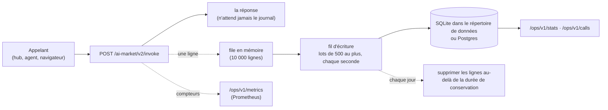

# Journal des appels — chaque invocation consignée

> 🌐 [English](CALL-LOG.md) · [Русский](CALL-LOG.ru.md) · [Español](CALL-LOG.es.md) · **Français** · [中文](CALL-LOG.zh.md)

Un oracle qui vend des capacités doit pouvoir répondre à tout moment à trois questions : qu'a-t-on
appelé, comment cela s'est-il terminé, et combien a-t-il gagné. Jusqu'à la 0.6.0, la seule trace
était le journal du processus. Désormais chaque `POST /ai-market/v2/invoke` est **une ligne d'un
journal des appels durable**, quelle qu'en soit l'issue : servi, refusé par le price gate, au-delà
d'une limite, en échec. L'opérateur le lit sous forme de statistiques, de lignes brutes et de
métriques Prometheus.



## Ce que contient une ligne

| Colonne | Contenu |
|---|---|
| `ts` | quand l'appel s'est terminé (secondes unix ; l'API affiche de l'ISO 8601 UTC) |
| `service` | le product id de l'oracle |
| `capability_id` | ce qui a été appelé (y compris un identifiant inconnu, pour voir les sondages) |
| `outcome` | voir ci-dessous |
| `http_status` | 200, 401, 402, 429, … |
| `reason` | le texte de l'erreur, 240 caractères au plus, **sans aucune chaîne envoyée par l'appelant** |
| `caller_kind` | `hub` (un hub de confiance a signé l'appel), `paid_tier` (un appelant désigné par l'opérateur) ou `anonymous` |
| `caller_hub` | pour `hub` : quel hub |
| `client_hash` | les 16 premiers hex de SHA-256(sel + adresse du client) : compte les clients distincts, ne stocke jamais d'adresse |
| `price_usd` | le prix catalogue d'un appel payant **servi** qu'un hub a signé ; sinon 0 |
| `latency_ms` | le temps de réponse |
| `input_sha256` | SHA-256 du JSON canonique de l'entrée : deux requêtes identiques concordent, l'entrée elle-même n'est jamais conservée |
| `subject` | l'appareil concerné (`actuator_id` ou `device_id`), quand l'entrée en nomme un |

| `outcome` | Quand |
|---|---|
| `ok` | servi (`200`, `ok: true`) |
| `failed` | réponse `200` avec `ok: false` — refus ou erreur du gestionnaire, capacité inconnue |
| `payment_required` | `402` : une capacité payante sans signature de hub |
| `unauthorized` | `401` : une signature de hub qui ne tient pas |
| `refused` | `403` |
| `rate_limited` | `429` |
| `invalid` | `400`, `404`, `422` |
| `error` | tout le reste |

Les **revenus** ne comptent qu'un appel payant servi qu'un hub a signé, au prix catalogue — que le
hub l'ait facturé ou offert dans son essai gratuit. Un appel d'un appelant désigné par l'opérateur
(`paid_tier` : l'ATLAS de l'opérateur lui-même, un proxy de paiement) et un appel anonyme qu'un
gate en mode `off` ou `report` laisse passer sont servis, mais jamais comptés comme gagnés. Le hub
reste le registre de l'argent ; ceci est la vue propre de l'oracle.

## Ce qui n'est jamais conservé

- **L'entrée.** Seulement son SHA-256. Les messages d'erreur qui citent l'entrée (un numéro de TVA,
  une adresse, une signature) sont nettoyés avant l'écriture de la ligne : chaque chaîne envoyée
  par l'appelant est remplacée par `‹input›`, y compris une citation que le gestionnaire a tronquée.
- **Une adresse IP.** Seulement un préfixe d'empreinte salée. Le sel, ce sont 16 octets aléatoires
  dans `calls.salt` du répertoire de données (mode 0600) ; sans ce fichier, on ne peut pas inverser
  les empreintes en essayant toutes les adresses. C'est une pseudonymisation, pas une
  anonymisation : qui détient le sel et une adresse suspecte peut la tester, ce dont a besoin un
  opérateur qui remonte un abus.
- **Rien au-delà de la durée de conservation.** Les lignes plus anciennes que
  `ORACLE_CALLS_RETENTION_DAYS` (90 jours) sont supprimées une fois par jour.

## Fiabilité

- **Le journal ne ralentit ni ne casse jamais une réponse.** Une ligne part dans une file et la
  réponse s'en va ; un fil d'écriture insère des lots. Si la base est lente ou indisponible, la file
  se remplit et les lignes suivantes sont abandonnées et comptées (`oracle_calls_dropped_total`,
  `write_errors`), jamais attendues.
- **SQLite** (par défaut) : `<ORACLE_DATA_DIR>/oracle.sqlite` en mode WAL avec 30 s d'attente sur
  verrou, si bien que plusieurs composants d'un même oracle peuvent partager le fichier.
- **Postgres** : définissez `ORACLE_DATABASE_URL=postgresql://…` et installez l'extra
  (`aimarket-oracle-core[postgres]`, psycopg 3). Une connexion perdue (un redémarrage, un délai
  d'inactivité) est rouverte à l'écriture suivante.
- Tables et index sont créés au démarrage (`oracle_calls`, indexée par temps et par capacité et
  temps). Plusieurs réplicas peuvent écrire dans un même Postgres ; chaque ligne porte son `service`.

## L'API de l'opérateur

Trois routes, toutes derrière `Authorization: Bearer $ORACLE_OPS_TOKEN`. Sans jeton configuré elles
répondent `503`, avec un mauvais `401` ; journal désactivé, `503`. Gardez-les sur la boucle locale :
nos configurations de proxy inverse n'exposent pas `/ops/`.

| Route | Répond |
|---|---|
| `GET /ops/v1/stats?since=&until=` | appels, clients distincts, appels par type d'appelant, revenus et, par capacité : appels, issues, revenus, latence moyenne et maximale. Fenêtre par défaut : les dernières 24 h |
| `GET /ops/v1/calls?since=&until=&capability=&outcome=&limit=` | les lignes elles-mêmes, les plus récentes d'abord, 1000 au plus |
| `GET /ops/v1/metrics` | texte Prometheus : `oracle_calls_total{service,capability,outcome}`, `oracle_call_duration_seconds` (histogramme), `oracle_revenue_usd_total{service,capability}`, `oracle_calls_dropped_total{service}` — depuis le démarrage du processus |

`since` et `until` acceptent des secondes unix ou de l'ISO 8601 (`2026-10-16T00:00:00Z`).

```bash
curl -s -H "Authorization: Bearer $ORACLE_OPS_TOKEN" 'http://127.0.0.1:9320/ops/v1/stats?since=2026-10-16T00:00:00Z'
```

```json
{
  "service": "gaia.gateway", "from": "2026-10-16T00:00:00Z", "to": "2026-10-16T18:00:00Z",
  "calls": 1412, "distinct_clients": 37,
  "by_caller": {"anonymous": 1288, "hub": 124},
  "revenue_usd": 1.94,
  "capabilities": {
    "gaia.actuate@v1": {"calls": 41, "outcomes": {"ok": 30, "failed": 6, "payment_required": 5},
                        "revenue_usd": 1.5, "latency_ms_mean": 1412.3, "latency_ms_max": 4120.0}
  }
}
```

Une collecte Prometheus par le même port local :

```yaml
scrape_configs:
  - job_name: gaia
    metrics_path: /ops/v1/metrics
    authorization: {type: Bearer, credentials_file: /etc/prometheus/oracle_ops_token}
    static_configs: [{targets: ["127.0.0.1:9320"]}]
```

## L'activer

| Variable | Sens |
|---|---|
| `ORACLE_CALLS` | `1` tient le journal. Désactivé par défaut dans la bibliothèque, pour qu'une suite de tests ou une application qui l'embarque ne reçoive ni fichier ni fil qu'elle n'a pas demandés. Nos images GAIA et SYMMARTYS l'activent |
| `ORACLE_DATA_DIR` | où se trouvent le fichier SQLite et le sel (`/data` dans nos images) |
| `ORACLE_DATABASE_URL` | Postgres au lieu de SQLite |
| `ORACLE_CALLS_RETENTION_DAYS` | durée de conservation des lignes, en jours (90) |
| `ORACLE_OPS_TOKEN` | le jeton Bearer de `/ops/v1/*` ; un secret aléatoire tiré d'un fichier 0600, jamais dans git |

Dans le code : `create_app(spec, call_log=True)` tient un journal même sans la variable
d'environnement, `call_log=False` le désactive, et une instance `CallLog(store, service, …)` est
utilisée telle quelle.

## Limites honnêtes

- Les métriques sont des compteurs de ce processus : un redémarrage les remet à zéro (Prometheus le
  gère), tandis que `stats` et `calls` lisent les lignes durables.
- Une file pleine ou une base indisponible perd des lignes ; elles sont comptées, pas cachées.
- Le journal consigne ce que cet oracle a répondu. Qu'un hub ait réellement débité un acheteur, c'est
  le registre du hub qui le dit.
