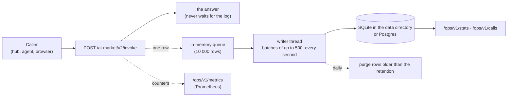

# Call log — every invoke written down

> 🌐 **English** · [Русский](CALL-LOG.ru.md) · [Español](CALL-LOG.es.md) · [Français](CALL-LOG.fr.md) · [中文](CALL-LOG.zh.md)

An oracle that sells capabilities has to answer three questions at any time: what was called,
what came of it, and what it earned. Until 0.6.0 the only record was the process log. Now every
`POST /ai-market/v2/invoke` is **one row in a durable call log**, however it ended: served,
refused by the price gate, over a limit, failed. The operator reads it as statistics, as raw
rows, and as Prometheus metrics.



## What a row holds

| Column | Content |
|---|---|
| `ts` | when the call ended (unix seconds; the API shows ISO 8601 UTC) |
| `service` | the oracle's product id |
| `capability_id` | what was called (an unknown id too, so probing shows) |
| `outcome` | see below |
| `http_status` | 200, 401, 402, 429, … |
| `reason` | the error text, at most 240 characters, **with every string the caller sent removed** |
| `caller_kind` | `hub` (a trusted hub signed the call), `paid_tier` (a caller the operator nominated) or `anonymous` |
| `caller_hub` | for `hub`: which hub |
| `client_hash` | the first 16 hex of SHA-256(salt + client address): counts distinct clients, never stores an address |
| `price_usd` | the catalogue price of a **served** priced call a hub signed; else 0 |
| `latency_ms` | time to answer |
| `input_sha256` | SHA-256 of the input's canonical JSON: two equal requests match, the input itself is never kept |
| `subject` | the device the call was about (`actuator_id` or `device_id`), when the input names one |

| `outcome` | When |
|---|---|
| `ok` | served (`200`, `ok: true`) |
| `failed` | answered `200` with `ok: false` — a handler refusal or error, an unknown capability |
| `payment_required` | `402`: a priced capability without a hub's signature |
| `unauthorized` | `401`: a hub signature that does not hold |
| `refused` | `403` |
| `rate_limited` | `429` |
| `invalid` | `400`, `404`, `422` |
| `error` | anything else |

**Revenue** counts only a served priced call that a hub signed, at the catalogue price — whether
the hub charged it or gave it as its free trial. A call by an operator-nominated caller
(`paid_tier`: the operator's own ATLAS, a payment proxy) and an anonymous call that a gate in
`off` or `report` mode lets through are served but never counted as earned. The hub remains the
ledger of money; this is the oracle's own view of it.

## What is never kept

- **The input.** Only its SHA-256. Error messages that quote the input (a VAT number, an address,
  a signature) are scrubbed before the row is written: every string the caller sent is replaced by
  `‹input›`, including a quote the handler cut short.
- **An IP address.** Only a salted hash prefix. The salt is 16 random bytes in `calls.salt` in the
  data directory (mode 0600), so the hashes cannot be reversed by trying every address without
  that file. This is pseudonymisation, not anonymisation: whoever holds the salt and a suspect
  address can test it, which is what an operator tracing abuse needs.
- **Anything older than the retention.** Rows older than `ORACLE_CALLS_RETENTION_DAYS` (90) are
  deleted once a day.

## Reliability

- **The log never slows or breaks an answer.** A row goes into a queue and the answer leaves; a
  writer thread inserts batches. If the database is slow or down, the queue fills and further rows
  are dropped and counted (`oracle_calls_dropped_total`, `write_errors`), never waited for.
- **SQLite** (default): `<ORACLE_DATA_DIR>/oracle.sqlite` in WAL mode with a 30 s busy timeout, so
  several components of one oracle can share the file.
- **Postgres**: set `ORACLE_DATABASE_URL=postgresql://…` and install the extra
  (`aimarket-oracle-core[postgres]`, psycopg 3). A dropped connection (a restart, an idle timeout)
  is reopened on the next write.
- Tables and indexes are created on start (`oracle_calls`, indexed by time and by capability and
  time). Several replicas can write to one Postgres; each row carries its `service`.

## The operator's API

Three routes, all behind `Authorization: Bearer $ORACLE_OPS_TOKEN`. Without a token configured
they answer `503`, with a wrong one `401`; with the log off, `503`. Keep them on loopback: our
reverse-proxy configurations do not expose `/ops/`.

| Route | Answers |
|---|---|
| `GET /ops/v1/stats?since=&until=` | calls, distinct clients, calls by caller kind, revenue, and per capability: calls, outcomes, revenue, mean and max latency. Default window: the last 24 h |
| `GET /ops/v1/calls?since=&until=&capability=&outcome=&limit=` | the rows themselves, newest first, at most 1000 |
| `GET /ops/v1/metrics` | Prometheus text: `oracle_calls_total{service,capability,outcome}`, `oracle_call_duration_seconds` (histogram), `oracle_revenue_usd_total{service,capability}`, `oracle_calls_dropped_total{service}` — since the process started |

`since` and `until` take unix seconds or ISO 8601 (`2026-10-16T00:00:00Z`).

```bash
curl -s -H "Authorization: Bearer $ORACLE_OPS_TOKEN" 'http://127.0.0.1:9320/ops/v1/stats?since=2026-10-16T00:00:00Z'
```

```json
{
  "service": "gaia.gateway", "from": "2026-10-16T00:00:00Z", "to": "2026-10-16T18:00:00Z",
  "calls": 1412, "distinct_clients": 37,
  "by_caller": {"anonymous": 1288, "hub": 124},
  "revenue_usd": 1.94,
  "capabilities": {
    "gaia.actuate@v1": {"calls": 41, "outcomes": {"ok": 30, "failed": 6, "payment_required": 5},
                        "revenue_usd": 1.5, "latency_ms_mean": 1412.3, "latency_ms_max": 4120.0}
  }
}
```

A Prometheus scrape over the same loopback port:

```yaml
scrape_configs:
  - job_name: gaia
    metrics_path: /ops/v1/metrics
    authorization: {type: Bearer, credentials_file: /etc/prometheus/oracle_ops_token}
    static_configs: [{targets: ["127.0.0.1:9320"]}]
```

## Turning it on

| Variable | Meaning |
|---|---|
| `ORACLE_CALLS` | `1` keeps the log. Off by default in the library, so a test suite or an embedding application gets no files and no thread it did not ask for. Our GAIA and EMPORION images set it |
| `ORACLE_DATA_DIR` | where the SQLite file and the salt live (`/data` in our images) |
| `ORACLE_DATABASE_URL` | Postgres instead of SQLite |
| `ORACLE_CALLS_RETENTION_DAYS` | days to keep rows (90) |
| `ORACLE_OPS_TOKEN` | the Bearer token of `/ops/v1/*`; a random secret from a 0600 file, never in git |

In code: `create_app(spec, call_log=True)` takes the environment, `call_log=False` turns it off,
and a `CallLog(store, service, …)` instance is used as given.

## Honest limits

- The metrics are counters of this process: a restart starts them at zero (Prometheus handles
  that), while `stats` and `calls` read the durable rows.
- A full queue or a database outage loses rows; they are counted, not hidden.
- The log records what this oracle answered. Whether a hub actually charged a buyer is the hub's
  ledger.
