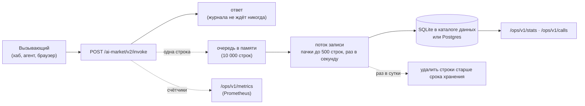

# Журнал вызовов — каждый вызов записан

> 🌐 [English](CALL-LOG.md) · **Русский** · [Español](CALL-LOG.es.md) · [Français](CALL-LOG.fr.md) · [中文](CALL-LOG.zh.md)

Оракул, который продаёт функции, должен в любой момент ответить на три вопроса: что вызывали, чем
это кончилось и сколько он заработал. До 0.6.0 единственной записью был журнал процесса. Теперь
каждый `POST /ai-market/v2/invoke` — **одна строка в долговременном журнале вызовов**, чем бы он
ни кончился: обслужен, отклонён price gate, упёрся в лимит, не удался. Оператор читает журнал как
статистику, как сами строки и как метрики Prometheus.



## Что в строке

| Столбец | Содержимое |
|---|---|
| `ts` | когда вызов закончился (unix-секунды; API показывает ISO 8601 UTC) |
| `service` | product id оракула |
| `capability_id` | что вызвали (и неизвестный id тоже — так видно прощупывание) |
| `outcome` | см. ниже |
| `http_status` | 200, 401, 402, 429, … |
| `reason` | текст ошибки, не длиннее 240 символов, **без единой строки, присланной вызывающим** |
| `caller_kind` | `hub` (вызов подписал доверенный хаб), `paid_tier` (вызывающий, назначенный оператором) или `anonymous` |
| `caller_hub` | для `hub` — какой хаб |
| `client_hash` | первые 16 hex от SHA-256(соль + адрес клиента): считает разных клиентов, адрес не хранит |
| `price_usd` | цена по каталогу **обслуженного** платного вызова, который подписал хаб; иначе 0 |
| `latency_ms` | время ответа |
| `input_sha256` | SHA-256 канонического JSON входа: два одинаковых запроса совпадают, сам вход не хранится |
| `subject` | устройство, о котором был вызов (`actuator_id` или `device_id`), если вход его называет |

| `outcome` | Когда |
|---|---|
| `ok` | обслужен (`200`, `ok: true`) |
| `failed` | ответ `200` с `ok: false` — отказ или ошибка обработчика, неизвестная функция |
| `payment_required` | `402`: платная функция без подписи хаба |
| `unauthorized` | `401`: подпись хаба не сходится |
| `refused` | `403` |
| `rate_limited` | `429` |
| `invalid` | `400`, `404`, `422` |
| `error` | всё остальное |

**Выручка** учитывает только обслуженный платный вызов, который подписал хаб, по цене каталога —
списал ли хаб за него деньги или дал его в бесплатной пробе. Вызов назначенного оператором
вызывающего (`paid_tier`: собственный ATLAS оператора, платёжный прокси) и анонимный вызов,
пропущенный шлюзом в режиме `off` или `report`, обслуживаются, но заработком не считаются никогда.
Книгой денег остаётся хаб; это взгляд самого оракула.

## Чего не хранится никогда

- **Входа.** Только его SHA-256. Сообщения об ошибках, которые цитируют вход (номер VAT, адрес,
  подпись), очищаются до записи строки: каждая строка, присланная вызывающим, заменяется на
  `‹input›`, включая цитату, которую обработчик обрезал.
- **IP-адреса.** Только префикс хеша с солью. Соль — 16 случайных байт в `calls.salt` в каталоге
  данных (права 0600), поэтому без этого файла хеши не обратить перебором всех адресов. Это
  псевдонимизация, а не анонимизация: у кого есть соль и подозрительный адрес, тот может его
  проверить — именно это нужно оператору, который разбирается со злоупотреблением.
- **Ничего старше срока хранения.** Строки старше `ORACLE_CALLS_RETENTION_DAYS` (90 дней) удаляются
  раз в сутки.

## Надёжность

- **Журнал никогда не замедляет и не ломает ответ.** Строка уходит в очередь, ответ уходит
  вызывающему; поток записи вставляет пачки. Если база медленная или недоступна, очередь
  заполняется, а следующие строки отбрасываются и считаются (`oracle_calls_dropped_total`,
  `write_errors`), но их никто не ждёт.
- **SQLite** (по умолчанию): `<ORACLE_DATA_DIR>/oracle.sqlite` в режиме WAL с ожиданием блокировки
  30 с, так что несколько компонентов одного оракула могут делить файл.
- **Postgres**: задайте `ORACLE_DATABASE_URL=postgresql://…` и установите дополнение
  (`aimarket-oracle-core[postgres]`, psycopg 3). Оборванное соединение (перезапуск, тайм-аут
  простоя) открывается заново при следующей записи.
- Таблицы и индексы создаются при запуске (`oracle_calls`, индексы по времени и по функции со
  временем). В один Postgres могут писать несколько реплик; каждая строка несёт свой `service`.

## API оператора

Три маршрута, все за `Authorization: Bearer $ORACLE_OPS_TOKEN`. Без настроенного токена они
отвечают `503`, с неверным — `401`; с выключенным журналом — `503`. Держите их на loopback: наши
конфигурации обратного прокси `/ops/` наружу не отдают.

| Маршрут | Отвечает |
|---|---|
| `GET /ops/v1/stats?since=&until=` | вызовы, разные клиенты, вызовы по видам вызывающих, выручка и по каждой функции: вызовы, исходы, выручка, средняя и максимальная задержка. Окно по умолчанию — последние 24 ч |
| `GET /ops/v1/calls?since=&until=&capability=&outcome=&limit=` | сами строки, новые сверху, не больше 1000 |
| `GET /ops/v1/metrics` | текст Prometheus: `oracle_calls_total{service,capability,outcome}`, `oracle_call_duration_seconds` (гистограмма), `oracle_revenue_usd_total{service,capability}`, `oracle_calls_dropped_total{service}` — с момента запуска процесса |

`since` и `until` принимают unix-секунды или ISO 8601 (`2026-10-16T00:00:00Z`).

```bash
curl -s -H "Authorization: Bearer $ORACLE_OPS_TOKEN" 'http://127.0.0.1:9320/ops/v1/stats?since=2026-10-16T00:00:00Z'
```

```json
{
  "service": "gaia.gateway", "from": "2026-10-16T00:00:00Z", "to": "2026-10-16T18:00:00Z",
  "calls": 1412, "distinct_clients": 37,
  "by_caller": {"anonymous": 1288, "hub": 124},
  "revenue_usd": 1.94,
  "capabilities": {
    "gaia.actuate@v1": {"calls": 41, "outcomes": {"ok": 30, "failed": 6, "payment_required": 5},
                        "revenue_usd": 1.5, "latency_ms_mean": 1412.3, "latency_ms_max": 4120.0}
  }
}
```

Сбор метрик Prometheus через тот же loopback-порт:

```yaml
scrape_configs:
  - job_name: gaia
    metrics_path: /ops/v1/metrics
    authorization: {type: Bearer, credentials_file: /etc/prometheus/oracle_ops_token}
    static_configs: [{targets: ["127.0.0.1:9320"]}]
```

## Как включить

| Переменная | Значение |
|---|---|
| `ORACLE_CALLS` | `1` — вести журнал. В библиотеке по умолчанию выключен, чтобы набор тестов или встраивающее приложение не получали файлов и потоков, о которых не просили. Наши образы GAIA и EMPORION его включают |
| `ORACLE_DATA_DIR` | где лежат файл SQLite и соль (`/data` в наших образах) |
| `ORACLE_DATABASE_URL` | Postgres вместо SQLite |
| `ORACLE_CALLS_RETENTION_DAYS` | срок хранения строк в днях (90) |
| `ORACLE_OPS_TOKEN` | Bearer-токен для `/ops/v1/*`; случайный секрет из файла с правами 0600, никогда не в git |

В коде: `create_app(spec, call_log=True)` ведёт журнал и без переменной окружения,
`call_log=False` выключает его, а экземпляр `CallLog(store, service, …)` используется как есть.

## Честные ограничения

- Метрики — счётчики этого процесса: после перезапуска они начинаются с нуля (Prometheus это
  учитывает), а `stats` и `calls` читают долговременные строки.
- Переполненная очередь или недоступная база теряют строки; они считаются, а не скрываются.
- Журнал записывает, что ответил этот оракул. Списал ли хаб деньги с покупателя — это книга хаба.
