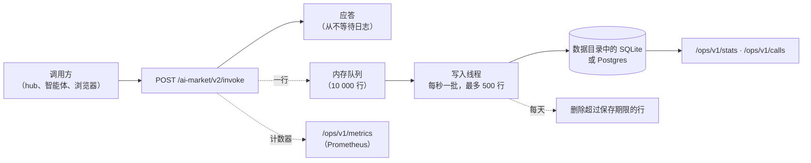

# 调用日志——每一次调用都有记录

> 🌐 [English](CALL-LOG.md) · [Русский](CALL-LOG.ru.md) · [Español](CALL-LOG.es.md) · [Français](CALL-LOG.fr.md) · **中文**

出售能力的预言机随时都要能回答三个问题：调用了什么、结果如何、赚了多少。在 0.6.0 之前，唯一的记录是
进程日志。现在，每一次 `POST /ai-market/v2/invoke` 都是**持久化调用日志中的一行**，无论结果如何：
已服务、被 price gate 拒绝、超出限额或失败。运营方可以按统计、按原始行以及按 Prometheus 指标读取它。



## 一行包含什么

| 列 | 内容 |
|---|---|
| `ts` | 调用结束的时间（unix 秒；API 显示为 ISO 8601 UTC） |
| `service` | 预言机的 product id |
| `capability_id` | 调用了什么（未知的 ID 也记录，便于发现探测） |
| `outcome` | 见下表 |
| `http_status` | 200、401、402、429…… |
| `reason` | 错误文本，最多 240 个字符，**删除了调用方发送的每一个字符串** |
| `caller_kind` | `hub`（受信任的 hub 签署了该调用）、`paid_tier`（运营方指定的调用方）或 `anonymous` |
| `caller_hub` | `hub` 时：是哪个 hub |
| `client_hash` | SHA-256（盐 + 客户端地址）的前 16 位十六进制：用于统计不同客户端，从不存储地址 |
| `price_usd` | 由 hub 签署且**已服务**的付费调用的目录价格；否则为 0 |
| `latency_ms` | 应答耗时 |
| `input_sha256` | 输入的规范 JSON 的 SHA-256：两个相同的请求会匹配，输入本身从不保存 |
| `subject` | 调用所涉及的设备（`actuator_id` 或 `device_id`），如果输入中指明了的话 |

| `outcome` | 何时 |
|---|---|
| `ok` | 已服务（`200`，`ok: true`） |
| `failed` | 以 `200` 应答但 `ok: false`——处理程序拒绝或出错、能力未知 |
| `payment_required` | `402`：付费能力缺少 hub 签名 |
| `unauthorized` | `401`：hub 签名不成立 |
| `refused` | `403` |
| `rate_limited` | `429` |
| `invalid` | `400`、`404`、`422` |
| `error` | 其他一切情况 |

**收入**只计入由 hub 签署的已服务付费调用，按目录价格计算——无论 hub 是收了费还是作为免费试用提供。
运营方指定的调用方（`paid_tier`：运营方自己的 ATLAS、支付代理）的调用，以及处于 `off` 或 `report` 模式的
gate 放行的匿名调用，都会被服务，但从不计为收入。资金账本仍然是 hub；这里只是预言机自己的视角。

## 从不保存的内容

- **输入。** 只保存其 SHA-256。引用了输入的错误信息（增值税号、地址、签名）会在写入前被清理：调用方
  发送的每个字符串都替换为 `‹input›`，包括被处理程序截断的引用。
- **IP 地址。** 只保存加盐哈希的前缀。盐是数据目录中 `calls.salt` 文件里的 16 个随机字节（权限 0600），
  没有这个文件就无法通过穷举所有地址来反推哈希。这是假名化而不是匿名化：持有盐和可疑地址的人可以验证
  该地址——这正是追查滥用的运营方所需要的。
- **超过保存期限的任何内容。** 早于 `ORACLE_CALLS_RETENTION_DAYS`（90 天）的行每天删除一次。

## 可靠性

- **日志从不拖慢或破坏应答。** 一行进入队列，应答随即返回；写入线程批量插入。如果数据库变慢或不可用，
  队列会被填满，之后的行会被丢弃并计数（`oracle_calls_dropped_total`、`write_errors`），从不等待。
- **SQLite**（默认）：`<ORACLE_DATA_DIR>/oracle.sqlite`，WAL 模式，锁等待 30 秒，因此同一预言机的多个
  组件可以共用这个文件。
- **Postgres**：设置 `ORACLE_DATABASE_URL=postgresql://…` 并安装扩展（`aimarket-oracle-core[postgres]`，
  psycopg 3）。断开的连接（重启、空闲超时）会在下一次写入时重新建立。
- 启动时创建表和索引（`oracle_calls`，按时间以及按能力和时间建索引）。多个副本可以写入同一个 Postgres；
  每行都带有自己的 `service`。

## 运营方 API

三个路由，都需要 `Authorization: Bearer $ORACLE_OPS_TOKEN`。未配置令牌时返回 `503`，令牌错误返回 `401`；
日志关闭时返回 `503`。请只在本机回环地址上使用：我们的反向代理配置不对外暴露 `/ops/`。

| 路由 | 返回 |
|---|---|
| `GET /ops/v1/stats?since=&until=` | 调用数、不同客户端数、按调用方类型的调用数、收入，以及每个能力的调用数、结果、收入、平均和最大延迟。默认时间窗：最近 24 小时 |
| `GET /ops/v1/calls?since=&until=&capability=&outcome=&limit=` | 原始行，最新的在前，最多 1000 行 |
| `GET /ops/v1/metrics` | Prometheus 文本：`oracle_calls_total{service,capability,outcome}`、`oracle_call_duration_seconds`（直方图）、`oracle_revenue_usd_total{service,capability}`、`oracle_calls_dropped_total{service}`——自进程启动以来 |

`since` 和 `until` 接受 unix 秒或 ISO 8601（`2026-10-16T00:00:00Z`）。

```bash
curl -s -H "Authorization: Bearer $ORACLE_OPS_TOKEN" 'http://127.0.0.1:9320/ops/v1/stats?since=2026-10-16T00:00:00Z'
```

```json
{
  "service": "gaia.gateway", "from": "2026-10-16T00:00:00Z", "to": "2026-10-16T18:00:00Z",
  "calls": 1412, "distinct_clients": 37,
  "by_caller": {"anonymous": 1288, "hub": 124},
  "revenue_usd": 1.94,
  "capabilities": {
    "gaia.actuate@v1": {"calls": 41, "outcomes": {"ok": 30, "failed": 6, "payment_required": 5},
                        "revenue_usd": 1.5, "latency_ms_mean": 1412.3, "latency_ms_max": 4120.0}
  }
}
```

通过同一个回环端口采集 Prometheus 指标：

```yaml
scrape_configs:
  - job_name: gaia
    metrics_path: /ops/v1/metrics
    authorization: {type: Bearer, credentials_file: /etc/prometheus/oracle_ops_token}
    static_configs: [{targets: ["127.0.0.1:9320"]}]
```

## 如何开启

| 变量 | 含义 |
|---|---|
| `ORACLE_CALLS` | `1` 表示保留日志。库中默认关闭，这样测试套件或嵌入它的应用不会得到它们没要求的文件和线程。我们的 GAIA 和 EMPORION 镜像会开启它 |
| `ORACLE_DATA_DIR` | SQLite 文件和盐所在的位置（我们的镜像中为 `/data`） |
| `ORACLE_DATABASE_URL` | 用 Postgres 代替 SQLite |
| `ORACLE_CALLS_RETENTION_DAYS` | 行的保存期限，单位为天（90） |
| `ORACLE_OPS_TOKEN` | `/ops/v1/*` 的 Bearer 令牌；来自权限为 0600 的文件的随机秘密，绝不放进 git |

在代码中：`create_app(spec, call_log=True)` 即使没有环境变量也会保留日志，`call_log=False` 关闭它，
`CallLog(store, service, …)` 实例则按原样使用。

## 诚实的限制

- 指标是本进程的计数器：重启后从零开始（Prometheus 会处理这种情况），而 `stats` 和 `calls` 读取的是
  持久化的行。
- 队列已满或数据库不可用会丢失行；这些行会被计数，而不是被隐藏。
- 日志记录的是这个预言机应答了什么。hub 是否真的向买方扣了款，以 hub 的账本为准。
